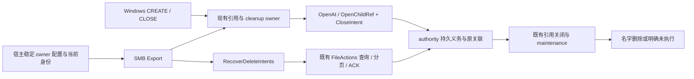

# Agent Note: SMB 关闭删除义务与跨重启恢复

Status: implemented

## 问题

Windows 的 `FILE_DELETE_ON_CLOSE` 在打开成功时接受删除责任，发起句柄关闭、连接丢失或宿主终止都可能触发它。删除作用于原对象及其名字关联，等待其它相关引用结束；CREATE 或 CLOSE 响应丢失、SMB 或 authority 重启都不能把原责任转成新的按路径删除，同名替代物不能成为目标。

本决定落实 [Windows 网络驱动器总方案](../../proposed/feature/2026-09-16-windows-network-drive-support.md)的 7.6，复用[有界 CREATE/CLOSE](2026-09-28-smb-bounded-create-close.md)的原子打开、FileId、引用关闭与 cleanup owner。需求来自 [R-FS-6、R-FS-8、R-INT-11、R-WS-7、R-SEC-5、R-WIN-7、R-WIN-10](../../../../docs/spec/requirements.md)。authority、FileStorage 与 HTTP adapter 已经持有关闭删除、持久查询、分页和 ACK 能力；SMB 需要接入 CREATE 标志，并保存当前引用与跨进程发现的责任。

## 决定

### 范围及后续约束

| 范围 | 需求与分类 | 交付或延期成本 |
|---|---|---|
| 文件及目录 CREATE 关闭删除 | R-WIN-7；能力 | 本决定将五种非 supersede disposition、字节及 metadata-only 引用接入原 CloseIntent；[名字修改](2026-09-28-smb-guarded-name-mutation.md)的 supersede 复用该接纳链。 |
| 对象身份、共享、原子接受、未知结果和跨重启责任 | R-FS-6、R-FS-8、R-WIN-6、R-WIN-7；保证 | 原打开与关闭责任保持不变；不能在事后另按路径补做。 |
| 显式恢复、当前授权、停止和状态 | R-SEC-5、R-ERR-4、R-WIN-10；保证 | 有界有限扫描、恢复额度预留、原 ACK witness 和未结算 session 错误保留。 |
| 原生旧 Armed trigger、物理 discard 与 pending 目录准入 | R-WS-7、R-WIN-7、R-INT-11；保证 | 复用 SQLite 现有启动、发布与名字 guard；接口、RPC 和 schema 保持原形。 |
| 普通 disposition、SMB rename／replacement／unlink／supersede | R-WIN-2、R-WIN-7；能力 | 由[名字修改决定](2026-09-28-smb-guarded-name-mutation.md)拥有协议与中立 mutation 接入，复用原 CloseIntent／pending 与 cleanup；其它未支持类明确失败。 |
| LOCK／CANCEL、通知、缓存、WNet 与 Windows 11 资格 | 各自平台需求；能力或验收 | 按独立提案接入；本任务的 Windows Server 原生用例不证明 Windows 11 普通用户资格。 |

删除责任不能绑定到原路径、SMB FileId、session epoch 或 authority incarnation；普通 disposition 的 CLEAR 不能撤销它。Linux／SDK 名字效果经过同一个 pending 检查，现有兼容引用继续访问原对象。后续能力复用这些身份和排序，不需要重建持久删除责任。

### 组成与责任



SMB 拥有引用、未判定请求及 ACK 尝试；authority 从原子接受起拥有固定效果和持久结果；宿主保存 owner 配置并驱动恢复。`OpenAt`／`OpenChildRef` 的初始效果、Use claim、引用和 intent 属于同次结果。`ReferenceCloseActions`、`CloseOwnerStatus` 与 `ReferenceCloseResult` 分别证明关闭尝试、引用释放和 adapter settlement。`StateScalars` 提供真实 pending，SMB 没有独立 pending 缓存或删除调度器。

这些能力由 [storage 类型](../../../../packages/storage/capabilities.go)、[FileSession](../../../../packages/storage/files.go)、[SQLite 原子打开](../../../../packages/metastore/sqlite/atomic_open.go)和[持久删除及维护](../../../../packages/metastore/sqlite/pending_unlink.go)承担。中立 owner／发现顺序与引用结算由[可恢复关闭决定](../architecture/2026-09-23-recoverable-close-ownership.md)拥有。SMB 复用原 handle registry、未知打开恢复、FileActions、授权与诊断预算，没有 owner store、prepared WAL、持久 cursor、wrapper 接口或新的 RPC。

### 宿主配置与发布

```go
type Share struct {
    // Other fields bind the trusted volume, backend volume, root and backend.
    DeleteIntentOwner storage.DeleteIntentOwner
}

func (e *Export) RecoverDeleteIntents(ctx context.Context) error
```

owner 为空时普通访问可用，关闭删除在效果前返回不支持。非空 owner 必须通过现有 `DeleteIntentOwner.Check()`；非法值、同 Server 重复 owner 或同一 `Volume`／`BackendVolume`／`RootNodeID` 恢复绑定重复发布返回 `ErrConfig`。share 名字和 authority incarnation 不参与持久绑定。

宿主首次启用时通过 `storage.NewDeleteIntentOwner()` 生成一次 owner，与可信 volume、backend volume 和 root 一起保存，正常启动、republish 与备份恢复保留原绑定。宿主验证配置完整并独占 endpoint 生命周期；丢失或损坏原配置时恢复原绑定，不能生成新 owner 声称没有历史。进程内重复检查不能证明跨进程互斥。持久保存、备份和互斥由宿主的配置管理承担。

`Publish` 不取得凭据或 FileSession。每个 owner-enabled Export 从既有 `MaxUnresolvedOwners` 与 `MaxDiagnosticBytes` 预留一个恢复责任槽，普通 handle／write 准入包含这笔费用；无容量返回 `EMFILE`。槽不计为假的 FileId，Export 移除时归还。恢复 session 的远端 enrollment 独立受 backend／HTTP session 上限约束：宿主为每个 enabled Export 保留至少一个实际可用名额，无名额时报真实容量错误；session 内 control 保留不代替 enrollment。

发布后关闭删除尚未就绪。宿主用 `WithPrincipal` 提供当前 `Principal` 调用恢复，`AuthorizeIdentity` 和实际 backend identity、session-open、status、session identity、intent query/list、ACK、action query、session-close 每次独立授权。没有当前主体、身份失效、绑定不符或远端拒绝都保留原错误；旧 SMB SID 和 owner 不是授权凭据。Export 使用自己的恢复 session，不借用任意 SMB session 的主体或生命周期，也不启动续期或周期扫描 worker。

### CREATE 的原子接受

`FILE_DELETE_ON_CLOSE=0x1000` 必须有规范化 `DELETE`，否则返回 `STATUS_INVALID_PARAMETER`。请求自身不必允许 `FILE_SHARE_DELETE`；原 authority 双向 Use／Deny 检查约束其它持有者。share root 没有可删除的父关联，在打开效果前拒绝。文件条件为 `UnlinkFile`，目录为 `UnlinkIfEmpty`；目录为空在触发时检查，非空目录可以先接受义务。

CREATE 使用原名字观察、ancestry guards、资源预留与当前授权。已有对象的 READONLY 及新建／reset 属性中的 READONLY 在效果前拒绝，reset 仍保留 HIDDEN／SYSTEM 条件。已有 Windows metadata 的版本或缺席条件进入 `Target.ExpectedMetadata`，authority 在同次效果前核对 CAS。`CloseIntent.ExpectedMetadata` 不重复旧 token：reset 可能合法地产生新 token，arm 再比较旧 token 会拒绝本次原子结果。

在 authority 调用前生成一次 `FileActionID` 与 `DeleteIntentID`，关联原 handle owner，将固定 `CloseIntent{ID, Owner, OnReferenceClose, Condition}` 注入 `OpenAtOptions` 或 `NodeRefOptions`。ID、selection、options 及初始效果在重投时不可变。随机数、授权、资源及条件失败先于对象效果；成功返回同次原子结果的身份、属性和 intent，再公布 FileId。

error 与非 nil 引用共存时沿原失败打开关闭链接管引用。无引用且未知时，原 `pendingOpenRecovery`、动作回执与同负载重投保留责任；intent 查询不能单独证明引用释放，缺失 intent 也不能证明 CREATE 未接受。取消、编码或发送失败、断线均使用原 owner，不按当前路径重新打开。

CREATE、共享和删除条件见 [MS-SMB2 CREATE](https://learn.microsoft.com/en-us/openspecs/windows_protocols/ms-smb2/e8fb45c1-a03d-44ca-b7ae-47385cfd7997)及 [MS-FSA Existing File Open](https://learn.microsoft.com/en-us/openspecs/windows_protocols/ms-fsa/82b364ce-6d7b-422f-8d88-4db32eea809a)。

### 关闭、持久状态与本地责任

| authority 状态 | 含义与处理 |
|---|---|
| `Armed` | 接受但发起引用尚未触发；不等于 pending。 |
| `Pending` | 原关联有效且触发条件成立；阻止冲突新打开和名字效果，等待相关引用结束。 |
| `Completed` | 删除确定完成；本地引用、adapter settlement 和请求责任结算后 ACK。 |
| `NotExecuted` | 原关联已分离或触发时目录非空等确定未删除；保留真实终态，不删除替代物。 |
| `CleanupFailed` | 保留 authority failure，maintenance 继续重试；查询报告实际错误。 |
| `Unknown` | 不能证明持久结果；保留本地责任，不推断缺席、完成或未接受。 |

CLOSE、TREE_DISCONNECT、LOGOFF、断线、Unpublish 和 Shutdown 使用原关闭链，fence／drain 后关闭确切引用。发起引用失活时触发 pending，最后相关引用结束后才移除名字。引用释放与 adapter settlement 分别确认，barrier-only owner 不因 FileId 退休而释放。非空目录触发返回真实 `STATUS_DIRECTORY_NOT_EMPTY` 与明确未执行；R-WIN-7 的错误要求强于 MS-FSA 关闭算法，普通 Win32 CloseHandle 的同步呈现由原生测试单独记录。

引用与完整链均结算后，FileId 退休，但 intent query／ACK 未完成时仍保留原 `handleOwners` 记录和同一容量，`HandleOwners()` 将其投影为 `delete-intent-only`。intent 尝试与原引用共用同一 registry。Export 的 busy gate 串行化句柄结算与恢复扫描；扫描占用时 CLOSE 仍完成原引用关闭，后续恢复处理原 intent 尝试。查到 authority 持有 Armed／Pending 且没有本地请求、引用或 ACK 责任时，确认 handoff 后释放本地预留；持久 owner 留在宿主配置。

QUERY_INFO Standard 每次通过当前 `StateScalars` 取得 `PendingUnlink`；pending 或 detached 的 `NumberOfLinks=0`，其它已关联状态为一。Armed 未触发时 `DeletePending=false`。观察失败或权限不足返回错误，不用本地 intent 推断 pending，不增加 FileAllInformation。字段投影见 [MS-FSA FileStandardInformation](https://learn.microsoft.com/en-us/openspecs/windows_protocols/ms-fsa/500cb1cb-b980-4a26-b517-459eed2ddc8e)。

### 有限发现与精确 ACK

每次 `RecoverDeleteIntents` 先令关闭删除未就绪，封住新的关闭删除 CREATE，并等已准入 CREATE 完成。普通 I/O 与旧引用关闭继续。gate 在 `EAGAIN`、context 结束或错误之间保持未就绪，使一轮扫描拥有有限的新增尾部；并发恢复返回 `ErrBusy`。

调用在现有 CleanupTimeout 与 caller context 内，最多处理 `MaxUnresolvedOwners` 条工作，每页最多 256 条。先核对原 registry 中引用已结算的本地 intent 尝试，再按持久 owner／序号分页。只有一项处理完成才越过它；失败保留当前页、index、cursor 和原 ACK。空页前再次检查迟到的本地尝试，不能因 durable List 为空丢掉已执行 ACK 的未知响应。完整遍历并确认当前恢复 session 的释放与 settlement 后才设置 ready，游标归零；后续完整扫描重新看到早期 pending。已知 Armed／Pending 允许 ready；CleanupFailed、查询未知、ACK 未判定及当前 session 未 settlement 返回实际错误。

ACK 仅针对 `Completed`／`NotExecuted`。端点先证明原本地引用、pending-open 和 adapter 责任已结算，保存 owner、intent ID、terminal outcome、原 action 及 issued witness。同一 ACK 返回未知后先查询原 action；历史 Unknown／Retired 或原 session ESTALE 不证明未执行。当前 Query 仍给出同一终态时，ACK 对固定 owner／intent 的幂等语义允许使用当前 session 的新 action，原未知 ID 仍保留。新观察与旧终态不符、无 witness 的缺失，或 Completed action 却仍存在终态 intent 都返回错误。

只有此前确实观察终态且已经发出 ACK，后来持久 Query 为 Unknown，才能确认该固定记录已经回收。单独缺失不能否定 CREATE。此规则不改变 CREATE、WRITE 或 CLOSE 的重投规则，不把 intent ACK 扩成通用新动作重试机制。

### 恢复 session、停止与崩溃

恢复 session 先验证实际 backend volume／root、FileSession descriptor、epoch、活跃状态和完整能力。当前 session 可按原身份继续处理未知尝试；identity 查询返回 ESTALE 时，保存原错误并将该 session 标为 closing。后续调用先走原 CloseWithResult、结果检查与完整 settlement，未结算保留同一 owner、容量、cursor／page 和 terminal／issued ACK witness，返回实际关闭错误；确认结算后才退休 current，部分遍历返回 EAGAIN，再由新 session 续作原扫描与 ACK。同 authority 的到期换 session 不新增责任槽，ready 仍要求完整遍历和当前 session 关闭结算，ESTALE 本身不证明释放。backend incarnation 改变时，旧 session 的精确关闭先重试；未结算则保留其原 owner、语义错误和 cause，并从同一全局责任额度额外取得一个槽供当前发现。最多 current 与 retired 两份 session；没有第三份，也不按重试新增槽。

新 incarnation 使旧 native 引用失效，但不能证明 HTTP／replica 的 adapter settlement。当前发现 ready 与旧恢复 session 的 cleanup 分开计数；当前扫描完整不能清空旧错误。旧 session 确认关闭后归还额外槽。停止保留 issued Unknown ACK，在原 witness 上核对后才能关闭自己的 session；授权或查询失败继续保持 stopping。已有删除是被 authority 接受的固定效果，后续权限撤销不能取消它；新 query/list/ACK/session 工作仍重新授权。

本 endpoint 的引用、请求和完整链结算，且 authority 已确认持有义务并向宿主稳定配置明确 handoff 后，停止不等待其它客户端的合法引用。未知打开、释放、ACK 或 session settlement 不能用 handoff 抹去。重复清理沿原 owner，不重复释放容量；backend 始终属于宿主。

SMB 进程异常终止时，authority 根据 session 生命周期与 durable intent 触发续作；宿主重启加载同一 owner 发现状态。authority 异常终止时，SQLite 启动接管旧义务，新 session 查询原 owner。两者同时终止也使用同一持久 backend／owner；不依赖 SMB 内存账本或 redirector durable handle。

### SQLite 启动与共享名字事务

持有 EX ownership 的 durable Store 在对外暴露前分类当前 volume 的全部旧 Armed，再由原 bounded maintenance 回收。没有 lease-recovery owner 的独占 durable 构造在 attachFileDomain 后调用原 recoverArmedDeleteIntents，涵盖 localstore 的 Locks=nil；分类失败沿原 pool 清理及 ownership 保留／释放规则返回错误，不交出 Store。启用 Strong 的 OpenLocking 与 localstore.Open 通过公开 EnableLocks 附加 authority 后分类，不能在 Strong 恢复安装前抢先触发。两条入口复用同一私有分类 helper 与 activation transaction；Strong 路径经过原 publication guard，每次最多两个目标，不能把任意历史塞进一次 aggregate transaction。

遇到 `locking.Recovering` 时，读取真实 `RecoveryRemainingMillis`，在原 startup context 下等待并重试同一个 authority。ownership acquisition 与 Strong recovery window 不重建；Conflict、取消或其它错误使构造真实失败并走原清理。没有旧 Armed 不增加恢复等待。分类不受物理 reclaim batch 限制，普通 reference／name 准入不能插入尚未分类的历史；当前 live Armed 仍只由原引用关闭触发。

shared `discardNode` 在无 pin、确实物理删除节点时，同一事务先将该节点 Armed 置为 NotExecuted，再 DELETE；仍有合法 pin 的节点只 detached，保持 live Armed 等发起引用结算。该路径覆盖 Remove、NameRemove、replacement 和原子打开回收，原完整性检查保持严格。

shared `tree.link` 在 INSERT 前复用 `checkNameAddition`，SDK Write／Commit 的具名创建不能绕过 pending 父目录。它与 NamespaceAccess 共用原 guard，没有新增机制。源位置为 [sqlite.go](../../../../packages/metastore/sqlite/sqlite.go)、[publication.go](../../../../packages/metastore/sqlite/publication.go)、[pending_unlink.go](../../../../packages/metastore/sqlite/pending_unlink.go)与 [tree.go](../../../../packages/metastore/sqlite/tree.go)；schema、迁移、storage／HTTP 接口和外键保持原形。

### 资源与诊断

| 资源 | 计费和释放 |
|---|---|
| 引用与本地 intent 尝试 | 原 MaxHandles、MaxUnresolvedOwners、256-byte diagnostic 槽；delete-intent-only 保留同一 charge，结算或明确 handoff 后释放。 |
| Export 恢复预留 | Publish 取得既有 unresolved／diagnostic 槽；普通数据不能占用，Export 移除归还。 |
| 恢复工作与页面 | 每次 MaxUnresolvedOwners、每页 256、context／CleanupTimeout；只保留当前页及原 registry 中有界尝试。 |
| 恢复 session | 每 Export 一份预留；最多另一份退休未结算 owner 从同一额度取得槽，没有额外额度池。 |
| authority 历史 | 原 MaxDeleteIntents，包括 Armed、Pending、失败和未 ACK 终态；拒绝先于原子效果，ACK 回收。 |

现有 `Status` 提供 `DeleteRecoveryReadyExports`、`DeleteRecoveryPendingExports`、`LocalDeleteOwners` 和 `DeleteRecoveryCleanupOwners`；HandleOwnerStatus 增加 `DeleteIntent`／`DeleteOutcome`，保留原 open action、close attempt、LastStatus 和有界记录。计数是当前本地责任，不能冒充 authority 全量；没有本地记录不代表 owner 没有历史。原 Logger 用可信 volume、opaque intent／action、phase、outcome 和 NTSTATUS 区分接受、引用结算、ACK、部分发现、失败和 ready，不记录凭据或完整 backend error，不增加 metrics 子系统。

### 源码归属与验证

```text
packages/smb/
  config.go                    Share owner 与既有 Status 字段
  server.go                    Publish、恢复预留、Export 停止和状态
  commands_file.go             CREATE 标志、删除授权、原子 CloseIntent
  file_handles.go              原引用、intent 关联、FileId 退休及同 charge
  handle_diagnostics.go        有界 DeleteIntent／DeleteOutcome 快照
  delete_intent.go             准入、引用结算、authority handoff、Logger
  delete_intent_recovery.go    有限 owner 分页、精确 ACK、两份 session 责任
  commands_file_info.go        StateScalars pending／links 投影
  authority_recovery.go       父 session 结算后的同 intent 责任保留
  write_diagnostics.go        原全局 diagnostic 额度包含恢复预留
  status.go                   非空目录等真实 NTSTATUS
  delete_intent_test.go        CREATE、授权、未知结果与预算
  delete_intent_recovery_test.go
                              当前身份、有限扫描、ACK witness、session 责任
  delete_intent_integration_linux_test.go
                              真实 direct／HTTP authority 与 SDK 交错
  delete_intent_restart_integration_linux_test.go
                              真实宿主／authority 进程 kill 和持久重开
  native_delete_fixture_test.go
                              窄 mutable fixture 与平台无关状态核对
  protocol_delete_linux_test.go
                              签名 CREATE 缺少 DELETE 的无效果拒绝
  protocol_delete_windows_test.go
                              实际 SSPI／映射／Win32 CREATE、CLOSE 和断线
packages/metastore/sqlite/
  sqlite.go                   非 lease-recovery 的 EX durable 启动分类
  publication.go              Strong EnableLocks 启动分类
  pending_unlink.go            同 acquisition 的旧 Armed activation
  tree.go                     discard 终态与 shared link pending guard
  delete_intent_recovery_test.go
                              启动、Strong、discard、pin 与 SDK 准入回归
packages/storage/localstore/
  delete_intent_crash_linux_test.go
                              Locks=nil 的 SIGKILL、全量分类及构造失败清理
```

新增文件只拆分当前 SMB 内部职责；wire CREATE／CLOSE 编码、原 FileActions 和 wrapper 继续使用现有接口。原生 probe 的请求 frame 捕获与目录 probe 共用现有重组辅助；没有通用协议 telemetry、长期测试服务或 FUSE 删除机制。

测试按[测试策略](../../../../docs/testing.md)固定原子 disposition、无效果拒绝、pending／最后引用、原关联变化、权限撤销、有界恢复及未知 ACK。真实 Linux authority 通过 direct 与 HTTP 测试；普通命令夹具不启动续期 worker，Lease／History 都为有限 5 分钟，使场景在该窗口内不因 action 分配至 dispatch 之间的非预期 history 退役改测旧 epoch 拒绝；专用 2 秒 History 用例仍以真实 Status 轮换、旧 action 拒绝及续期后的新 action 成功验证该规则，产品默认值保持原形。签名协议用例直接发送缺少 DELETE 的关闭删除 CREATE，核对拒绝签名、没有新名字、原对象及内容不变、没有 intent 或本地 owner。持久子进程在接受后、pending 和已提交／ACK 未确认处 SIGKILL 宿主、authority 或两者，使用同一 backend 与宿主配置重开，以名字、NodeID、内容和持久结果断言。

Windows Server 原生用例在应用未显式请求 DELETE 的 CreateFile 上，核对 redirector 实际发送的签名 CREATE 已包含 DELETE，再要求合法关闭删除成功；它不作为缺少 wire DELETE 的拒绝证明。两个相容句柄先确认发起引用的签名 CLOSE 和同节点 authority Pending，再观察 survivor 的原生 Standard API；API 错误、kind、EOF、allocation、原引用读取、冲突新打开拒绝及最后关闭后的原生／authority 名字缺席都保持必需断言。实际签名 TCP 的 class5 用例在同一 mutable fixture 上严格要求当前 DeletePending=true、links0，包括 Windows 执行；原生 getter 如产生 class5 response，同样必须核对签名、关联、状态和完整当前 body。未发生该 exchange 时，应用 links／pending 与零请求／响应分别记录，不充当当前 authority 投影。

非空目录在关闭前保留相容原生句柄，要求签名 CLOSE 为 DIRECTORY_NOT_EMPTY、authority 为 NotExecuted，原句柄的 FileIdInfo 身份及同句柄 NtQueryDirectory 返回的 child 保持；另核对 authority 完整观察中的原目录及 child。应用 CloseHandle 和重新按名 FindFirstFile 的结果单独记录，不由 wire 错误推导应用同步错误或 fresh-name 资格。mutable fixture 实现现有 ConditionalFileMutation 能力以满足字节 CREATE 预检，保留只读 mutation 拒绝；fixture 不证明 SQLite 持久性。实际执行结果由当次 local／CI 回执给出，编译或 wire 模拟不代替原生 verdict。

## 备选方案

**宿主稳定配置与既有 authority 持久义务。** 采用此方案。集成方已经选择可信 volume、backend 和 root，能在同一配置中保存 owner；新增公开面只有 owner 字段与显式恢复方法。代价是宿主承担绑定保存、备份和跨进程互斥，package 只能验证格式、实际 backend 身份及同 Server 重复使用。

**package 内置 owner store、Provision／LoadExisting、lease、备份和 prepared WAL。** 它让 package 管理部署状态，却增加第二套持久格式、目录和恢复责任。authority 从原子接受起已经保存 intent；prepared WAL 与持久 cursor 没有新的删除事实证明。随附配置管理若成为产品需求，需独立定义契约和验收。

**内存保存 intent，CLOSE 按当前路径删除。** 这不能跨重启发现，并会在 rename／同名替换后删除错误对象，不满足 R-WIN-7，未采用。

**接受时立即移除名字，或 SMB 周期轮询并重发删除。** 前者跳过发起引用关闭及最后相关引用的时序，后者复制 authority maintenance 并增加未知请求、授权和调度责任。原引用触发、authority 续作、宿主显式发现保持各自所有权。

**同时交付 disposition、rename 和通知。** 它覆盖更大的 Windows 工作流，但引入不同 protocol action、clear generation、名字原子性及缓存资格审查。保留 intent 身份与 pending 排序，让独立提案接入这些功能。

## 后果

关闭删除接受、初始打开效果、共享与对象身份来自同次权威结果；原关闭链确认本地释放和完整 settlement，持久 owner 跨宿主进程发现，authority 不会把义务转给同名替代物。SQLite 的共用启动与名字事务同时维持跨入口 pending 排序、Strong recovery 和严格持久完整性。

完整发现可能需要多次显式调用；`EAGAIN` 及错误期间新关闭删除不可用，普通访问继续。当前授权拒绝、authority 维护失败或远端不可达可能让清理长期保持 stopping，责任与错误仍有界可查询。终态历史在 ACK 前占用 authority 容量；ACK 后没有 tombstone，宿主不能复用 intent ID。`NotExecuted` 不能恢复 authority 没有保存的细分失败原因。

宿主丢失／轮换 owner 或把同一绑定交给两个 endpoint，会破坏跨进程发现或本地结算假设；package 不能猜回原命名空间。远端 session headroom 是宿主的集成责任，Publish 的本地预留不保证独立 backend enrollment。

**延期：退役 HTTP session 的通用关闭收敛。** authority 重启后，旧 HTTP session 可能持续 ESTALE 且没有足够终态证据，不能证明 adapter settlement。本能力保留最多两份恢复 session 的责任、允许当前发现独立就绪，并使旧责任继续导致停止错误；没有无条件清理进展保证。修复需要独立的 adapter retirement／settlement 设计，不能把新 incarnation 或 Unknown 当释放证明。

关闭删除不构成完整 Windows 删除工作流；普通 disposition、名字修改、锁、通知、WNet 和 Windows 11 普通用户资格按各自提案交付。Windows Server 的原生 Standard API 在签名 CLOSE 和同节点 authority Pending 已确认后，观察到 links1／pending0，期间没有观察到 class5 请求或响应；它不是一次新的 endpoint class5 投影，也未证明 Windows 内部状态来源。实际签名 class5 的当前 pending／links 投影仍是必需正确性要求；原生应用信息刷新和缓存资格保持为 8.3／10 的未完成验收。

Win32 CloseHandle 可在非空目录的 SMB CLOSE 报错时仍返回成功，重新按名枚举也可能失败；原生用例分别记录这两个结果，并通过原相容句柄和 authority 证明对象及 child 保留，不解释其原因或宣称客户端缓存资格。应用错误呈现与重新按名访问也由 8.3／10 继续验收。原对象与可移动名字关联、跨入口 guard 和有界错误责任使这些延期保持为新增接入。
