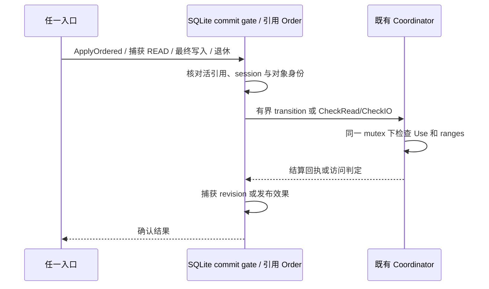
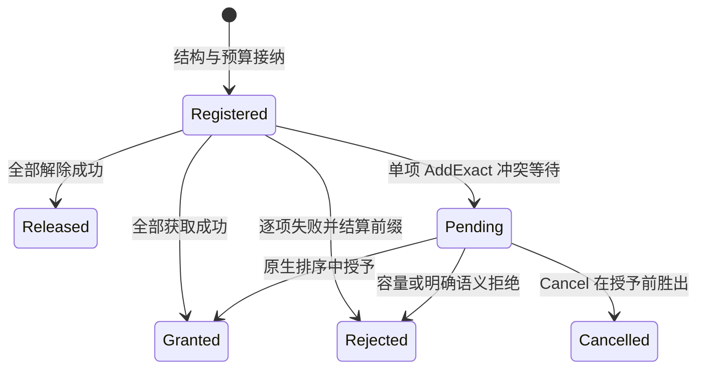

# Agent Note: 8.2a 中立有序范围动作

Status: proposed

## 问题

一个范围控制请求可以在后项失败前已经产生效果。Windows 的批次要求报告失败位置，并保留已成功的解除；立即冲突的获取又必须回滚本批新锁。若入口把每项拆成不同动作，响应丢失后就无法核对原批次的完整结果；若 authority 在执行前验证所有条目的语义，后项错误又会抹掉本应保留的前缀。`R-FS-8`、`R-CC-14` 和 `R-WIN-6` 要求这些结果在实际受控 I/O 的最终顺序中成立，并能用原动作身份核对。

范围保护还存在两个不能仅由入口处理的差异。同一持有者可以有多个相同范围的精确 claim，解除必须选定一项并在重投时保持选择；有限 READ 的锁冲突判断使用请求范围，不能先按 EOF 缩短请求再检查。它们影响 Linux、编程入口和远端包装链是否能绕过已生效的 Windows 保护，也影响同一打开引用对自身锁的判断。

本提案承接[Windows 系统网络驱动器](2026-09-16-windows-network-drive-support.md)的范围控制要求，并将[合并的范围锁与取消提案](../../rejected/feature/2026-09-28-smb-range-lock-cancel.md)拆为两个独立决定。本文件拥有 authority、storage、HTTP 和 wrapper 的中立能力；[8.2b SMB LOCK/CANCEL 生命周期](2026-09-28-smb-lock-cancel-lifecycle.md)拥有 SMB wire、异步响应和端点请求所有权。这里的接口、算法和验收均为拟实施设计，当前源码尚未提供 `OrderedRangeControl`。

## 提案

在现有 `RangeControl` 旁增加可选 `OrderedRangeControl`，以一个规则值完整选择有序精确范围政策。使用既有 `UseOwner`、`LockRequestID`、`RangeCommand`、`RangeAttempt` 和同一 action ledger；`Query`、`Cancel`、`Drop` 继续由 `RangeControl` 提供。旧 `Apply` 的整批预验证、advisory 范围代数和取消结果保持各自契约；Linux `R-CC-12`、`R-CC-13` 不因这个能力变成强制锁政策。

### 现有机制与缺口

| 已存在的能力 | 本提案复用的位置 | 需要补充的语义 |
|---|---|---|
| `RangeControl.Apply/Query/Cancel/Drop` 与有限 request 历史 | `packages/storage/capabilities.go`、`packages/advisory/actions.go` 和 `reconciliation.go` | 新规则的身份比较、语义逐项执行、完整前缀结果 |
| `ownerState.ranges []rangeClaim` | `packages/advisory/coordinator.go`、`edits.go` | 在现有 owner slice 上选择精确解除；私有 claim 保留其规则值 |
| `Bytes` 的 `uint64` 范围与 `Boundary` | `packages/storage/ranges.go`、`packages/advisory/ranges.go`、`extents.go` | 明确零长度 LOCK 映射和严格 READ 检查，继续使用现有范围表示 |
| 每 volume 的共享 `advisory.Coordinator`、SQLite commit gate 与引用 `Order` | `packages/metastore/sqlite/files.go`、`file_access.go`、`packages/storage/objectstore/file_locks.go` | 同一 gate 内应用新规则，覆盖授予、I/O、共享声明及退休 |
| `OwnerReference` 与引用关闭清理 | `packages/storage/objectstore/file_locks.go`、`packages/advisory/owners.go` | 部分 `Rejected` 获取也必须进入核对和清理 |
| HTTP range RPC、有限 admission、capability 协商与回执校验 | `packages/transport/httprest/file_wire.go`、`file_capability_{client,server,json}.go`、`file_range_receipt.go` | 宣告、转发新规则，校验回执；在既有账户中分开新效果与清理，保留查询和取消路径 |

上述状态和排序已经存在于[owner 与 request 数据结构](https://github.com/codetreker/remote-fs/blob/0d49a6a833bcb01f90d8ee5c56c2c93431ddb771/packages/advisory/coordinator.go#L80-L123)、[动作登记与重投](https://github.com/codetreker/remote-fs/blob/0d49a6a833bcb01f90d8ee5c56c2c93431ddb771/packages/advisory/actions.go#L69-L162)、[原生 owner 绑定与 Order](https://github.com/codetreker/remote-fs/blob/0d49a6a833bcb01f90d8ee5c56c2c93431ddb771/packages/storage/objectstore/file_locks.go#L100-L198)。缺口是现有 `checkCommands` 会在 action 登记前验证所有命令，`conflictLocked` 跳过同 owner，读取访问意图又先按已捕获大小裁剪；这些行为不能直接承担本提案的严格规则。

### 范围切分

| 需求与性质 | 纳入的工作 | 延后的工作与代价 | 必须保留的形状 |
|---|---|---|---|
| `R-CC-14`、`R-WIN-6`：保证 | 有序前缀、选择并固化解除、同 owner 获取冲突、跨入口实际 I/O 排序 | 无法延后；缺失会改变成功与失败的含义 | 规则必须在 authority 解释，不能由 endpoint 锁表代替 |
| `R-FS-8`：保证 | 同 ID 精确重投、查询、取消及历史过期失败 | SMB 响应所有权由 8.2b 增加，代价是不能仅凭 8.2a 发布 SMB LOCK | 原规则、owner 和原命令是同一 ledger 的身份，不能建第二份动作历史 |
| `R-CC-12`、`R-CC-13`：已有保证 | 回归 Linux advisory owner、转换、等待和关闭行为 | 新 advisory 模式不在本提案中，增加时由各自调用方选择 | 规则零值必须继续表示既有 `Apply`，不能改变原有默认语义 |
| `R-INT-3`：保证 | 复用现有限额，并加强 HTTP 新效果／清理分类和定向 pending 恢复 | 更大批次、无界等待历史与通用调度公平性不纳入；清理自身额度满时仍明确失败 | 接纳检查在效果前完成，新效果不能占清理账户或迫使清理恢复无关普通工作 |
| Windows 原生文件行为：验收条件 | 锁、READ、EOF 与 allocation 的联合资格检查 | EOF/allocation 政策如需变化须另作决定；本提案不能用未经验证的推测扩展它们 | 继续表达实际 truncate 意图与变更范围，不能为通过锁测试重新解释现有内容操作 |

### 公共类型与规则身份

拟新增类型如下；名称不接收 SMB `FileId`、`MessageId`、`AsyncId` 或状态码。

```go
type OrderedBatchRule uint8

const OrderedExactRanges OrderedBatchRule = 1

type OrderedRangeIntent struct {
    Rule     OrderedBatchRule
    Commands []RangeCommand
}

type OrderedRangeControl interface {
    CheckOrderedRangeControl() error
    ApplyOrdered(context.Context, UseOwner, OrderedRangeIntent, LockRequestID) (RangeAttempt, error)
}
```

`RangeAttempt` 增加 `Rule OrderedBatchRule`。零值只标识既有 `Apply`，`ApplyOrdered` 要求非零且受支持的 `OrderedExactRanges`。该值选择完整政策：首项决定获取或解除、逐项语义失败与前缀、立即冲突回滚、同 owner 获取冲突、精确解除选择及有限 READ 的请求范围检查。不能把它实现为只改变批次预验证的开关。

每个 action 按值保存规则；严格重投比较同一节点、domain、owner、`Rule` 与完整原始 `Commands`，其中命令顺序、失败项和未触及后缀都必须相同。旧 `Apply` 与新 `ApplyOrdered` 共享 ID 空间，因此同 ID 改换调用方法或规则也构成不同意图并失败。公开 `UseOwner` 已由 session、节点和已验证 scope 约束；不增加公开 `OwnerKey`。

私有 `rangeClaim` 增加按值复制的 `rule OrderedBatchRule`，仅新获取的 claim 继承产生它的 action 规则；已有 claim 不改写。它和 claim 一起存活，不能指向可能过期的 receipt，不能在 receipt 裁剪后丢失严格 READ 语义。规则零值的旧 claim 继续使用现有 actual-byte 检查；新严格 claim 无需新 schema、复制事件或持久恢复格式。

### 命令、范围与冲突

`OrderedExactRanges` 只接受 `DomainEnforced` 的精确动作：

| 动作 | 有效字段 | 语义 |
|---|---|---|
| shared `AddExact` | `Mode=RangeShared`、`Policy={DenySelf: WriteData, DenyOthers: WriteData}`、有效 `Range` | 重复 shared 分别保存；自身 shared 也禁止写入 |
| exclusive `AddExact` | `Mode=RangeExclusive`、`Policy={DenySelf: 0, DenyOthers: ReadData\|WriteData}`、有效 `Range` | 同一引用可对自己的 exclusive 执行 I/O，但不能重复取得重叠 exclusive |
| 新 `RemoveMatching` | 只有 `Domain=DomainEnforced`、`Edit=RemoveMatching` 与有效 `Range` 非零 | authority 在调用 owner 的现有 slice 中选择一项并解除 |
| `RemoveExact` | 已有 claim、mode、policy 和精确范围；不等待 | 继续允许调用方解除自己已确认的确切 claim |

所有获取的 `Claim` 为空，`Conversion` 为零；获取可用 `Wait`，但只有单项 `AddExact` 请求允许等待。解除的 `Wait`、`Conversion` 为零。`RemoveMatching` 的 `Mode`、`Policy`、`Claim` 也必须为零：调用方既不猜模式，也不猜 claim。它仅在严格意图中合法，旧 `RangeCommand.Check` 与旧 `Apply` 仍拒绝它；严格路径使用独立的结构检查与逐项语义检查。

正长度范围继续是 `Range{Kind: Bytes, Start: offset, Length: length}`，按 `Length-1 <= MaxUint64-Start` 判断合法性，包含的最后一个字节可以是 `MaxUint64`。不把 `uint64` LOCK 裁成 `int64`。零长度 LOCK/UNLOCK 则使用 `Range{Kind: Boundary, CutAt: offset}`，依现有边界重叠算法表示字节之间的切点；`{offset:0,length:0}` 与其它锁无重叠。该映射与 [MS-FSA §2.1.4.10 的冲突算法](https://winprotocoldocs-bhdugrdyduf5h2e4.b02.azurefd.net/MS-FSA/%5bMS-FSA%5d.pdf#page=31)相符，并由全域边界测试核对。POSIX `fcntl` 的 length=0 继续由 FUSE 表达延伸至未来 EOF 的 `Bytes` 范围，不能送入这个 LOCK 映射；已有[范围类型校验](https://github.com/codetreker/remote-fs/blob/0d49a6a833bcb01f90d8ee5c56c2c93431ddb771/packages/storage/ranges.go#L155-L211)已经能表示完整无符号范围。

严格获取核对实际 live ranges 和本批 draft 前缀。新 shared 与 shared 不冲突；新 shared 允许与本 owner 的 exclusive 重叠，但与其它 owner 的 exclusive 冲突；新 exclusive 与任何 owner 的 shared 或 exclusive 重叠都冲突，包括自己的已有 claim 和本批已加入的 claim。同 owner 判断只属于严格获取，不改变旧 advisory 规则；I/O 自我豁免仍按已验证引用 scope 与各 claim 的显式 policy 判断。其它 owner 的规则零值 claim 也参与同 domain 冲突，不能因调用方换用旧 `Apply` 绕过严格保护。

### 有序执行与回滚

执行分为结构接纳和逐项语义两部分。结构接纳完整解码为有界 typed intent，检查 owner/request 身份、支持的规则、命令数量、字符串存储界限和最大可能回执预算；枚举、布尔和无符号数必须能按其原类型解码，body 不得含未知字段或尾随数据。它不对整个批次调用 `RangeCommand.Check`，也不提前否定后项的 edit、mode、policy、范围语义或等待组合。结构畸形或容量不足在任何效果前失败。

成功接纳时复制整份原命令并在既有 ledger 登记，进入原生 `Order` 后处理。严格规则有一项整数组检查：首项为获取且批次含多项时，所有获取项都必须 `Wait=false`。任何获取项违反它，整个动作结算为 `Rejected/RangeInvalid`，`FailedAt=nil`、`Claims/Effects` 为空、`EverGranted=false`，不开始 element loop。该规则先于逐项 edit class 检查，不能保留其之前的获取前缀。

8.2b 另按所选择的 MS-SMB2 server SHOULD 政策，在调用 authority 前检查此类多项 raw LOCK 的所有 element 都带 `FAIL_IMMEDIATELY`；这是 SMB wire 准入，范围比这里的“获取命令不等待”检查更明确。它不授权中立层提前检查所有解除项或其它非法后缀的语义，也不改变非 SMB 调用方的前缀规则。

其余语义均逐项判断。未触及的非法后缀仍是有界、可保存、可逐字比较的 typed command；规范化失败项或丢弃其后缀会破坏同 ID 重投，因此禁止。第一个命令的有效 edit class 决定整个批次是获取还是解除；未知首项 edit 在索引 0 失败。对索引 `i`：

1. 在该步骤检查命令语义、首项 edit class、domain、policy 与允许的等待形状；失败记 `Rejected/RangeInvalid` 或相应明确错误，`FailedAt=i`。
2. `AddExact` 检查 live ranges 和 draft 前缀。无冲突时派生 `NewClaimID(request,i)`，在原生 transition 内预留 range 额度、追加并安装 claim，记录获取效果。`RemoveExact` 检查本 owner 的确切 claim；`RemoveMatching` 按下一节选择并冻结其实际 `RemoveExact`，在同一 transition 解除选中 claim。
3. 成功项推进 draft 和有序效果。语义失败后停止，失败项及后缀不产生效果。
4. 不等待的获取因 `RangeBlocked` 失败时，回滚本动作之前新增的所有 claim，保留动作开始前的 claim；自身冲突和其它 owner 冲突使用同一回滚规则。类型、范围参数、policy、容量或其它非冲突失败保留成功获取前缀。解除批次的成功前缀在任何后项失败下都保留。
5. 全部成功的获取结算为 `Granted`，全部成功的解除结算为 `Released`。部分失败结算为 `Rejected`，保留原失败位置和存活前缀；`EverGranted` 记录本动作是否已经产生过获取，立即冲突回滚后也可以为 true。

每一步安装、回滚和前缀结算在同一原生 gate 与 coordinator mutex 内完成。其它 I/O 无法在批次中间观察暂存的新锁；立即冲突回滚只删除该动作新增的 claim，保留原有列表及其次序。批次结果一旦结算，同 ID 只返回其历史，不执行第二遍。

等待只有单项有效 `AddExact` 能进入 `Pending`，此时尚无获取、解除或既有批次前缀；只有真实冲突可以登记等待。获取批次的多项等待由整数组规则在 loop 前拒绝；解除项的非法 `Wait` 仍在对应步骤停止并保留此前解除。等待沿用原 callback、现有 waiter 限额与唤醒 pump；不新增 worker 或回调 API。

### 精确解除的选择与冻结

[MS-FSA UNLOCK §2.1.5.9](https://winprotocoldocs-bhdugrdyduf5h2e4.b02.azurefd.net/MS-FSA/%5bMS-FSA%5d.pdf#page=109)在同一 Open/key、offset/length 的候选中选择遍历到的第一个 exclusive；不存在 exclusive 时选择最后一个 shared。本提案将已经验证的 session 和 `UseOwner` 作为 Open/key 的中立投影：这个能力一次绑定一个引用范围 owner，额外的 Windows key 不进入公共类型。需要多个 key 的调用方必须登记互不复用的 owner。

`AddExact` 已按追加顺序保存在本 owner 的 slice；`RemoveExact` 删除一项并保留其它项相对顺序。`RemoveMatching` 只扫描这个已计费的 slice 或本批相同顺序的 draft，精确比较完整 `Range`，保留最后一个 shared 候选，遇到第一个 exclusive 立即选定。未命中返回 `RangeNotHeld`。其它 owner 的列表无需参加选择；其中间插入的 claim 不改变本 owner 候选的相对顺序，因而无需全对象 claim 列表或新时间戳。

在同一个排序步骤、任何解除效果之前，将所选 claim 的完整 `RemoveExact{Domain,Mode,Range,Claim,Policy}` 按值冻结到现有 request 的步骤记录。选择不按 claim 的规则过滤，所选的 mode/policy 取自真实 claim，不从当前请求规则推导。`RangeAttempt.Commands` 始终保存原 `RemoveMatching`，`Effects` 携带冻结后的 `RemoveExact` 和同一 claim ID。冻结记录属于该 action 的既有有限历史，不是第二份 journal；原 ID 的重投、查询和等待恢复只读取原结果，绝不能再次选候选。

例如，同 owner 范围 `Bytes{Start:8,Length:4}` 的 slice 是 `[X:c, S:a, S:b, S:d]`，一次新解除选 `c`，下一次新解除选 `d`。第一项解除响应丢失后，原 ID 重投仍回答已经解除 `c`；只有不同新 ID 才允许选择 `d`。边界 claim 按 `CutAt` 精确匹配，同样一次解除一项。

### READ 意图与同一原生排序

[MS-FSA READ §2.1.5.3](https://winprotocoldocs-bhdugrdyduf5h2e4.b02.azurefd.net/MS-FSA/%5bMS-FSA%5d.pdf#page=78)先用有限 READ 的请求范围核对锁，再处理 EOF 与缩短返回内容。现有 [`checkAccessIntent`](https://github.com/codetreker/remote-fs/blob/0d49a6a833bcb01f90d8ee5c56c2c93431ddb771/packages/metastore/sqlite/file_access.go#L23-L46)先裁剪读取长度，因而一项位于 EOF 后的严格 exclusive 会被错误跳过；但旧 generic policy 的 actual-byte 语义仍须保持。

在 `packages/metastore.FileAccess` 增加内部 `ReadAll bool`。`ReadAll` 只允许 `Uses=ReadData`，其 `Offset/Length/Size` 为零，`Truncate/Append` 为 false；普通有限 READ 仍保留原始非负 offset/length 并按现有 `int64` I/O 上限校验。原 [`Storage.Read/ReadBounded` 的 `Length=math.MaxInt64`](https://github.com/codetreker/remote-fs/blob/0d49a6a833bcb01f90d8ee5c56c2c93431ddb771/packages/storage/objectstore/storage.go#L407-L435)改为明确 `ReadAll`，防止整文件读取被误解成请求直到 `MaxInt64` 的有限 READ。

authority 增加内部 `Coordinator.CheckRead(ctx,node,scope,requestedRange,availableLength)`，范围使用 `storage.Range`，可用长度使用 `uint64`。`requestedRange` 保留有限 READ 的原始 offset 与 length；零 length 使用调用前明确的零读分支，不构造无效 `Bytes`。`availableLength` 是从同一次捕获的 `FileState.Size` 计算的可返回长度，满足 `availableLength <= requestedRange.Length`。两种长度必须与 revision 捕获共用原生 gate，重新捕获 revision 时重新计算并检查；不能以先前的 Stat 或 endpoint 预检替代。

`CheckRead` 与现有 `CheckIO` 共用私有受锁 helper：先检查引用 scope、UseClaim 与 `ReadData` 权限；遍历 `DomainEnforced` claim 时，规则为 `OrderedExactRanges` 的 claim 对完整请求范围检查 overlap，规则零值 claim 对从相同起点截出的 `availableLength` 检查。然后按该 claim 的 `DenySelf/DenyOthers` 判定访问。requested 范围有效但实际长度为零时，严格 claim 仍能冲突；零值 claim 无实际字节可检查。真正 length=0 的 READ 仅执行 `CheckUse`，不参加范围重叠。

`ReadAll` 则在同一捕获中变为 `[0,state.Size)` 的真实范围，对两类 claim 检查这个范围；空文件只检查 Use。该路径不会创造 EOF 以外的请求字节。例如大小为 8 的文件、其它 owner 在 `[12,16)` 持有严格 exclusive：`ReadAt(6,10)` 和 `ReadAt(12,4)` 都因其请求范围失败，`ReadAt(6,0)` 只核对 Use，整文件 `Read()` 仍只检查 `[0,8)`。如果该 claim 来自旧 `Apply`，有限读继续只检查实际可读部分。

这些变化只属于 `metastore` 访问意图及 authority 检查；公开 `storage.File.ReadAt`、raw `Storage.Read` 和 HTTP read 请求仍使用既有方法。SMB、FUSE、SDK、raw 路径与 retained reference 都经 native capture/publication 检查，不增加由调用方传入的“跳过检查”或任意 range override。



现有 `Order` 要求先取得 native gate 再进入 coordinator mutex；coordinator 不能持 mutex 调用 `Order`，不能在已排序 callback 内再次进入 `Order`。SQLite [`fileDomain` 共享同 volume 的 coordinator](https://github.com/codetreker/remote-fs/blob/0d49a6a833bcb01f90d8ee5c56c2c93431ddb771/packages/metastore/sqlite/files.go#L632-L698)，既有 [`CheckIO`](https://github.com/codetreker/remote-fs/blob/0d49a6a833bcb01f90d8ee5c56c2c93431ddb771/packages/advisory/uses.go#L156-L196)也已经在 capture/final publication 的 gate 下执行。本提案沿用这条锁序，授予前已接纳的 I/O 可以完成，之后的冲突操作在效果前失败；引用退休先封住新准入并排空已接纳操作，再释放该引用的共享声明和范围 owner。

截断继续使用原 `FileAccess{Truncate:true,Size:...}` 和实际改变的字节跨度；allocation/EOF 的 Windows 原生行为是资格验收条件。不能从字节锁规则推导额外 allocation 语义，不能为这项能力新建内容 publication 机制。

### 回执、取消与所有权

同一 ledger 的状态如下，`Unknown` 是调用方因无法核实结果而进入的所有权状态，不是新增 authority `AttemptState`。



| 字段或结果 | 严格回执的含义 | 调用方义务 |
|---|---|---|
| `Rule/Request/Commands` | 原规则、原 ID 和完整原始 typed intent | 查询、取消和原 ID 重投核对相同动作 |
| `FailedAt` | 本次失败项的零基下标；整批 admission 拒绝及多项获取违反立即规则时为 nil | 失败项与后缀不能出现新效果；请求级拒绝无效果 |
| `Effects` | 原结算时未被本批回滚的有序获取与解除证据 | 获取按 request/index 派生 claim；选择解除核对冻结的 `RemoveExact` |
| `Claims` | 原结算时本动作保留的获取 ID，保留原顺序 | 不将它当作查询时的 live claim 清单 |
| `EverGranted` | 原动作在结算中曾产生获取 | 不据此改写 `Rejected`、判断当前持锁或认定取消成功 |
| `Pending` | 单项等待，尚无任何效果 | 只由原 ID 的 `Query/Cancel` 结算 |
| authority/owner/history 失效或传输错误 | 无法核实原动作，错误对象和链继续传递 | 隔离受影响 owner，保留清理责任，不能生成新 ID 补做 |

`Claims/Effects` 是历史证据：后续新 UNLOCK、`Drop` 或引用关闭可以改变 live ranges，旧回执仍保留原命令和效果。当前 live 状态由 coordinator 的 owner slice 拥有，不由历史回执重建。既有 `Granted` 最后一项解除后可观察为 `Released` 的核对语义须保留；这也不能使其历史 `Claims` 变成当前持锁证明。部分 `Rejected` 获取必须保留原 `State/Rejection/FailedAt`，不能因后续释放被改写为取消或成功；内部 claim 核对和 `dropLocked` 要覆盖这些动作，不能继续只筛选 `State==Granted`。

`Cancel` 只在 `Pending` 时胜出并产生 `Cancelled`。`Granted`、`Released` 与带存活获取的 `Rejected` 都返回原结算状态；`Rejected` 的获取不会被 CANCEL 顺手解除。只有确认 `Cancelled` 且没有效果的回执能证明取消未留下授予。引用仍 live 时持有者保留原获锁责任；引用已退休时既有 `OwnerReference` 清理路径负责释放，包括失败批次留下的获取。

`Drop(owner,DomainEnforced)` 与 owner 退休沿用现有语义，在已接纳 I/O 排空后清空该 owner 的所有精确 claim，包括 receipt 已过期和部分 `Rejected` 的 claim。`Query/Cancel` 继续经原 request 找节点，即使 owner 注册已退休也不创建新 owner；action 保留期结束后返回原有失效错误，不将“没有 receipt”解释成“没有锁”。关闭或清理失败仍保留原 owner 和额度，不能只清空端点 ledger。

节点引用打开的 [`NotExecuted` 证明](https://github.com/codetreker/remote-fs/blob/0d49a6a833bcb01f90d8ee5c56c2c93431ddb771/packages/storage/objectstore/file_actions.go#L312-L331)只属于对应 node-open 动作，不能推导 range cancellation 的证明。范围动作的取消依据始终是自己的 `RangeAttempt` 和原生结算；其它动作类型的 barrier 或历史结论不转用到这里。

### HTTP 与包装链

HTTP 在已有 `fileCapabilities` 增加 `OrderedRanges` facet；服务端只有同时通过 `CheckOrderedRangeControl` 和既有 `RangeControl` 检查时才宣告，客户端和每层 wrapper 必须保留相同区分。缺少能力时检查与调用均返回 `EOPNOTSUPP`；不从“有 Ranges facet”推断严格规则已实现。

复用现有 `OpFileRangeApply`、owner、lock ID、commands，在 apply envelope 增加规则字段。零值走旧 `Apply`，非零通过已协商 capability 走 `ApplyOrdered`。`OpFileRangeQuery/Cancel/Drop`、原 action ledger 和 `HistoryRemaining` 沿用，query/cancel 返回包括 `Rule` 的原回执；不增加查询、取消 RPC、barrier 或独立动作 journal。typed JSON 的结构接纳不能提前逐项调用旧 `RangeCommand.Check`：对严格请求只做有界结构检查，把可保存的非法语义后缀交给 authority；旧请求仍使用原验证规则。

#### 接纳分类与有限清理容量

现有 file Apply、Query、Cancel、Drop、关闭和 Strong 获取都进入同一个 `lockControls` 账户；[客户端](https://github.com/codetreker/remote-fs/blob/0d49a6a833bcb01f90d8ee5c56c2c93431ddb771/packages/transport/httprest/file_client.go#L301-L320)与[服务端](https://github.com/codetreker/remote-fs/blob/0d49a6a833bcb01f90d8ee5c56c2c93431ddb771/packages/transport/httprest/file_server.go#L638-L675)在解码前取得预约。获取 RPC 占满 active、字节或 waiter 额度时，清理可以在到达 authority 前收到 `EAGAIN`。authority 返回 `Pending` 后，HTTP RPC 的预约已经释放；问题是同一接纳账户的饱和，并非 Pending 持续占用 HTTP slot。

将既有 typed file 请求分类扩展到完整 `fileRequest`，在现有 `OpFile` 与 `OpFileControl` URL 之间选择，使用现有普通账户和 `lockControls`。分类只决定接纳位置，不改变 authority 方法、动作身份或错误语义：

| file 请求 | 既有 URL 与账户 | 分类依据 |
|---|---|---|
| 严格 `RangeApply` 的首项为 `RemoveExact/RemoveMatching` | `OpFileControl`、`lockControls` | 首项解除规则保证后续获取项不会授予；不扫描非法后缀的语义 |
| 严格 `RangeApply` 的首项为 `AddExact`、未知首项或不支持的规则 | `OpFile`、普通账户 | 获取或尚不能证明是清理；未知规则仍在效果前拒绝 |
| 零规则旧 `RangeApply`，非空且每项 edit 都是 `Subtract/RemoveExact` | `OpFileControl`、`lockControls` | 旧 Apply 允许混合动作，仅这组 edit 能证明不会新增获取 |
| 其它零规则旧 `RangeApply` | `OpFile`、普通账户 | 包含 `Replace/AddExact` 或无法确定的 edit |
| `NewUseOwner`、`SetPendingUnlink/ClearPendingUnlink` | `OpFile`、普通账户 | 新增 owner 或接受新的状态效果，原 action 与 native 语义不变 |
| 原有 Query、Cancel、Drop、RetireUseOwner、reference/session Close、关闭查询、观察、续期和 ACK | `OpFileControl`、`lockControls` | 核对、解除、退休与完成已接纳责任 |
| 原有普通数据请求与显式写恢复 | 既有 `OpFile` 与 `OpFileRecovery` | 保持原数据／恢复分类，恢复账户不承载范围获取 |

Strong 与 file 控制共用 `lockControls`，因此其新增资源操作也必须离开该账户。这是保障上述有限清理容量的接纳后果：[Strong 客户端统一接纳](https://github.com/codetreker/remote-fs/blob/0d49a6a833bcb01f90d8ee5c56c2c93431ddb771/packages/transport/httprest/lock_client.go#L152-L178)和[服务端统一接纳](https://github.com/codetreker/remote-fs/blob/0d49a6a833bcb01f90d8ee5c56c2c93431ddb771/packages/transport/httprest/lock_server.go#L36-L80)按 URL 已知的 operation 选择现有账户，Strong RPC URL、receipt、权限、持久恢复和 grant 规则不变。

| Strong 请求 | 接纳位置 |
|---|---|
| SessionEnrollment、SessionOpen、OwnerCreate、LockResolve、LockAcquire | 既有普通 request/body/response 账户 |
| SessionClose、OwnerRetire、LockRenew、LockRelease、LockCancel、QueryAction、QueryGrant、LockStatus | 既有 `lockControls` |

`LockResolve` 虽然观察路径，也会[建立或延长有限 resource reference](https://github.com/codetreker/remote-fs/blob/0d49a6a833bcb01f90d8ee5c56c2c93431ddb771/packages/locking/resources.go#L41-L56)，所以属于新工作。现有 Strong bulk-saturation 测试中“饱和期间仍能 enrollment/open”的断言须改为新工作容量拒绝；先在饱和前建立真实 session/owner，继续要求其 Status、Renew、Query、Release、Close 在普通账户满时可完成。不能隐藏这个已有测试与可观察接纳行为的变化。

接纳顺序必须避免先物化未计费请求，也不能由本次预约阻塞原请求恢复：

1. 客户端对原 typed file 请求做不分配大对象的分类。新工作先执行既有 all-pending barrier，尚不持有本次普通预约；随后预留 `fileRequests`，freeze 请求并复核分类未变，再使用既有 `responses` 预约执行 RPC。两账户分别覆盖请求保留与网络结果保留，不重复取得同一账户。
2. 清理／核对请求跳过全 session 的 pending resolver，先取得 `lockControls`，设置既有 `fileRequestAdmissionKey{storage,control:true}`，再 freeze、复核分类并执行下节的定向恢复。同 ID replay 继承这个 pre-admitted context；`Storage.fileCall/callWithin` 不再取得第二份 `lockControls`，容量为 1 时也能完成。
3. 服务端根据外层 URL 在读取 body 前取得对应原预约；`OpFile` 继续计费既有 `bodies/responses`，`OpFileControl` 继续计费 `lockControls`。typed decode 后重新计算期望 URL，在 authority 调用前拒绝错误通道。客户端 freeze 后分类变化也以无效果错误结束，释放已选预约，不重新路由。
4. wire 限额与账户分类分别检查。file range 请求在客户端编码前预留既有 ordinary/control 容量，编码后、发网前要求完整 body 与最大回执都不超过 `min(maxBodyBytes,256 KiB)`；服务端普通路由按既有 maxBody 预算读取，再在 decode 后、authority 前核对 range raw body 与最大回执的同一上限。Strong URL 提前确定类别，客户端编码前在普通 `fileRequests` 或控制 `lockControls` 预约固定 `DefaultMaxLockControlBytes=16 KiB` 的请求与结果容量；服务端普通 Strong 读取前在现有 `bodies/responses` 预约固定上限，控制 Strong 继续在 `lockControls` 预约。消息限额不因改走普通账户而增大。

保证是：普通新效果的 active、字节与 waiter 饱和，不能消费清理账户或迫使清理重投无关普通动作。观察、核对、续期和退休仍共同争用有界 `lockControls`；该账户自身满、授权拒绝、传输或 backend 失败仍明确报错并保留 Unknown。这个能力不承诺通用公平调度，也不增加账户、RPC、hint 字段、worker 或队列。

#### 匹配的 pending 恢复与并发发布

现有 [`remoteFileSession.call`](https://github.com/codetreker/remote-fs/blob/0d49a6a833bcb01f90d8ee5c56c2c93431ddb771/packages/transport/httprest/file_client.go#L280-L336)在选择路由前对多数请求调用 `resolvePending`；它会在[网络持有的 `reconcileMu`](https://github.com/codetreker/remote-fs/blob/0d49a6a833bcb01f90d8ee5c56c2c93431ddb771/packages/transport/httprest/file_client.go#L542-L601)下重投无关普通 pending。只改 URL 无法使清理独立于普通账户饱和，必须一并约束这项依赖。

清理请求不进入或等待该全局 resolver。沿用已有 `pending` map、freeze 和 intent/scope 比较，在取得清理预约后，仅在现有 `s.mu` 下选取本请求匹配的 key、完整原 Action、冻结 intent、scope 与已知结果，然后释放 mutex。同 ID 重投在锁外进行，保留原 session、Action、scope、授权及 pre-admitted context，不生成新 ID。不存在匹配 entry 时按本请求正常执行，不恢复无关 entry；新工作继续使用原 all-pending barrier 和 `reconcileMu`。

一旦选中 pending entry，该次调用就始终是原 Action 的恢复。返回时以现有 `s.mu` 比较完整 key/Action/intent/scope，只向仍匹配且尚未结算的 entry 发布结果；并发已缓存的确定结果优先。全局 resolver 的发布也使用相同匹配检查，不能用旧快照覆盖别的结果。在返回 unknown/error 前重查并发确定结果。entry 已被其它调用取走时，返回本次原 ID 重投的结果或保存的原 unknown，不复活已消费 entry，也不继续落入新 Action 生成。

并发原 ID HTTP replay 可以存在；现有 native action journal 串行化同意图的效果，控制账户限制并发 RPC，map 的匹配发布承担结果所有权。不在网络等待期间持有 `s.mu`，不增加新的 mutex、gate 或 journal。这保持单动作身份，并避免一个普通 resolver 因普通池饱和而阻止已接纳责任的 Query/Cancel/Drop/退休。

调用方在首次 apply 前由既有 request owner 保留完整 typed intent，未知结果查询时仍由该 owner 核对；SMB 使用 8.2b 的 pending record，HTTP session 不另建 intent journal。Apply 响应由 transport 与原请求逐字比较；Query/Cancel RPC 只有 owner 和 ID，transport 校验回执的规则、结构和前缀自洽，调用方再与原规则、命令及已经见过的冻结选择比较。只通过内部自洽校验不能证明它属于调用方的原意图。wrapper 不规范化命令、不剥掉带 `Rejected` 回执的原始错误、不只返回 error 而遗失部分效果；receipt Clone 必须复制新字段和命令、claim、effect、失败索引，不能持有调用方可变 slice。

[`validateFileAttempt/validateRangeEffects`](https://github.com/codetreker/remote-fs/blob/0d49a6a833bcb01f90d8ee5c56c2c93431ddb771/packages/transport/httprest/file_json.go#L735-L824)与[响应预算计算](https://github.com/codetreker/remote-fs/blob/0d49a6a833bcb01f90d8ee5c56c2c93431ddb771/packages/transport/httprest/file_range_receipt.go#L15-L122)按 `Rule` 选择完整校验：

- Apply 的规则、ID 和完整 `Commands` 与原 intent 相同；Query/Cancel 的 ID 相同，并保留可交给 request owner 比较的完整规则与命令。结构界限始终有效；已执行前缀中的每个命令及每个效果必须完整通过对应规则的语义校验。
- `Rejected` 的 `FailedAt` 与原命令同序；失败项和未触及后缀允许包含原样保留的无效语义，但最终采用结果前必须与原 typed intent 完全相同，绝不能放宽 effect、claim 或前缀校验。规则不支持或调用方无法核对原 intent 时报告 I/O 错误。
- `AddExact` 效果的 claim 必须等于 `NewClaimID(request,index)`，mode/range/policy 与原项一致。`Claims` 精确对应原结算中保留的获取效果，不能遗漏、重复或重排。获取效果必须有 `EverGranted=true`。
- `RemoveMatching` 效果必须是同一 range、`DomainEnforced`、有效选中 ID 的具体 `RemoveExact`，并携带所选 claim 的合法 mode/policy；`Released=true` 且 effect 的 `Claim` 与命令 `Claim` 相同。HTTP 能核对表示与历史一致性，候选的第一个 exclusive／最后 shared 由 authority 保证。
- `Rejected` 可以有获取前缀和非空 `Claims`。仅 `RangeBlocked`、获取失败、该失败项不等待的回执允许本批获取回滚并因此没有获取效果；既有 claim 不能被回滚。不能用 `EverGranted` 单独判断 `Granted` 或取消结果。
- 请求级 `RangeInvalid` 只有原命令证明“首项获取、多项、至少一项获取的 `Wait=true`”时允许 `FailedAt=nil`，并要求 `Claims/Effects` 为空、`EverGranted=false`。其它语义 `RangeInvalid` 必须有逐项失败位置，不能用请求级结果吞掉已生效前缀。
- `Pending/Cancelled` 的严格回执只能来自单项等待 `AddExact`，且无 `Claims/Effects/EverGranted`；终态失败后不得重新进入 Pending。保留的历史效果在随后释放后仍按原结算校验，不能用当前 live 范围裁剪它们。

预算计算要同时覆盖规则、完整原 commands、最大前缀效果、最大历史 claims、`FailedAt`、冲突和错误 envelope，尤其是包含获取的 `Rejected`。客户端与服务端使用同一算法，在 effects 前预留预算；较小的配置限额导致明确拒绝，不抬高全局上限。按上述分类选择的现有 request/body/response 或 control 账户承担各自驻留字节，原 body 限额与回执预算不依赖外层 URL。

### 实施模块与资源上限

以下是拟实施责任，路径均对应当前模块布局；本提案本身不创建这些源码文件。

| 模块 | 拟修改的责任 |
|---|---|
| `packages/storage/ranges.go`、`capabilities.go` | 规则、intent、可选接口、`RemoveMatching`、回执 `Rule` 与调用方契约 |
| `packages/advisory/coordinator.go`、`actions.go` | 私有 claim/action 规则值、同 ledger 身份、结构接纳、命令存储与冻结步骤 |
| `packages/advisory/edits.go`、`ranges.go` | 有序 draft、同 owner 与 draft 前缀冲突、选择解除、条件回滚和前缀安装 |
| `packages/advisory/reconciliation.go`、`waiting.go`、`session.go`、`owners.go` | 原状态结算、单项等待、取消、包括部分 `Rejected` 的 live 核对与 Drop/退休 |
| `packages/advisory/uses.go` | `CheckRead` 与 `CheckIO` 共用 helper，按私有 claim 规则选择检查范围 |
| `packages/metastore/capabilities.go`、`packages/metastore/sqlite/file_access.go`、`files.go` | `ReadAll` 校验、同一捕获状态的 requested/available 长度、保留 capture/publication/retire gate |
| `packages/storage/objectstore/file_locks.go`、`file_session.go`、`storage.go` | 新能力检查与有序转发、既有 owner/reference admission、raw 整文件读取的明确意图 |
| `packages/storage/{limited,locked,replicated}/capabilities.go`、`packages/storage/localstore/files.go` | 按实际底层检查和转发可选能力；localstore 已返回底层 session，验证该链保真，保留预算、错误与清理所有权 |
| `packages/transport/httprest/file_wire.go`、`file_json.go`、`file_capability_{client,server,json}.go`、`file_range_receipt.go`、`file_result_budget.go` | facet、既有 apply envelope 的 rule、typed 请求分类、结构接纳与严格回执、原 RPC 与独立 wire 预算 |
| `packages/transport/httprest/file_client.go`、`file_server.go`、`client.go`、`server.go`、`body.go` | 原 ordinary/control 预约贯通、先计费后 freeze/read、路由复核、定向 pending 恢复与原 map 的匹配并发发布 |
| `packages/transport/httprest/lock_client.go`、`lock_server.go`、`lock_client_test.go` 及 file admission 测试 | Strong 新资源请求离开共享控制账户，保留 native/RPC 语义；修订 enrollment/open 饱和断言并验证既有 owner 的控制可完成 |
| `docs/design/server/file-handles.md`、`file-locks.md`、`architecture.md`、`docs/design/architecture.md`、`docs/testing.md`、各模块 `*_test.go` | 实施时同步已落地能力、Strong/file 接纳后果和 HTTP 调用契约、错误路径、跨入口和包装链验收 |

同一 action 原命令、选择解除与回执继续受 `MaxRangeCommands=64`、`MaxRangeClaims=64`、`MaxRangeEffects=64` 约束。每条命令最多保留一项对应的效果及一个冻结选择；其工作和空间为有界命令数加现有 owner ranges，不新增按对象复制的全局列表。`RemoveMatching` 选择扫描 `O(owner ranges)`；获取与 I/O 仍沿用 coordinator 的有界 volume 范围扫描，不能宣称它提供新索引或不同吞吐。

规则标量按现有 claim/action 额度计费；新增 slice 与复制数据也在同一 action/response reservation 中计费。沿用 `Config.MaxOwners/MaxRanges/MaxRequests/MaxWaiters/MaxCommands`、`FileSessionOptions.MaxLockOwners/MaxLockRanges/MaxPendingLocks/MaxLockActions/MaxWaiters` 和 History；每条 claim 的规则必须在 receipt 过期后仍受 range 额度约束。完整 HTTP control 命令及回执保持 [`MaxFileControlBytes=256 KiB`](https://github.com/codetreker/remote-fs/blob/0d49a6a833bcb01f90d8ee5c56c2c93431ddb771/packages/transport/httprest/file_wire.go#L17-L18)，不通过扩大这些 bounds 容纳新格式。

新申请遇到 action、range、waiter 或字节额度不足，按接纳或逐项阶段返回原有明确资源错误；接纳拒绝无效果，逐项资源失败保留严格规则要求的前缀。既有 query/cancel/drop/retire 不新占 range action slot。HTTP 清理预约与普通新效果分开，匹配的 pending 重投复用原预约；清理自身 active/字节/waiter 满时仍有限失败并保留责任，不能声称任何控制饱和都不影响清理。Unknown 与尚未释放 claim 持续计费，只有核实原生释放或退休后才归还额度。authority 重启仍使此类 owner、claim 和 action history 失效，不增加跨重启恢复承诺；强 S/X 的独立持久恢复不受这里影响。

## 备选方案

**只用既有 `Apply`，由入口预验证或逐项调用。** 这是较小的范围，但整批预验证会消除应保留的语义失败前缀，拆 ID 又不能按原批次核对 lost reply 和回滚。只补 `RemoveMatching` 也不能满足严格同 owner 获取与 READ 的共同政策，因此没有选择这个切分。

**在 SMB endpoint 保存锁列表并选择解除。** 它能简化 authority 改动，但另一个入口的 I/O 和并发 release 不经过该表。端点猜选 claim 还会在回复丢失重投后误解下一项，无法承担 `R-CC-14` 和 `R-WIN-6`。

**公开 `OwnerKey`，建立全对象 claim 顺序和独立 coordinator/journal。** 这是较大的范围，可以表示额外平台的 key 或全对象遍历，但本 owner 候选的相对顺序已经保存在现有 slice，session/UseOwner 已表达必需身份。并行结构会重复记账、清理和结果核对，并引入两个最终顺序；未选择。将来多 key 能力仍可通过多个明确 owner 增加，不要求复制所有 claim。

**把所有 `DomainEnforced` 或所有 READ 改成严格政策。** 少一个规则字段，但会把 generic caller 的显式 policy、旧 actual-byte 检查及 Linux advisory 语义当成 Windows 政策。按值保存在 claim 的规则让不同政策在同一 authority 共存，receipt 过期也不改变访问含义，因此选择可选能力。

**同时实现 SMB 异步协议、原生 fixture、缓存与 EOF/allocation 重构。** 它能一次发布更多能力，但 authority 的前缀、HTTP receipt 和 READ 政策无法作为独立契约审查。8.2b 可以使用本提案结果增加协议行为；原生 qualification 和缓存各有[既有提案](2026-09-28-smb-native-qualification.md)与[通知／缓存提案](2026-09-28-smb-change-notify-cache-coherence.md)。EOF/allocation 保留为资格条件；观察到偏差时才决定其行为修正。

**维持所有 HTTP controls 在共享账户，或增加通用优先队列。** 前者让范围及 Strong 新资源请求耗尽清理接纳，无法满足 `R-INT-3`；后者引入新的公平性、队列和计费机制，但还不能消除清理先恢复无关 pending 的依赖。选择在原账户和 URL 中分类，并定向恢复原动作；代价是新 owner、pending-state 效果和 Strong enrollment/open/resolve/acquire 在普通饱和时明确容量失败。

## 验收标准

下列是实施必须得到的可观察证据；本提案只定义测试和完成条件，尚未执行这些验收。

1. **公共能力与回归。** direct authority、objectstore、localstore、limited、locked、replicated 和 HTTP 执行同一严格契约。缺少可选能力时 Check/ApplyOrdered 确定失败；完整包装链才宣告 facet。旧 `Apply`、Linux flock/POSIX 的 owner、转换、等待、取消和关闭结果保持 `R-CC-12/13`；同 ID 改 Rule、owner、顺序或失败后缀均拒绝且无新效果。
2. **范围全域。** 正长度覆盖 `MaxUint64` 的合法最后字节、溢出、EOF 后锁、零 offset/length、非零 cut、cut 两侧相邻区间与边界之间。FUSE POSIX length=0 继续锁至未来 EOF，LOCK length=0 按 Boundary 匹配；非法后项在原索引失败，回执保留其 typed fields。
3. **获取与前缀。** 同 owner X/X、S/X、X/S 和重复 S；前缀中刚加入的 X 对后项 X 也造成冲突。自身或他者立即冲突回滚本批获取，原有 claim 仍在。首项获取的多项请求出现等待获取时，loop 前 `RangeInvalid`、nil FailedAt、无效果；其它获取后遇解除类型、坏 policy/范围或资源失败保留应存活前缀。解除后遇获取类型、非法等待或未持有项保留全部先前解除。`FailedAt`、`Claims`、`Effects` 与错误状态逐项一致。
4. **选择解除与 lost reply。** 重复 S 按最后 shared、X+S 按第一个 exclusive；跨 owner、session、节点与 detached/同名替代物互不误选。选定后丢掉响应，原 ID query/reapply 永远返回原 `RemoveExact`；不同新 ID 才解除下一项。每次只解除一项，测试用另一入口的冲突 I/O 证明剩余 claim 仍生效。
5. **有限 READ 与整文件读取。** 同一大小捕获下，严格 claim 检查包含 EOF 后部分和全部在 EOF 后的有限请求；旧 claim 只检查可用字节。零读只检查 Use；整文件 read 只检查真实 extent。receipt 过期后 claim 的规则仍生效。raw path、retained File、FUSE、SDK 和 HTTP 不存在绕过；重复 capture 遇并发 revision 时重做同一 gate 内检查。
6. **原生排序与清理。** 使用可控 gate 交错锁授予、有限读、写入、截断、共享模式、引用退休和 owner drop；授予前已接纳 I/O 可完成，其后冲突在效果前失败，退休排空后释放。owner 的部分 `Rejected` 获取、receipt 已过期的 claim 和 cleanup error 都覆盖；清理失败不释放未核实额度。观察 `Drop` 或 reference close 后其它入口确实可访问，历史回执仍保留原结算证据。
7. **等待与取消证据。** 仅单项 AddExact 能 Pending，无前缀或历史获取；确定性测试分别固定 Cancel 先于授予、授予先于 Cancel，二者核对同一 ID。部分 `Rejected` 即使有历史获取也返回原失败；Cancel 不释放它。query/transport 失败、history 过期、authority 换代保持 unknown/error，不复用节点打开的 `NotExecuted` 结论。
8. **HTTP 伪造与预算。** round trip 保留 Rule、无效失败项和无效未触及后缀、部分 Rejected 获取、冻结解除和原错误。分别篡改 Rule、Commands、FailedAt、派生 ID、effect 模式/policy、冻结选择、Claims、EverGranted 和 HistoryRemaining，客户端明确失败。最大 64 项 commands/claims/effects 的成功及错误 envelope 都在同一预留预算及 256 KiB 内；普通路由也拒绝过大的 range body/receipt，Strong 仍遵守 16 KiB。错误外层 URL 在 authority 前拒绝。
9. **HTTP 饱和与定向恢复。** 分别填满客户端 fileRequests/responses 和服务端 bodies/responses 的 active、字节与 waiter 额度，按请求实际使用的账户验证范围获取、NewUseOwner、SET/CLEAR 的容量失败；Strong 新资源请求验证客户端 fileRequests 及服务端 bodies/responses 的饱和拒绝。真实已建立 owner 的 Query/Cancel/Drop、reference/session Close、Status/Renew/Release/退休继续经空闲控制账户完成。严格解除首项带非法或获取后缀仍按首项走清理并保留逐项前缀；旧混合 Apply 走普通账户。先制造无关普通 pending 并让 resolver 在普通池等待，清理不等待 `reconcileMu`，不触发该 pending 重投。制造匹配的未知 Drop/退休，控制容量为 1 时原预约能完成同 ID 恢复；与全局 resolver、另一个恢复者和取走结果的调用方交错，验证只发布匹配原 Action/intent/scope，确定缓存优先，已取走 entry 不复活且不生成第二个逻辑动作。普通容量为 1 时新工作先恢复旧 pending，再预留本次容量。最后单独填满控制账户，要求有限容量错误和 Unknown 责任保留，不能伪报完成。Strong 现有 bulk-saturation 测试先建立 owner，修订新 enrollment/open 预期，并保留真实旧 owner 的核对／释放断言。
10. **Windows 资格条件。** 与 8.2b 接合后，真实 Windows 环境验证重复范围、同 Open 获取政策、请求范围 READ、EOF、FileEndOfFileInformation 与 FileAllocationInformation 的组合，SDK/Linux 入口同时作为观察者。EOF/allocation 的实际行为未核实时不能声称 Windows 范围锁合格，不能以模拟 adapter 或现有 CI green 代替该证据。

完成条件是：每个确认结果能由原 ledger 核对；同原生 gate 的跨入口实际访问遵守已生效 claim；所有语义失败前缀和立即冲突回滚准确；解除重投不重新选择；历史与 live 状态不混淆；有限额度和清理能力在全部错误路径成立。实施时代码、已实施 note、受影响设计文档与测试在同一改动同步。

## 风险

最容易失真的地方是把 `OrderedExactRanges` 缩成批次验证开关：同 owner draft 冲突、READ 请求范围和 claim 存活规则必须一起实现，否则包装链看似支持新能力却提供错误保护。另一个风险是 HTTP 对非法后缀的允许被扩大为放宽整个 receipt；原 intent 逐字比较、已执行前缀和每个 effect 的完整语义校验是必要条件。

新增规则和冻结选择增加既有有限 action/claim 的驻留开销，不提高容量或吞吐承诺。严格策略允许参数失败留下成功获取前缀，调用方必须把失败回执交给同 owner 的核对与清理；只处理成功动作会留下范围保护。历史 `Claims/Effects` 也不能作为实时授权依据，长期 Unknown 继续占用额度并使相关持有者访问失败。

HTTP 接纳分类同时影响旧 Apply、owner 创建、SET/CLEAR 与 Strong 新资源请求；这是清理账户共享关系带来的必要范围，必须同步真实调用和现有测试。定向恢复的风险是并发旧快照覆盖确定结果，或 entry 被消费后落入新 ID；原 intent/Action/scope 匹配、锁外同 ID replay 和不可改换恢复责任的规则必须一起实现。控制账户自身仍有限，持续核对流量、授权或网络失败可以阻止当次清理，相关责任与额度继续保留。

本提案交付中立控制能力；SMB 异步响应、签名、credit 和客户端 CANCEL 只有 8.2b 才能交付。Windows 原生 EOF/allocation 资格是明确的未完成验证，未通过时限制能力发布。其它平台可复用有序精确动作，但需要保留自己独立的持有者和 I/O 政策，不能从一个规则名称推导未声明的语义。
