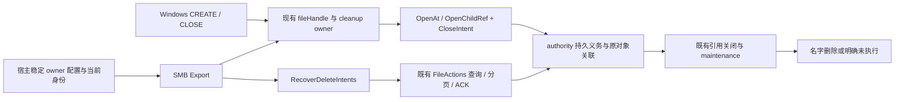

# Agent Note: SMB 关闭删除义务与跨重启恢复

Status: proposed

## 问题

Windows 的 `FILE_DELETE_ON_CLOSE` 在打开成功时接受删除责任，发起句柄关闭、连接丢失或宿主终止都可能触发它。删除必须作用于原对象及其当时的名字关联，等待其它相关引用结束；同名替代物不能成为删除目标。CREATE 或 CLOSE 响应丢失、SMB 宿主重启、authority 重启，都不能把已经接受的责任变成一次新的按路径删除。

本提案落实 [Windows 网络驱动器总方案](2026-09-16-windows-network-drive-support.md)的 7.6，依赖 [有界 CREATE/CLOSE](../../implemented/feature/2026-09-28-smb-bounded-create-close.md)已经交付的原子打开、FileId、引用关闭与 cleanup owner。需求来自 [R-FS-6、R-FS-8、R-INT-11、R-WS-7、R-SEC-5、R-WIN-7、R-WIN-10](../../../../docs/spec/requirements.md)。普通 SET_INFO disposition、显式删除与 rename 的 SMB 接入属于 [名字修改提案](2026-09-28-smb-guarded-name-mutation.md)。

authority、直接 FileStorage adapter、HTTP adapter 已有关闭删除、持久查询、分页发现和 ACK 能力；SMB 尚未把 CREATE 标志接入这条链。需要设计的是 SMB 的身份与恢复准入、现有引用 owner 的责任转交，以及可观察结果。设计阶段只更新提案；实现时将本 note 移到 `implemented/`，与代码、测试和 `docs/design/` 一起提交。

## 提案

### 范围与后续约束

| 范围 | 需求与分类 | 本任务的交付或延期成本 |
|---|---|---|
| CREATE 关闭时删除，文件及目录 | R-WIN-7；能力 | 接入既有 `CloseIntent`，覆盖全部当前支持且合法的 create disposition、metadata-only 引用和错误路径。 |
| 对象身份、共享、原子接受、未知结果、跨重启责任 | R-FS-6、R-FS-8、R-WIN-6、R-WIN-7；保证 | 在本任务完成。事后补入会改变打开和关闭责任结构。 |
| 显式恢复、当前授权、停止与状态 | R-SEC-5、R-ERR-4、R-WIN-10；保证 | 提供有界、宿主驱动的有限扫描；预留恢复责任额度，保留旧 session 未结算错误。 |
| 原生重启 trigger 与物理 discard 结算 | R-WS-7、R-WIN-7、R-INT-11；保证 | 修复既有 SQLite 事务排序；接口、RPC、schema 不扩展。 |
| 普通 disposition、SMB rename／replacement／unlink | R-WIN-2、R-WIN-7；能力，留给 8.1 | 以后增加协议处理器；本任务保留 authority 对原关联的移动、分离和 pending 检查。SMB 请求仍明确返回不支持。 |
| CHANGE_NOTIFY、Windows 缓存资格、WNet | R-WIN-1、R-WIN-8；能力，留给相应提案 | 以后增加通知、映射和验收；本任务不使用名字缓存解释删除结果。 |
| Windows 11 Home／Pro 普通用户资格 | R-INT-8、R-WIN-9；验收，留给任务 10 | 本任务执行 Windows Server 原生探测；它不证明目标客户端资格。 |

后续实现不得把删除责任绑定到原路径、SMB FileId、session epoch 或 authority incarnation；不得让普通 disposition 的 CLEAR 撤销关闭时删除；不得把同一 volume 的 Linux 或 SDK 名字效果放在 pending 检查之外；不得将等待其它合法引用结束解释成恢复错误。新旧引用仍通过现有 authority 排序点相互约束。

### 已有能力及责任分层

| 已有能力 | 本任务如何复用 |
|---|---|
| `AtomicFileOpener.OpenAt`、`NodeReferences.OpenChildRef` | 将 `CloseIntent` 放进当前原子打开选项；创建／截断、共享 claim 和 intent 接受属于同一次结果。 |
| `CloseIntent`、`DeleteIntentID`、`DeleteIntentOwner` | 使用中立的触发、条件及发现身份；不添加 Windows 位到 storage。 |
| `FileActions.QueryFileAction` | 核对当前 session 的原打开或 ACK 动作；Unknown／Retired 不证明未执行。 |
| `FileActions.QueryDeleteIntent`、`ListDeleteIntents`、`AcknowledgeDeleteIntent` | 用持久 owner 发现旧义务，查询状态和回收终态；新 session 可查询旧 authority 进程接受的 intent。 |
| `ReferenceCloseActions`、`ReferenceCloseResult`、`CloseOwnerStatus` | 保留释放、结果判定与 adapter settlement 的区别；`Released=true` 不单独证明全部责任已结算。 |
| `BackendIdentity`、`FileSessionIdentity`、`Status` | 验证宿主固定的 backend volume／root 绑定，以及本次恢复 session 的真实 epoch 与 authority 身份。 |
| `ReferenceStateAccess.State(StateScalars)` | QUERY_INFO 直接观察 pending；没有本地 pending 缓存。 |
| SQLite `RetryPendingUnlinks` 与既有 authority maintenance | 推进已接受效果；SMB 恢复只发现、核对和 ACK，不添加删除调度器。 |

这些能力由现有 [storage 类型及 FileActions](../../../../packages/storage/capabilities.go)、[FileSession](../../../../packages/storage/files.go)、[SQLite 原子打开](../../../../packages/metastore/sqlite/atomic_open.go)和[持久删除及维护](../../../../packages/metastore/sqlite/pending_unlink.go)承载。SMB 接入点是[当前 CREATE](../../../../packages/smb/commands_file.go)、[引用 owner](../../../../packages/smb/file_handles.go)、[authority session](../../../../packages/smb/authority_session.go)与[宿主 principal](../../../../packages/smb/auth.go)，复用其准入及生命周期规则。



SMB 拥有本地引用、未判定请求与 ACK 尝试；authority 从接受起拥有固定删除效果及持久结果；宿主持有跨 SMB 进程重启的 owner 配置和恢复调用责任。停止 SMB 不关闭调用方拥有的 backend，也不撤销 authority 已接纳的义务。

### 宿主配置与恢复接口

拟在现有类型中增加一个字段和一个方法：

```go
type Share struct {
    // Existing fields include Volume, BackendVolume, RootNodeID and Backend.
    DeleteIntentOwner storage.DeleteIntentOwner
}

func (e *Export) RecoverDeleteIntents(ctx context.Context) error
```

`DeleteIntentOwner` 为空时，该 export 的普通文件操作保持可用，`FILE_DELETE_ON_CLOSE` 在产生效果前返回不支持。非空非法值返回 `ErrConfig`。宿主在首次启用能力前，通过已有 `storage.NewDeleteIntentOwner()` 生成一次 owner，把它与可信 `Share.Volume`、稳定 `Share.BackendVolume`、`Share.RootNodeID` 一起纳入自己的持久配置；正常启动和 republish 使用原绑定。owner 是发现命名空间，不授予权限。share 名字和 authority incarnation 不参与这个绑定。

宿主必须验证持久配置完整、绑定正确，并在 endpoint 生命周期内独占使用该绑定。缺失或损坏的既有绑定必须恢复原配置；运行时不得生成替代 owner 来声称没有旧义务。配置备份、原子保存和跨宿主进程互斥由集成方已有的配置管理承担，本 package 不增加 owner 文件格式、文件 store、lease 接口或备份子系统。`Publish` 在单个 Server 内拒绝重复 owner 和同一恢复绑定的重复发布；它不能证明其它进程没有使用这个绑定。

`Publish` 保持同步配置及 capability 检查，不获取凭据或 FileSession。每个带 owner 的 Export 在发布时，必须从已有 `MaxUnresolvedOwners`／`MaxDiagnosticBytes` 的共享责任额度中预留一个恢复责任槽；普通 handle 或 write 不能占用它。容量不足使 Publish 失败，配置检查失败退还预留。恢复方法复用这个槽，不把恢复 session 伪装成 fileHandle，不另建额度池或按重试不断预留。

带 owner 的 export 发布后关闭删除尚未就绪，普通访问仍可用。宿主调用 `RecoverDeleteIntents`，完成一次有界、有限的完整遍历并结算当前恢复 session，才开启新的关闭删除。已知且由 authority 持有的 Armed／Pending 不妨碍就绪。扫描、ACK 或当前 session 关闭的真实错误不能被省略。

恢复调用必须携带宿主当前验证的 `Principal`，使用已有 `WithPrincipal`／`PrincipalFromContext`。方法每次重新执行 `AuthorizeIdentity`，并对 backend 身份查询、FileSession 创建、status、FileSession identity、intent 查询／分页、ACK、动作查询及关闭按实际 operation 执行当前 `Authorize`。远端 adapter 使用宿主当前配置的远端凭据继续独立授权。缺少 principal、身份不再被接受或远端授权拒绝都返回真实错误，不能使用旧 SMB SID、旧会话身份或虚构后台身份补齐。

当前句柄的 intent 查询／ACK 可在它自己所属且仍有效、当前授权允许的 FileSession 上结算，先于父 session 关闭。Export 的独立恢复使用自己的已有恢复 session，或通过 `Backend.NewFileSession` 创建；不借用任意 SMB session 的主体或生命周期。本地恢复槽不保证远端 session enrollment：宿主须为每个启用能力的 Export 预留至少一个实际可用的 backend session 名额。其它客户端耗尽远端 `MaxSessions` 时，返回真实容量错误；现有 session 内控制保留不能冒充 enrollment 保留。不增加新 factory、续期 worker 或优先 session 协议。

该方法由宿主显式调用：启动完成初始遍历，运行中核对或 ACK 旧义务，停止时重试未结算责任。它不启动固定周期轮询；authority 自主推进已经接受的删除。当前恢复失败保留 Export、游标和有界责任；宿主刷新实际身份或凭据后可安全重试同一个 Export。

### CREATE 的原子接受流程

CREATE 标志及共享字段见 [MS-SMB2 CREATE](https://learn.microsoft.com/en-us/openspecs/windows_protocols/ms-smb2/e8fb45c1-a03d-44ca-b7ae-47385cfd7997)，打开时的删除访问判定见 [MS-FSA Open of an Existing File](https://learn.microsoft.com/en-us/openspecs/windows_protocols/ms-fsa/82b364ce-6d7b-422f-8d88-4db32eea809a)。`commands_file.go` 的 `classifyCreate` 将支持位翻译为 `openIntent` 的关闭删除请求，沿用现有访问位展开、disposition 分类、`UseClaim` 和 capability 检查：

1. `FILE_DELETE_ON_CLOSE` 必须具有规范化后的 `DELETE` 访问。请求不必允许它自己的 `FILE_SHARE_DELETE`；authority 按现有双向共享检查决定与其它持有者是否相容，不能把 share 位误当删除授权。
2. 复用名字解析和 handle 预留。根目录没有可删除的父目录关联，关闭删除在打开效果前拒绝。文件映射为 `UnlinkFile`，目录映射为 `UnlinkIfEmpty`；目录为空的关闭删除条件在触发时检查，不用 CREATE 的预检代替它。
3. 使用原有 Windows metadata 解码检查既有目标的 `READONLY`；同时验证 CREATE 的初始属性及 reset 结果没有构造不允许删除的 `READONLY` 状态。普通访问、创建／截断、属性效果和本次删除分别通过当前准入授权。
4. 在 authority 调用前预留既有 unresolved owner／diagnostic 容量，生成 `FileActionID` 和 `DeleteIntentID`。把 intent ID、配置 owner 与原 action 关联到当前 handle owner。随机数或额度失败必须先于对象效果；同一次重投使用相同 ID 和不可变选项。
5. 将以下 intent 注入现有 `OpenAtOptions.CloseIntent` 或 `NodeRefOptions.CloseIntent`，连同原 `ChildSelection`、`Target`、初始属性、共享 claim 和 action 提交。

```go
closeIntent := storage.CloseIntent{
    ID:        intentID,
    Owner:     export.share.DeleteIntentOwner,
    Trigger:   storage.OnReferenceClose,
    Condition: condition, // UnlinkFile or UnlinkIfEmpty
    // Existing Target.ExpectedMetadata supplies the pre-effect condition.
}
```

已有目标的 `Target.ExpectedMetadata` 必须继续携带解码时观察到的 Windows opaque metadata 版本。authority 在对象效果前验证该 CAS，不能因准入后属性改变而错误接受。SMB 不在 `CloseIntent.ExpectedMetadata` 重复放入旧 token：`OpenAt` 的 reset／初始属性效果可能产生新 token，随后 arm 再比较旧 token 会把本次合法原子打开拒绝。intent 只承载固定删除效果，关闭时不重新观察属性或重新授权。`CloseIntent.Uses` 只在既有 storage 准入要求时传入实际 scoped use；不伪造引用 scope，也不添加第二套共享机制。

6. 原子成功后才发布 FileId 并回应 CREATE；intent 接受、创建／截断和返回对象属于同一结果。明确未执行时释放预留，不留下 intent-only 责任。返回非空引用即转移 cleanup ownership，即使同时返回错误，也必须沿用原有失败打开关闭链。
7. 无引用且结果未知时，原 `pendingOpenRecovery`、动作回执与同负载重投继续拥有请求。持久 intent 查询只补充“义务是否已接受”的证据，不能单独证明引用已释放；找不到 intent 也不能证明尚在执行的 CREATE 未接受。编码失败、取消、连接丢失都进入同一责任链，不重新按名字打开。

### 状态、关闭与责任转交

authority 状态采用现有 `DeleteIntentOutcome`，不添加第二份持久状态机：

| authority 状态 | 进入条件 | SMB 的动作 |
|---|---|---|
| `Armed` | 原子打开接受，发起引用尚未触发关闭 | 句柄沿用现有权限和共享；查询显示 authority 持有义务。 |
| `Pending` | 发起引用关闭／失活，原关联仍有效且触发条件成立 | authority 阻止冲突新打开与名字效果；已兼容引用继续 I/O，等待最后相关引用结束。 |
| `Completed` | 原名字移除与对象回收责任已确定 | 本地引用、adapter settlement 及请求 owner 结算后才 ACK。 |
| `NotExecuted` | 原关联已分离，或目录在触发时非空等确定没有删除效果 | 保留准确的未执行终态；本地责任结算后才 ACK，不试删现在的同名对象。 |
| `CleanupFailed` | authority 清理遇到可报告错误 | 保留现有 failure errno；authority maintenance 重试，SMB 返回或显示错误。 |
| `Unknown`／`Retired` | 当前查询不能证明持久结果 | 保留责任与真实错误；不解释成未接受、完成或不存在。 |

本地状态仍由 `fileHandle` 的 reserved、live、cleanup-only、barrier-only 及现有 diagnostic owner 表达。实现只增加关联 intent ID、已观察的 authority 状态与 ACK 尝试；没有本地 prepared WAL、持久打开负载、持久恢复 cursor 或独立 owner 文件。

显式 CLOSE、TREE_DISCONNECT、LOGOFF、连接丢失、Unpublish 和 Shutdown 使用同一现有关闭链：先阻止该 owner 的新 I/O，排空 FIFO 与已接纳操作，再以已有 `ReferenceCloseActions` 关闭原引用。发起引用的关闭触发 `Pending`，不用等其它兼容句柄先关闭。引用释放明确后 FileId 可以退休；若 adapter 尚未 settlement，仍保留 barrier-only owner。只有两者结算后，才把尚需查询／ACK 的 intent 责任转移到 Export 的 cleanup 范围。

这次转移保留原 server unresolved owner 预留，禁止在 handle 与 Export 同时记两份额度。没有剩余本地或 ACK 责任、并已经确认 authority 持有义务时，可以释放本地预留；持久 owner 配置继续由宿主保存。扫描发现的旧义务每次只驻留有界页面及正在核对的责任，不把 authority 的全部记录复制进本地 heap。

名字关联在触发前被 rename 时，authority 跟随同一对象关联；被 unlink／replacement 分离时为 `NotExecuted`。已有 Linux 和 SDK 名字操作作为交错验证入口，本任务不增加 SMB 名字操作。pending 后不能新增目录子项或执行冲突名字效果；最终 authority 事务仍负责目录条件与对象身份，SMB 不用本地检查代替它。

目录触发时非空，活跃 SMB CLOSE 返回 `STATUS_DIRECTORY_NOT_EMPTY`。查询的 `NotExecuted` 不持久保存细分原因，恢复时不能推测一个 errno；现有 `CleanupFailed` 才携带 failure errno。原生验收分别记录 Win32 `CloseHandle` 返回值、实际 SMB CLOSE 状态和 authority 终态，不能假设 redirector 将服务端关闭错误同步交给应用。若原生结果暴露 R-WIN-7 的应用可观察要求差异，作为资格问题明确报告，不通过新应用 RPC 或编造成功掩盖。

### 结果未知、有限遍历与 ACK

同一 Export 的恢复扫描、ACK 和恢复 session 清理按既有 cleanup gate 串行化。每轮扫描先封住该 Export 的新关闭删除 CREATE，排空已经准入的关闭删除打开；普通 CREATE、已有引用 I/O 和关闭继续。宿主独占 owner 的部署合同排除了其它生产者，以此得到有限的 intent 序列尾部，不增加 high-water、快照或 RPC。扫描开始后的 gate 在分页未完成、取消、错误或当前 session 关闭未结算时保留；不能在下次恢复前继续追加新关闭删除来无限推迟早期 pending 的重查。

一次调用按以下顺序执行：

1. 验证当前宿主 principal、owner 绑定和 Export 生命周期，复用发布时预留的恢复槽。授权并调用已有 `BackendIdentity`，核对实际稳定 volume／root，以及本次真实 authority incarnation。
2. 使用当前恢复尝试拥有的 `FileSession`，没有适用尝试时由已有 `Backend.NewFileSession` 创建。`Status` 和 `FileSessionIdentity` 确认当前 action epoch、session epoch 与 authority。创建返回 session 和错误时仍承担关闭责任；不恢复旧 Windows 句柄、共享或锁。
3. 每轮完整扫描从 `DeleteIntentCursor(0)` 开始，按 owner 调用 `ListDeleteIntents`。每页最多 256，一次处理量受现有 `MaxUnresolvedOwners` 限制；页大小适配剩余预算。保留页内未完成条目位置，只有其查询／ACK／责任判定已结算，才能推进过该条目。
4. 校验状态和 cursor 前进，逐项按 ID 核对。Armed／Pending 由 authority 持有；SMB 不另发删除。终态必须在当前 live／pending-open／close owner 已结算后才 ACK，扫描不能越过尚在执行的当前请求。
5. 达到单次工作预算时保留内存 cursor、页内位置及未结算尝试，返回 `syscall.EAGAIN`；context 截止返回原 `ctx.Err()`。下一次继续同一有限扫描。完整空页表示本轮结束，下一轮 reset 为零，重新核对先前 Pending／CleanupFailed；cursor 不持久化，宿主重启也从零发现。
6. ACK 使用 `AcknowledgeDeleteIntentCommand{Action, Owner, Intent}`，保存原 action 和终态观察。先查询或同负载重投原动作；原动作回执为缓存 Unknown、Retired 或原 session 已失效时，若原引用及请求责任已结算，且当前可信 Query 仍确认同一 owner／intent 为终态，允许发起新的当前 epoch ACK。无须证明旧 ACK 未执行：原生 ACK 在 commit gate 内只删除该固定 owner／intent 的终态行，行已缺失则成功，重叠尝试安全。此规则仅适用于 ACK，不能推广到 CREATE、WRITE 或其它有实际效果的动作。
7. 保存旧 ACK 的未知结果与 terminal witness。缺失只有在原引用／请求已结算、已经亲见该 intent 终态且发起过 ACK、owner 绑定独占且 intent ID 没有复用的条件下，才表示记录已回收；不能用缺失否定 CREATE 曾接受。原 session 查询失效时，由新 session 核对持久 intent，旧 session 的关闭责任仍单独保留。
8. 自己新建的恢复 session 使用 `FileSession.CloseWithResult` 关闭，按 `ReferenceCloseResult.Check` 和 `CloseSettlementError` 核对释放与 settlement。未知或未结算时保留同一 session 重试；没有显式 session close action 接口，不套用引用的 action／generation。

初始扫描完整、当前恢复 session 全部关闭责任结算后，才能就绪并解除新关闭删除 gate。没有历史未结算责任时，nil 表示该轮发现及本地责任已结算；已知且由 authority 持有的 Armed／Pending 不单独返回 busy。部分遍历 EAGAIN、并发恢复立即拒绝时的现有 `ErrBusy`、配置 `ErrConfig`、原授权／I/O／关闭错误各自保留含义，不增加新错误接口。

authority 重启可以证明原 session 连续性已经丧失，不能证明原 HTTP adapter 关闭已 settlement。旧 adapter 的关闭可能持续返回 ESTALE；这项通用退役关闭收敛问题留作跟进。Export 保留旧 session 的原恢复槽和真实错误；至多另从同一个既有全局 unresolved／diagnostic 额度取得一个槽，创建一份新的当前 authority 发现 session。无槽或远端无名额返回资源错误，第二份也失败时不得创建第三份。

若新 session 完成完整扫描并确认自身关闭结算，可以独立确认当前持久义务发现就绪；旧 session owner 仍有界、可见，恢复调用保留并返回其尚未结算的真实错误，Stop 也继续失败。当前发现就绪与历史 cleanup 成功是不同事实。新 session 自身关闭未结算时不能就绪；verified incarnation、空列表和已知 authority handoff 都不能省略它的 settlement。该路径允许正确报告发现事实，不承诺旧 adapter 永远自动收敛。

空列表只描述本次 owner 的记录；它不证明更早已接纳、尚未结算的请求从未发生。停止、初始准入和未知打开处理都保留这个区别。

### authority 原生正确性修复

本任务必须修复两处已经存在、会直接阻断关闭删除交付的 SQLite 时序缺口。接口、RPC 和 schema 保持现有词汇；修复落在 authority 的既有事务与回收路径。

**上一 authority 的 Armed 必须在重新开放普通访问前全部触发。** 当前 `OpenLocking` 首次有界 `RetryPendingUnlinks` 把普通 pending 节点与 Armed 节点放在同一预算中，而且任意新 pin 会让 Armed 的 activation 被跳过。合法的 `MaxDeleteIntents=1` 下，较早 pending A 可占据启动批次；Armed B 留到 volume 暴露后，SDK 新引用 pin 住 B，便能长期阻止 B 进入 pending。异步 maintenance 不能作为正确性准入屏障。

拟在既有独占 authority 重启恢复事务中，确认上一 file domain 全部退休、旧 initiator 已失效后，分类全部上一 incarnation 的 Armed。原关联已分离为 NotExecuted；目录触发时非空为 NotExecuted；其余仍关联且条件成立为 Pending，原聚合 pending 为假时在同事务推进 `pending_generation`。此分类不等待其它新 pin，也不占用物理回收的单次批量预算；记录量受现有持久 intent 上限约束。所有旧 Armed 分类完成前，不得暴露允许新引用或名字效果的 Store。

该排序继续遵守已有强占有持久 lease 恢复、publication guard 和 authority admission。只有上一 incarnation 的 Armed 需要分类时，启动保持一份尚未向调用方暴露的 Store／native ownership 尝试，在同一个 acquisition 和 recovery window 内，按启动 context 等待并重试受保护分类；恢复仍为 Recovering 时不得关闭后重新取得 ownership，以免每次重试重置恢复窗口。期间不准入普通新 pin／名字效果，也不绕过强占有保护。Conflict 返回真实错误，不暴露 Store；启动 context 取消或超时返回原错误，并对该私有尝试执行一次清理，清理错误保持原错误链。没有旧 Armed 时不扩大启动等待条件。已经在当前 authority 新接受的活跃 Armed 不属于重启分类，不得被 maintenance 提前触发。Pending 的实际名字删除和物理回收继续分批进行，慢清理不会重新放开冲突访问。

**物理删除原对象的事务必须结算其尚存 Armed。** 当前 shared `discard` 对仍有 pin 的对象只做 detached，而无 pin 时进入 `discardNode` 物理 DELETE。拟在 `discardNode` 的同一既有事务、DELETE 之前，将即将物理移除对象的 Armed intent 改为 NotExecuted；这是原关联被分离的准确终态，不是删除了同名替代物。由共享 helper 覆盖普通 Remove、NameRemove、replacement 和原子打开中的替换／回收路径。仍有合法 pin 的对象只 detached，保留其 live Armed，供发起引用关闭时依据真实 detached 状态结算，不能提前删掉其义务。

该事务排序避免非终态 intent 指向已经物理删除的节点，保持既有持久完整性验证通过。实现不放宽完整性检查、不新增外键、不增加迁移判断或旧数据 fallback。相关源位置为 [OpenLocking](../../../../packages/metastore/sqlite/locking_store.go)、[既有 detached 恢复](../../../../packages/metastore/sqlite/internal/schema/retained.go)、[删除 activation](../../../../packages/metastore/sqlite/pending_unlink.go)、[shared discard](../../../../packages/metastore/sqlite/tree.go)、[名字修改](../../../../packages/metastore/sqlite/namespace_mutations.go)、[原子打开](../../../../packages/metastore/sqlite/atomic_open.go)和[持久完整性检查](../../../../packages/metastore/sqlite/internal/schema/durable_identity.go)。

### 停止、授权撤销与崩溃

已接受的删除是固定效果，authority 在引用失活和 maintenance 中自主续作，随后撤销删除权限不能取消它。新查询、分页、ACK、session 创建及其它补充清理按本次实际请求重新授权；拒绝时保留责任，向宿主报告权限或 I/O 错误。拥有 owner 字符串不能绕过这种检查。

停止先按已有 stopping 规则拒绝新的工作，并结算本 endpoint 的已接纳请求、引用、锁和 adapter settlement。若其它客户端仍合法持有兼容引用，删除可能保持 `Pending`；只要已确认 authority 持续拥有义务，并明确交接给宿主持有的稳定 owner 配置，就无需让本 endpoint 等待其它客户端关闭才能结束。未确定的打开、释放、ACK 或恢复 session 不能用这项交接规则抹去；错误继续由同一 stopping 对象持有，重复清理不重新取得已经释放的资源。

SMB 宿主异常终止后，authority 凭既有 session 生命周期及持久 intent 触发并推进清理；新宿主加载原 owner 后发现状态。authority 异常终止后，旧引用明确失效，新 session 查询同一持久 owner；SQLite 的既有 recovery／maintenance 接管原义务。两者都异常终止时也从同一 owner 发现，不依赖 SMB 内存账本或 redirector durable handle。

### 有界资源与可观察结果

| 资源 | 准入、上限与释放点 |
|---|---|
| 新 CREATE 的引用与潜在删除责任 | 沿用 `MaxHandles`、`MaxUnresolvedOwners` 和 `MaxDiagnosticBytes`，在对象效果前预留。handle 退休后保留同一 unresolved 预留至本地结算或明确交接；不能按两个 owner 双重计费。 |
| 恢复页面及单次工作 | 页大小不超过 256，处理条数受现有 `MaxUnresolvedOwners` 限制，受调用 context／已有 cleanup timeout 限制；页处理后释放。 |
| 恢复 session 和 ACK 回执 | Publish 为每个启用能力的 Export 预留一个既有责任槽。旧 incarnation 的 session 未结算时，最多另从同一全局额度取得一个槽供当前发现；无槽则失败，不创建第三份 session。ACK 原动作及终态 witness 同样有界保留。 |
| authority 持久义务 | 使用既有 intent admission 及 authority 容量限制。ACK 回收终态；拒绝必须在 CREATE 的原子效果前发生。 |
| 各完整遍历之间的进度 | 只保留当前 cursor、当前页与有界未结算尝试；完整后 reset 为零，重启从零。 |

达到本地预算返回资源不足或未完成，不能挤掉旧责任接纳新删除。authority 的旧历史超过单次预算时分多次显式恢复；没有要求先把所有义务读进内存。完整遍历发现 `Armed`／`Pending` 而无实际错误，可以使关闭时删除恢复就绪：它证明责任已由 authority 持有，不证明删除已经完成。当前扫描的 `CleanupFailed`、授权失败、查询未知、ACK 未判定或当前恢复 session 关闭未结算返回实际错误。已验证旧 incarnation session 的关闭责任与当前发现就绪分别记录，不能因当前扫描完成清空旧 owner。

实现拟在现有 `Status` 增加 `DeleteRecoveryReadyExports`、`DeleteRecoveryPendingExports` 和 `LocalDeleteOwners` 三个发现／intent 计数，增加 `DeleteRecoveryCleanupOwners` 报告未结算恢复 session 的责任数；在现有 `HandleOwnerStatus` 增加 `DeleteIntent storage.DeleteIntentID` 与 `DeleteOutcome storage.DeleteIntentOutcome`，继续使用其原 open action、close attempt 和 LastStatus。引用 intent 责任转交后的记录仍占用同一个有界 diagnostic 预留，不能在 FileId 退休时连带删除；恢复 session 以 Export 的原恢复槽登记，不生成假的 FileId／fileHandle。具体恢复调用返回原错误，清理失败使用已有 CleanupFailures 与 Logger；不增加诊断查询接口。计数只报告当前掌握的本地责任，不把单页或部分遍历中的数量伪装成 authority 全量未完成数。无本地诊断记录不代表持久 owner 没有历史。

既有 `Logger` 记录绑定校验失败、恢复失败和责任交接，携带可信 volume、opaque intent ID、action、phase、outcome 和去除敏感数据的 error category。例如按 `volume=V` 与 `intent=I` 筛选，可以连续查看 CREATE 接受、引用关闭、authority pending、ACK 与 session 清理，不输出凭据。没有新增 metrics 系统或状态存储。完整成功扫描、部分扫描、关闭未结算和 authority 清理失败必须能区分，不能都记成“恢复成功”。

现有 `FileStandardInformation` 用本次 `StateScalars` 的真实 `PendingUnlink` 返回 `DeletePending`；`NumberOfLinks` 在 detached 或 pending 时为零，其它仍关联状态为一。`Armed` 尚未触发时保持非 pending。无状态观察权限或观察失败返回错误；不退回缓存。该改动只修正已有信息类，不增加尚未支持的 `FileAllInformation`。

pending 的链接数投影见 [MS-FSA FileStandardInformation](https://learn.microsoft.com/en-us/openspecs/windows_protocols/ms-fsa/500cb1cb-b980-4a26-b517-459eed2ddc8e)。关闭动作的协议时序见 [MS-FSA Algorithm for Close](https://learn.microsoft.com/en-us/openspecs/windows_protocols/ms-fsa/d142c93a-72bc-4b05-9d96-8e00371c3308)；目录触发非空时的明确未执行及错误报告采用本项目 R-WIN-7 的要求，原生应用的错误呈现由验收单独确认。

模型与外部工具集成：N/A；该能力是现有文件协议与 authority 事务的接入。

### 目录结构与拟修改文件

```text
packages/smb/
  config.go                    Share owner、现有 Status 诊断字段
  server.go                    Publish 唯一绑定与生命周期准入
  commands_file.go             CREATE 标志、删除授权、原子选项
  commands_close.go            既有 CLOSE 结果映射
  file_handles.go              原引用 owner、intent 关联及责任转交
  handle_diagnostics.go        有界关联和状态快照
  delete_intent.go             新：SMB intent 翻译与本地结算辅助
  delete_intent_recovery.go    新：Export 恢复、分页、ACK、session 清理
  commands_file_info.go        现有 standard info 的 pending 投影
  session_cleanup.go          既有退出路径交接同一 owner
  authority_recovery.go       authority 退休时同一释放／转交规则
  status.go                   DIRECTORY_NOT_EMPTY 等现有状态映射
  *_test.go                   分类、额度、故障和生命周期契约
  *_integration_linux_test.go 真实 authority／HTTP／跨入口／进程终止
  protocol_*_windows_test.go  Windows 原生关闭删除探测
```

新增文件只是 SMB 内部职责拆分，不形成新 package 或可替换 store 接口。wire CREATE 已提供 Options 和 CLOSE 编码能力；沿用 [internal/wire/files.go](../../../../packages/smb/internal/wire/files.go)及现有状态映射，不增加 intent 协议消息。测试可按现有 fixture 风格选择名字，不引入长期测试服务或通用协议 telemetry wrapper。

`packages/storage/capabilities.go`、FileSession wrapper 与 `packages/transport/httprest/file_*` 沿用既有接口和 RPC。SQLite 在 `locking_store.go`／既有启动恢复路径、`pending_unlink.go` 与 `tree.go` 的 shared discard 事务中完成上述两项必要正确性修复，覆盖现有 `namespace_mutations.go` 和 `atomic_open.go` 调用方，不增加 schema 或持久机制。通用旧 HTTP session 退役关闭收敛问题延后；本任务验证真实错误、有界责任保留及不虚报 stopped。其它阻断问题须有本任务实际可达证据，minor 和未证实问题记录跟进。

实现 PR 同步 `docs/design/client/smb-endpoint.md`、`docs/testing.md`、本 note 的 implemented 版本及引用它的总方案；只有实际代码改变其它既有架构事实时才同步其 owning section。设计提案不会提前把 `docs/design/` 写成已实现。

### 实施顺序与审查范围

1. 在既有 authority 启动恢复与 shared discard 事务修复旧 Armed 的完整 trigger 和物理删除结算；用合法预算、跨入口 pin／unlink 与持久重开固定回归。接口、RPC 和 schema 保持原形。
2. 落实 Share 稳定 owner、同 Server 重复发布检查及 Publish 的既有恢复责任槽预留，确认远端 session headroom 的宿主合同。
3. 在 `commands_file.go` 接入关闭删除、实际删除授权、属性条件和同次原子打开，复用当前 handle 资源预留与 pending-open 恢复。
4. 在原关闭链补齐 intent 关联和 handle→Export 责任转交，映射实际 CLOSE 结果，修正 standard info 的 pending links 投影。
5. 实现有界 `Export.RecoverDeleteIntents`，复用 session 身份、当前授权、FileActions 和关闭 settlement；证明初始就绪与停止交接的区别。
6. 执行以下故障／原生验收、同步实现文档，再对 frozen diff 做独立审查。只有本范围内的 critical／major 在该 PR 修复；minor 和尚未证实的问题延后。

以上服务于同一个目的“关闭时删除及恢复接入”，包括直接阻断该能力的两项原生正确性修复，使用一个 worktree、一个分支和一个 PR。新的名字操作、通知、映射、通用 storage 机制不进入它。

## 备选方案

**在宿主配置中注入稳定 owner，并使用已有 authority 持久义务。** 选择此方案。集成方已经控制 share 的可信 volume 和 backend 身份，能够一起持久保存 owner；package 增加的公开面限于该字段和显式恢复方法。代价是宿主必须正确管理原绑定、备份与单 endpoint 生命周期互斥，package 只能检查格式、实际 backend 身份和进程内重复使用。

**由 package 提供必需的 owner 文件 store、Provision／LoadExisting、lease、备份和 prepared WAL。** 此方案让 package 自行管理配置持久性与跨进程互斥，但增加第二套持久状态、磁盘格式、部署目录及恢复责任。authority 已经从原子接受起持久保存 intent，稳定 owner 可以复用宿主配置；prepared WAL 与持久 cursor 不产生新的删除事实证明，因此不采用这套子系统。只有集成方明确需要随附配置管理产品时，才另行讨论它的需求与完整验收。

**只在内存保留 intent，CLOSE 时按当前路径删除。** 实现更少，但崩溃后不可发现，而且 rename／同名替换会把删除转向错误对象；它缺少 R-WIN-7 的身份及跨重启保证，不能作为本任务交付。

**让 authority 接受 intent 后立即移除名字，或由 SMB 主动轮询并重发删除。** 前者跳过发起句柄关闭及最后相关引用的时序；后者重复 authority 已有 maintenance，增加授权、调度与未知结果责任。选择既有引用关闭触发、authority 续作、宿主显式有界发现的分工。

**同时交付普通 disposition、rename 与通知。** 可以一次覆盖更大的 Windows 工作流，但会增加不同的 protocol action、clear generation、名字原子性和缓存资格审查。本任务约束 intent 身份及 pending 排序，让这些能力按已有独立提案接入。

## 验收标准

| 场景 | 必须观察到的结果 |
|---|---|
| owner 为空、非空格式错误、重复 owner／绑定发布 | 普通访问行为明确；关闭删除未启用或配置拒绝，均在对象效果前失败。 |
| 初始恢复未完成、完整扫描、有限预算分页、持续新增／ACK | 扫描前封住新关闭删除并排空已准入打开；gate 跨 EAGAIN／错误保留，有限尾部最终到达；页内错误不越过条目，完整后从零重查早期 pending，普通 I/O 继续。 |
| 宿主稳定绑定跨 republish／重启／share 改名 | 发现同一 owner 的旧 intent；配置丢失或换错 volume／root 时拒绝恢复，不能自动生成新 owner。 |
| 无 DELETE、共享冲突、不允许的 root／READONLY、初始或 reset 属性 | 全部无效果失败；请求自己不共享 DELETE 但无其它冲突时可以打开，不能误加限制。 |
| 合法 FILE_OPEN／CREATE／OPEN_IF／OVERWRITE／OVERWRITE_IF、metadata-only、文件／目录 | 原子 result、对象 ID、初始效果、intent 一致；不支持的 disposition 仍明确不支持。 |
| metadata 预检到最终事务之间发生变化；reset 本身更新 token | 外部旧版本请求被 Target CAS 拒绝；同次合法 reset 不因 arm 比较旧 token 而失败。 |
| 接受前取消、接受后响应丢失、编码失败、无引用未知结果 | 原 action／intent 不变；明确未执行没有残留义务；未知保留原 owner、查询／重投，不按原路径新开。 |
| CLOSE 时另一个兼容句柄／Linux 引用仍活跃 | 即时 pending 阻止冲突新打开与名字效果，旧引用仍能操作原对象，名字在最后相关引用结束后移除。 |
| pending standard info | 每次 StateScalars 真实返回 DeletePending，links 为零；armed 非 pending，未 detached 时 links 为一；查询失败没有旧状态 fallback。 |
| 触发前 rename、unlink、replacement | rename 跟随原关联；分离为明确未执行，旧句柄仍指向原对象，同名替代物内容和身份不变。 |
| 目录触发时非空、pending 后尝试加子项 | 非空关闭报告实际 SMB 错误并留存 NotExecuted；pending 拦截冲突加项，不能清理子项伪造空目录。 |
| 明确释放、释放未知、adapter settlement 失败 | FileId 退休与 cleanup owner 保留分别正确；责任转交不漏记、不重复记，不以 Released=true 冒充完成。 |
| 删除授权随后撤销；查询／ACK／session 清理授权随后撤销 | 已接受固定删除继续；新请求按当前权限拒绝且责任保留；host 当前 principal 缺失或失效不会被旧 SID 代替。 |
| ACK 回执缓存 Unknown、同 authority 历史退休、authority 重启 | 旧请求／引用结算且当前 Query 仍终态时，允许新 action ACK；同 owner／intent 重叠 ACK 与缺失安全，原未知结果保留；缺失不能否定 CREATE。CREATE／WRITE 的重投规则没有放宽。 |
| 合法 MaxDeleteIntents=1，较早 pending A 和上一进程 Armed B | 启动前 B 被 trigger 分类；SDK 新 pin 不能把它长期留在 Armed，冲突打开／名字效果拒绝；普通 maintenance 不触发当前 live Armed。 |
| 旧 Armed 遇到强占有 Recovering、Conflict 或启动 context 终止 | 同一私有 acquisition／recovery window 内等待分类，重试不重置窗口；分类前不能取得普通引用或名字准入；Conflict 真实失败，取消／超时只清理该尝试一次；无旧 Armed 不增加等待。 |
| 无 pin 的 armed 对象经 Remove／NameRemove／replacement／reclaim 物理删除 | 同事务先 NotExecuted 再 DELETE；重开通过原完整性验证。仍有 pin 的 live Armed 只 detached，关闭正确结算且不影响替代物。 |
| Publish 恢复槽、普通数据工作饱和、远端 session 饱和 | 普通工作不能耗尽既有预留；远端新 session 无额度真实失败并保留 owner，不声称 session 内保留保证 enrollment。 |
| authority 重启后旧 HTTP session 关闭长期 ESTALE | 原 owner 与错误保留；最多一份另行准入的当前发现 session，无第三份；新 session 未 settlement 不就绪；旧 session 未结算 Stop 仍失败。 |
| Unpublish／Shutdown、重复清理、其它客户端仍有引用 | 本地请求、引用和 session 先结算；明确 authority handoff 后可结束，未知仍停在 stopping；不关闭宿主 backend。 |
| SMB 宿主 kill、authority kill、两者 kill | 由真实已接受 CloseIntent、持久 backend 和原 owner 恢复；不会依靠手工 SQL 造 intent 或优雅关闭代替崩溃。 |
| local／authority intent 容量耗尽、恢复中途超时、查询出错 | 错误真实、无新对象效果或旧责任丢失；计数与诊断有界，复试能推进同一责任。 |

崩溃验收使用真实子进程：在接受之后、触发前后、删除提交之后、ACK 前后有控制点地结束 SMB 宿主或 authority，再重开同一持久 backend。以对象 ID、原关联／替代物、持久 intent 状态、名字和内容结果作为断言。直接 adapter 与 HTTP adapter 都覆盖本任务的新接入行为；跨入口交错验证 Linux／SDK 不能绕过 pending 或共享，复用已有 fixture，不增加 FUSE 的删除机制。

Windows Server 原生探测复用现有 SSPI、映射与 API fixture，增加只服务此验收的 mutable backend，实现已有中立打开／intent／查询能力；现有只读目录 backend 对修改返回 ENOSYS，不能用它证明关闭删除。真实 Windows API 执行 CREATE/CLOSE、允许删除共享的第二句柄、file／directory 和断线，分别收集应用结果、实际 SMB 状态及 fixture authority 状态；模拟 frame 或编译通过不能代替这些结果。该 backend 不冒充 SQLite 持久性证明；真实持久 authority／HTTP 与进程 kill 的验收在 Linux 子进程 fixture 独立执行，不假设 Windows cross-build 能运行真实 SQLite。Win32 关闭错误的同步可观察性如有差异须单独说明；Windows 11 Home／Pro × x64／ARM64 资格仍由任务 10 证明。

本任务修改路径执行严格无 skip 测试与相关 race、package-local 覆盖和 Windows 交叉编译／vet；资源错误、授权错误、取消与结果未知均有实际故障注入。只运行覆盖该 diff 的本地检查；CI 保留原门槛、超时和真实原生检查。

## 风险

宿主配置是跨 SMB 进程发现旧义务的必要状态。错误轮换或丢失 owner 不能由 package 猜出原命名空间；集成方必须保留原绑定及恢复能力。进程内重复检测不能代替宿主跨进程互斥，同一 owner 被两个 endpoint 使用会破坏本地责任结算假设。

当前查询不为 `NotExecuted` 保存细分失败原因；恢复只能报告该终态，不能补造失败原因。原生 redirector 对 CLOSE 错误的应用呈现需要真实验收。authority 维护失败、权限撤销和远端不可达可让清理长期无法结算，必须保持可查询的 owner 与 stopping 对象。旧 HTTP adapter 在 authority 重启后的 session 关闭可能永久无法 settlement；本任务明确保留至多两份恢复 session 的有界责任和停止错误，通用收敛修复另作设计，不能宣称完整无条件清理进展。

7.6 的关闭时删除不是完整的 Windows 删除工作流；普通 disposition、名字修改、通知及缓存资格继续由各自提案完成。当前任务保留原对象、可移动名字关联和跨入口 pending 排序，因此这些后续接入无需重写持久删除责任结构。
