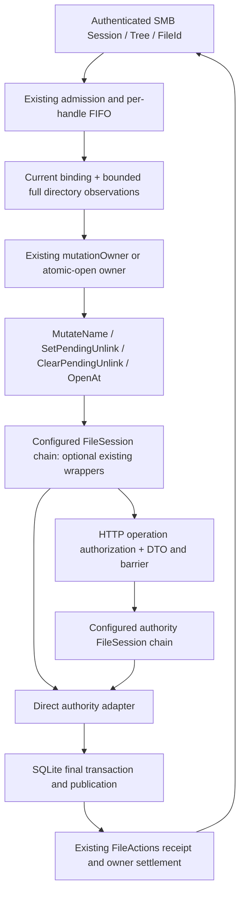

# Agent Note: SMB 受完整路径保护的名字修改

Status: proposed

## 问题

SMB 按 Windows 名字修改文件树，但已打开句柄绑定的是对象。其它入口可以在观察与提交之间改名、移动祖先目录、替换末级名字，或改变 Windows 属性。只保存打开时的路径、只检查末级 raw slot，都会让操作越过原 share 根或触碰同名替代物。响应丢失后重新观察当前路径，也不能证明原动作是否已执行。

本提案落实 [Windows 网络驱动器总方案](2026-09-16-windows-network-drive-support.md)的 8.1，使用 [有界原子打开](../../implemented/feature/2026-09-28-smb-bounded-create-close.md)、[目录枚举](../../implemented/feature/2026-09-28-smb-directory-enumeration.md)与[关闭删除义务](../../implemented/feature/2026-09-28-smb-close-delete-obligation.md)已经提供的对象、观察、保护和结算机制。依据 [R-FS-6、R-FS-8、R-FS-9、R-WIN-2、R-WIN-4–7](../../../../docs/spec/requirements.md)，交付必须同时保持身份、完整名字验证、原子效果和未知结果责任。

调研基线为 `1aeef7b50d20c0bcc81764106c59775cd2e9ddc9`。已有实现与 Microsoft 协议的证据链见[复用调研](../../../../docs/research/2026-10-13-smb-name-mutation-reuse.md)。这里描述待实现方案；当前代码行为仍由 implemented 决定和 design 拥有。

## 提案

### 交付范围

| 项目 | 分类 | 8.1 的交付与约束 |
|---|---|---|
| rename、跨目录 move、覆盖目标 | 功能与保证 | 支持普通 `FileRenameInformation`，在现有 `MutateName` 内核对完整源／目标观察；目录在任一后代仍有 authority-retained 引用时拒绝。 |
| 文件／空目录删除 | 功能与保证 | 原生入口通过普通 disposition 与现有关闭流程删除；中立 `NameRemove`／`NameRemoveDir` 同时支持 guarded 命令，保持其它入口的调用链。 |
| 普通 disposition TRUE／FALSE | 功能 | 使用已有 `SetPendingUnlink`／`ClearPendingUnlink`；普通状态与 CloseIntent 分账。 |
| `FILE_SUPERSEDE` | 功能与保证 | 使用 `ResetContent` 原子打开，在原对象内提交内容与 Windows metadata，返回新的 per-open FileId。 |
| 查询当前名字 | 功能 | 使用 remote-compatible 信息类查询对象当前关联和完整、有界 ancestry，不返回打开时路径。 |
| 全路径证明、共享排序、metadata CAS、动作回执 | 保证 | 在最终 authority 效果点核对；失败无部分效果，Unknown 保留原 payload。 |
| 范围 LOCK／CANCEL | 延期功能 | 由 [8.2](2026-09-28-smb-range-lock-cancel.md)接入已有 RangeControl；本任务保留现有受保护内容效果检查。 |
| 原生 WNet 与 Windows 11 资格 | 延期功能与证明 | 由 [9](2026-09-28-smb-native-wnet-fixture.md)与 [10](2026-09-28-smb-native-qualification.md)取得目标系统证据；Windows Server CI 的原生操作不能替代该矩阵。 |
| CHANGE_NOTIFY 与缓存失效 | 延期功能 | 由 [8.3](2026-09-28-smb-change-notify-cache-coherence.md)消费现有旧／新 location 事件；不能新增独立名字事件流或在本任务声称缓存一致性已完成。 |
| Ex rename／disposition、POSIX、IGNORE_READONLY、ADS、hard link、reparse | 排除能力 | 请求在效果前明确 unsupported；普通 class 10 的保留字节不解释成这些 flag。 |

8.1 保持一个独立提案、一个单一目的的实现 PR：让 SMB 名字效果经现有中立接口完成。实现阶段同步相关 design、testing 与 implemented note，不把后续锁、通知或控制器机制放入此 PR。

### 复用清单与真实缺口

| 已有机制 | 使用方式 | 需要扩展的合同 |
|---|---|---|
| `NamespaceAccess.MutateName`、`NameCommand`、`RenameTarget` | FUSE、HTTP、直接 adapter、wrappers 继续走同一入口。 | 为 `NameCommand` 增加 `Guards *NamespaceGuards` 表示路径 union，及仅用于 rename 的 `RequireNoOpenDescendants bool` 接纳条件。 |
| 已有 native pins、fileDomain、nameObservationHeader | 核对同一 volume 的所有保留后代引用，沿当前 association 向上追踪。 | 将原 coordinator.pins 按 volume 嵌套分组，复用 fileDomain 的 MaxRetainedFiles 引用额度与 Store 的 MaxIntegrityRecords 工作预算；无第二引用 registry。 |
| `ChildCondition.ExpectedMetadata` | 源、已存在目标的 Windows 属性检查使用现有 opaque CAS。 | 无新 metadata condition 字段。 |
| `NamespaceGuards`、`checkNamespaceGuards` | 同一个有界图包含共同祖先、两个分支和终端 child edge。 | 私有 command coverage 校验、可信 root 绑定、在名字效果事务内调用。 |
| `ReferenceNameObserver.ObserveName`、`DirectoryMetadataObserver`、`ListResult` | 从原引用的当前关联向上构造源证据；目标复用 `resolveCreateName`。 | 提取现有列表预算 helper；向上遍历使用独立的 identity cycle 检查。 |
| `ResetContent`、`Initial.OnReset`、`OpenOutcome.Reset` | 完成 supersede 的原对象重置与初始字段更新。 | `OpenAtOptions.ResetUse` 区分写用途重置和删除用途重置。 |
| `DeleteIntent.SetPendingUnlink`／`ClearPendingUnlink` | 原引用、当前唯一关联、DeleteName 及目录为空核对保持原样。 | `StateScalars` 暴露有界 generation；CLEAR 支持显式“当前无 pending”CAS 和授权后的 no-op。 |
| `mutationOwner`、`h.pendingWrite`、FIFO、FileActions、MutationBarrier | 名字／pending 动作沿现有写入责任链结算。 | 私有命令 union 与结果验证；保持 WriteOwnerID／Status 诊断。 |
| 原子打开 owner、CloseWithResult、CloseIntent | supersede 引用接纳、失败清理与关闭删除继续复用。 | 增加 reset effect 的用途选择与 CREATE outcome 投影。 |
| `recordRenamed`、`recordRemoved`、`recordNamedChanged` | 保留中立对象 ID、旧／新 location 和动作关系。 | 无新 change feed、关联 ID 或持久表。 |

双侧 `SourceGuards`／`DestinationGuards`、独立 `GuardedNameMutator`、`SupersedeFile`／`OnSupersede`／`Superseded`、SMB 专用关联表与新的恢复 registry 都不进入接口。它们分别重复既有 guard 图、mutation 入口、reset 效果、唯一对象关联和 owner／receipt 链。

### 分层与调用链



locked／limited／replicated 按实际调用方或 authority 的 backend 配置参与 FileSession 链；图不要求固定 wrapper 嵌套或顺序。SMB 解码、Windows 属性与大小写规则留在 `packages/smb`。远端只接收 raw 名字、NodeID、neutral uses、opaque metadata、版本和动作 ID。HTTP 对每个新外部动作执行当前授权；已接纳固定效果的内部完成遵守现有 publication／cleanup 合同。SQLite 不解释 Windows 位或 NTSTATUS。

所有观察在有效 session、tree incarnation 和原引用下进行；每次真实远端访问使用已有 Authorize。准入后还要再次核对身份。授权拒绝、Malformed、资源不足和不支持均在效果前结束；观察结果不能替代效果点的共享、身份及版本检查。

### 中立命令形状

```go
// Guards binds namespace observations; RequireNoOpenDescendants selects rename admission.
type NameCommand struct {
    Kind NameOperation
    Action FileActionID
    Name ChildName
    Target ChildCondition
    Destination *RenameTarget
    Initial InitialFields
    Uses []TargetUse
    Guards *NamespaceGuards
    RequireNoOpenDescendants bool
}

// ResetUse selects the authorization use of a ResetContent effect.
type OpenAtOptions struct {
    ResetUse Uses
}
```

`RequireNoOpenDescendants` 只允许 NameRename；SMB source directory rename 设置 true，FUSE／已有 raw-name 调用默认 false。该 flag 与 Guards、action 一同进入 clone、DTO、canonical digest、wrappers 与最终 authority，不能丢弃或在 host 提前扫描代替。`Guards == nil` 保持已有 raw-name 调用语义。SMB 的名字效果必须提供非 nil、可信 root 的完整证据；缺少 capability 时明确不支持，不通过无 guards 请求继续。无需给 wrappers 增加第二 capability，已有 `CheckNamespaceAccess`／透传链承担扩展后的命令。

`ResetUse == 0` 是既有 normal WriteData reset；非零只接受 `DeleteName`，且仅允许 `Existing == ResetContent`、`Target == SameNode`、`Create == false`、`Use.Uses` 包含 DeleteName。其它组合为 EINVAL／EACCES。normal reset 继续要求真实 Write；DeleteName reset 可 `Write == false`，其返回引用的 Read／Write 仍完全来自实际 granted data access。

### 合并 guards 的结构与 authority 校验

`NamespaceGuards` 已支持 rooted ancestry 图。合并两侧时按 ParentID 去重 directory observation、按 exact `(ParentID, RawLeaf, ChildID)` 去重 edge。共同节点必须 revision 完全相同；同一 child 的父边或同一 raw slot 的绑定矛盾立即冲突。保留 resolver 已产出的终端 child edge；它可能指向普通文件，不能要求每条 edge 的 child 都有 directory observation。

一个名字命令只有一个总预算：最多 256 个 directories、256 个 edges、64 KiB guard bytes，同时受现有 SMB／HTTP 请求字节上限约束。两条各自合法的路径合并后超限也必须失败。共享前缀只记一次，不通过丢弃前缀、叶边或 metadata 条件缩短请求。

`NameCommand.Check()` 调用已有 `Guards.Check()`，再做私有 exact coverage 校验：

1. 非 nil guards 必须有非零 RootID；`Name.Parent` 和 rename 的 `Destination.Parent` 都必须是该根下已观察目录。
2. 图允许源／目标两个分支；每个所需父目录到 root 的路径完整、无环，每个路径目录都有唯一 revision。
3. `Target == SameNode` 时源末级 exact edge 对应 `Name.RawLeaf`／`Target.NodeID`；rename 的存在目标同样对应 `ObservedLeaf`／`Expected.NodeID`。
4. Absence 由目标父目录 revision 与 `ChildCondition.Absent` 表示，不伪造 child edge；`OutputLeaf` 仍由既有第三占用者检查保护。
5. 所有 directories／edges 必须属于命令实际路径和允许的终端绑定，拒绝无关分支、缺失目录、错终点与自选小子树。

结构校验不宣称 RootID 受信，也不宣称 revision 仍当前。SQLite 私有 helper 用 `s.root` 绑定真实 volume root，随后在 `prepareNamespaceMutation` 中调用 `checkNamespaceGuards`。现有先行 inspection 与最终 write transaction 都执行该准备函数；真正效果仍须在后者重验，不能依赖先行 inspection。

最终 write transaction 顺序为：root／coverage／revision／exact edges，源与目标 ChildCondition 和 metadata CAS，pending、DeleteName 与共享、目录 kind／空／防环、OutputLeaf 第三占用者，以及请求的无保留后代引用条件，最后原子写 entries、detach／对象回收、时间和现有事件。任何一步失败 rollback 为零名字效果。替换丢失旧对象关联，但其旧引用继续指向原对象，现有 pins／publication 负责最终回收。

`checkPendingNameTarget` 对 aggregate pending 一律返回 `ErrPendingDelete`。现有 DeleteName token 免除只用于合法引用的 I/O／清除状态，不允许凭它继续 rename／replace／unlink。现有 path API 已阻止 pending；关闭删除由自己的 native trigger／discard 路径完成，不依赖 `MutateName` 的 token 例外。

canonical digest 与克隆使用现有代码：在 objectstore 与 HTTP 各自的已有 canonical helper 中提取私有 `canonicalNamespaceGuards`，让 `canonicalChildSelection` 与 NameCommand 共用其排序、deep clone 和空值处理。NameCommand 的 Guards／RequireNoOpenDescendants、ResetUse 和 metadata 条件全部进入原动作 digest；同 ID 修改任一字段都被拒绝，不新增动作种类或 replay 引擎。

### 从原句柄构造当前源名字

新私有 helper 使用原 `h.reference()`，不保存打开时 pathname，也不建立路径缓存或祖先引用集合。返回值拥有 `NameObservation`、源 Attr、`NamespaceGuards` 与 share-relative 当前名字；所有 raw bytes、revision 和 metadata token 在释放目录捕获前克隆。

1. 经已有 FIFO 与 `settlePendingFileIO` 接纳请求；调用 `ObserveName(ctx, nil)` 得到原 NodeID 当前 `Root`／`Linked`／`Detached` 状态。
2. Root 只能等于 tree 已固定 RootNodeID。名字修改拒绝 root；名字查询按 root 的投影规则处理。Detached 的名字修改明确失败，查询不能生成旧路径或借用同名替代物。
3. Linked 状态用 ParentID 调用 `ObserveDirectoryMetadata`，设置 `IncludeName: true`，提供新建有界 `ListResult`。
4. 完整捕获先经过已有 `projectDirectory`，验证所有 sibling 的 UTF-8、Windows 可表示性与大小写唯一性，再精确查找观察的 raw leaf 和 NodeID。source Attr 来自这一真实完整捕获，metadata token 可用于 source 条件与 disposition TRUE 的 READONLY 检查。
5. 捕获给出该 parent 的 revision 与当前名字。将 descendant exact edge、parent observation 和必要 metadata 条件克隆到累计证据；释放整份 sibling 列表，再向上走 parent 的名字。
6. 用 identity visited set 检测真实 ancestry 环，到 tree 已固定 root 才完成；每一步检查 guards、目录／帧预算、取消与 session incarnation。到另一个 root、Detached parent 或未能完整投影立即失败。
7. 在 helper 返回任何名字／Attr／metadata 条件前，始终对原引用调用 `ObserveName(ctx, sourceGuards)`，并逐字段比较最终 binding 与初始 NodeID／state／parent／raw leaf。该调用在一个 authority capture 内验证整份 source guards；不一致立即 conflict，不能返回由不同历史时点拼出的路径。纯 class 48 查询和 disposition TRUE 的 metadata capture 也必须经过这一步。
8. rename 目标继续调用 `resolveCreateName`，按 share 根解释目标字符串；合并共同观察，再对原引用 `ObserveName(ctx, unionGuards)` 比较同一 binding，提交包含该 union 的 NameCommand。

向上遍历的父目录列表合法地包含已经走过的 child directory。现有 `newNameObservationResult` 的 forward path cycle 假设不能原样套用；把 entries 内存／名字投影预算提取成公共私有 helper，forward resolver 保留其祖先拒绝，upward helper 自己维护访问 identity。两种观察共用 ListResult accounting 和全目录 validation。

观察间存在竞争只导致 condition conflict；各捕获不必锁住祖先。pure query 由 helper 末尾 guarded ObserveName 的 capture 形成可验证的观察点，名字效果由最终 authority 事务重验 union 后才能产生。原动作被确证 NotExecuted 时，既有有限 condition retry 才能重新观察并分配新 action；结果 Unknown 时保持原证据和 action。

### rename、move 与 replacement

wire 在已有 `file_info.go` 解码 class 10 TYPE_2：ReplaceIfExists 为一字节 Boolean，任一非零值为 true；忽略七个 reserved 字节及合法 padding。验证固定头、counted UTF-16 长度、odd／empty／越界、RootDirectory 必须为零、目标不得以反斜线开头。不把 class 10 的保留字节理解为扩展 flags。

目标是 share-root-relative 名字，复用 `parseSMBPath`／Windows ordinal comparer；source 来自原句柄当前关联。必须有 DELETE granted access，远端 authorization 与 source／target 两向 share 检查照常执行。

| 条件 | SMB 边缘结果与中立提交 |
|---|---|
| 同父、exact 同 raw leaf | 验证权限、pending 和所有条件后成功 no-op；不制造 rename 事件。 |
| 只改变大小写 | `ObservedLeaf` 保持已存在 raw leaf，`OutputLeaf` 是请求 leaf；真实 rename 保留对象 ID。 |
| 不同已存在目标且 ReplaceIfExists 为 false | OBJECT_NAME_COLLISION，无效果。 |
| 目标目录或目标 READONLY | ACCESS_DENIED；目标 metadata CAS 保证准入后的属性变更不会穿透。 |
| source READONLY | 该位本身不禁止 ordinary rename；不把删除 disposition 的规则泛化至 rename。 |
| source／target／有关父目录 pending | DELETE_PENDING，无 token 豁免。 |
| 完整名字观察失败、源 Detached、根或祖先不匹配 | 返回真实失败；不重建名字、不报虚假的不存在。 |
| 目标相容旧句柄仍打开 | 按 R-FS-6／R-WIN-4 保留旧对象和旧引用；最终共享限制仍须允许 DeleteName。 |

SMB 预检的 Windows target-kind／READONLY 策略与中立 storage 的通用 rename 规则分开；Linux／SDK 可继续使用其 raw 名字与既有 kind 行为。最终 source／target ExpectedMetadata 固化各自 Windows 观察。跨目录 move 复用现有 `recordRenamed`，一动作携带旧／新 location；8.3 可分别投影源 REMOVED、目标 ADDED，同目录则 OLD_NAME／NEW_NAME。

本项目的相容旧目标引用保证比 MS-FSA class 10 的 opened-target 条件更强。该差异必须进入原生资格证据，不能把 Windows object-store 算法对 opened target 的约束描述成通用允许替换规则。

### 目录 rename 的后代打开检查

SMB directory rename／move 遵守 R-WIN-2 的后代引用禁令；source 自身的引用不属于后代，仍按 source DeleteName／共享限制检查。任一由 authority 保留的 descendant file／directory 引用即使允许 SHARE_DELETE 也阻止名字效果。它是接纳条件，不改变合法旧引用的对象身份，也不把相同策略加入 FUSE raw rename。

复用 native 已有 pins。在同一 databaseCoordinator 中把 `pins map[retainedNode]int` 改为 `pins map[volumeID]map[NodeID]count`，保留原 coordinator 生命周期；用私有 count／retain／release helpers 替换现有八处生产接纳、释放、unlink／物理回收访问，最后实际结算释放后删除空 volume group。Store 继续共享原 fileDomain 的引用额度与同一 commit gate；原 pins 是唯一引用清单，不能维护另一份 subtree-open map、index 或 counter。metadata-only／Use=0 引用、effect 已不确定的返回引用，以及尚未确认释放的 close pin 都计入；只有现有最终释放路径实际移除的 pin 才消失。

`prepareNamespaceMutation` 对 RequireNoOpenDescendants 的检查在同一 coordinator.commit 与最终 write transaction 内执行，且位于 exact same-name no-op 的早退之前。先行 inspection 也使用该检查，但不能代替最终重验。检查算法为：

1. 只遍历 coordinator.pins 当前 volume group 中正数 pins 的 distinct NodeID；candidate 数由既有 fileDomain 的 MaxRetainedFiles 引用额度约束，不遍历其它 volume 的 pin 清单。
2. 排除 source NodeID 本身。其余 candidate 用已有 `nameObservationHeader` 读取 kind、Detached 与当前唯一 parent association；SQL 使用已有 entries_by_node 索引和 LIMIT 2，不装载 raw 名字。
3. 已校验的 Detached candidate 没有当前名字关联，不属于后代；只有完整验证 detach／零 association 后才忽略。missing／多 association／parent kind 或 volume 不正确均失败。
4. Linked candidate 沿 current parent NodeID 向上追踪；每一级复用同一 header validation，visited identity 检测环，合法路径终止于实际 s.root。任一步到 source 即确认 descendant，返回 EACCES，由 SMB 映射 STATUS_ACCESS_DENIED，零名字效果。
5. 同一调用的 candidate 与 ancestry header 工作量由已有 MaxIntegrityRecords 限制；扩展该 option 的用途说明。预算耗尽 EFBIG、I/O、取消或关联无法确认均真实失败，不解释为“无后代打开”。

pins 与原引用 grant／close 在同一 commit gate 排序，因此 effect 点不会遗漏接纳的新引用或把 Unknown close 推断为已关闭。将闭合状态用于该条件的替代 backend 必须满足扩展后的 NameCommand 合同；不能支持时明确 unsupported，不能降级为 SMB host-local subtree 扫描。仅 flag=false 的已有 raw 调用保持原行为。

### 当前名字查询

SMB 3.1.1 支持 `FileNormalizedNameInformation`（class 48）。直接 remote `FileNameInformation`（class 9）按 MS-FSA 返回 STATUS_NOT_SUPPORTED；不通过增加 FileAllInformation 或新的 consistent-state API 扩大本任务。class 48 使用上述 fresh helper，由原 NodeID 当前祖先关系构造 share-relative 名字，包含 leading backslash，以 backslash 分隔，trusted root 返回单个 backslash。

wire body 是 uint32LE FileNameLength（完整名字的真实字节数）后接 counted UTF-16LE，无终止 NUL。OutputBufferLength < 8 返回 INFO_LENGTH_MISMATCH，沿既有 SMB 3.1.1 error context 编码。否则名字完整可容纳时成功；不足时 FileNameLength 仍为完整值，只返回能容纳的 even-byte UTF-16 prefix，ByteCount 为 `4 + prefixBytes`，状态 BUFFER_OVERFLOW。不得把 FileNameLength 改成截断长度。

在现有 QUERY_INFO router／`file_info.go` 加 class 48 与 encoder，`connection.responseBudget` 在 compound frame 接纳前为 variable QUERY_INFO 48 按 OutputBufferLength、MaxFrameBytes 和 alignment 预留真实上限；不能依赖现有固定 128-byte File QUERY_INFO 预算。`relatedOperationFailed` 识别并验证 class 48 的合法 BUFFER_OVERFLOW warning envelope，使其后 related CLOSE 正常执行。名字 capture 还受 retained name budget 约束；所有观察失败和响应结束均释放 capture／response reservation。

名字 observation 仅授予已有引用的名字事实，不授予 ReadMetadata；沿既有 ReferenceNameObserver 和目录观察分别执行当前业务授权。known Detached 明确 INVALID_PARAMETER；不可达／无法确认是 I/O error。unsupported observer、异常祖先或完整名字验证失败不能返回开时名字、空字符串或替代物名字作为成功。

### 普通 disposition 与 generation

class 13 `FileDispositionInformation` 的 buffer 长度为零时返回 INFO_LENGTH_MISMATCH；长度至少一字节时只解码首个 Boolean：零 false，非零 true，surplus bytes 忽略，不解释为 Ex flags。TRUE 与 FALSE 都要求原 FileId 的 DELETE granted access、当前业务授权与 live DeleteName use。FALSE 不能仅依据 host 缓存返回成功。

TRUE 复用当前 `PendingUnlinkCommand{Action, Condition, ExpectedMetadata, Uses}`。source Attr 可从上面的有界父目录捕获得到；SMB 解码 READONLY，拒绝为真；目录选择 `UnlinkIfEmpty`。metadata token 加入已有 ExpectedMetadata，最终 retained-reference 事务继续检查 NodeID、当前唯一关联、metadata CAS、DeleteName／共享与目录为空。

普通 SET 不新增 Guards 或 Selection 字段：它根据已有引用改变原对象当前关联的 disposition，不按调用方旧 pathname 重新选择对象。原引用 NodeID 和 native 事务内唯一 entry 检查已经阻止替代物。名字图属于 NameCommand 的按名修改证明；两者的对象选择和最终条件不同。

`StateScalars` 包含 identity、kind、size、allocation、Detached、aggregate PendingUnlink，以及已有的有界 PendingGeneration。token 长度保持 MaxObservationTokenBytes（64 bytes），无新 State projection；scalar 仍不含 opaque metadata、时间或 LinkTarget，也不授予 DELETE／ReadMetadata。同步 native／objectstore／wrappers、HTTP DTO、CheckProjection、预算预检与 result clone。这里的 scalar 隐私与预算合同仅适用于 `State(StateScalars)`。SET／CLEAR 的现有 native FULL mutation result、完整 Attr／metadata／LinkTarget、预算和 receipt 保持原合同；完整结果超过既有预算时可能失败，不能宣称这两个 mutation 只返回 scalar 或完全不触及 opaque metadata。更广泛的 mutation result projection／隐私改造作为独立跟进；其延期成本是新增结果 projection、调用方与 receipt／预算同步，不改变本任务已存在的结果字段。

`pending_generation` 是已有 ordinary／DOC 共用的状态计数器。保留 DOC trigger 和 startup classification 的现有 aggregate false→true 增量；ordinary SET 另按 ordinary 位的 false→true 增加，即使 DOC 已使 aggregate pending 为真也增加。重复 ordinary TRUE 与 CLEAR 不额外增加；后续 ordinary false→true 必须取得新 token，旧 token 不能清除新的 ordinary episode。

调研基线的 activateExplicitPendingUnlink 用 aggregate pending 判断增量，因此 DOC 持续 pending 时 ordinary clear／set 可复用旧 token，形成 ABA。本任务把 ordinary 激活条件改为 ordinary 位；不删除 DOC 的计数调用，不新增第二个 generation 字段或 ledger。

CLEAR 继续使用 `ClearPendingUnlinkCommand{Action, Generation, Uses}`：

| 观察／最终状态 | CLEAR 结果 |
|---|---|
| 当前 aggregate pending，Generation 与当前 token 匹配，ordinary true | 原子清 ordinary 位；generation 保持；其它 CloseIntent 仍保留。 |
| 当前 token 匹配，ordinary false、仅 CloseIntent pending | 授权／DeleteName 检查后成功 no-op；不改 `delete_intents`。 |
| 观察 aggregate false，Generation nil，最终仍 aggregate false | 将 nil 定义为显式无 pending CAS；经同一 RPC／action／native 授权后成功 no-op。 |
| token 改变或 nil 期望与最终 aggregate pending 不符 | `ErrConditionConflict`，无效果；只有绑定原动作的 NotExecuted 才允许重观察。 |

放宽已有 `ClearPendingUnlinkCommand.Check()` 对空 token 的拒绝，保持 64-byte 上限。nil 表示明确无 aggregate pending 条件；HTTP 的 Generation 字段仍必填，canonical 空字符串是唯一空 token 表示，遗漏／null 仍拒绝。仍执行实际 backend CLEAR 授权和 `runFileAction`。native 按 live ownership／publication、DeleteUse／共享、aggregate token 与 ordinary 位的顺序核对，逐字节比较 token 后决定效果。

匹配且 ordinary false 时复用现有 `mutatePlannedTransactionLocked` 的 `mutate=false` 分支，返回有界 state 并执行 CheckFilePublication；不更新 event、ChangeTime、quota、generation 或 strong publication。真正清 ordinary true 仍使用原 SetAttrMutation。不能为了“已经 false”跳过远端 CLEAR，也不能用普通 clear 取消已接纳 DOC。

TRUE 检查 READONLY 和目录为空，分别投影 CANNOT_DELETE 与 DIRECTORY_NOT_EMPTY；FALSE 不执行这两项检查。普通状态清除只影响 nodes 的 ordinary pending；CloseIntent 查询、ACK、触发、失败重试与耐久性仍由 7.6 的原 ledger 完成。

最后相关引用关闭后，现有 native close／discard 路径按 NodeID 与关联执行删除和对象回收；SMB 不额外调用按旧名字 unlink，也不为 ordinary disposition 新增 durable intent 或 recovery session。

### FILE_SUPERSEDE 复用原子 reset

既有 `ResetContent` 已在一个 guarded OpenAt 事务中清主内容、应用 `Initial.OnReset`、记录变更并返回 `OpenOutcome.Reset`。缺口是 reset 固定要求 WriteData，而 supersede 的内容效果依靠 DeleteName；它不能改变返回引用的 data access。

在现有 CREATE intent 中记录 reset use。overwrite／overwrite-if 仍使用 `ResetUse == 0`；supersede 使用 DeleteName。不可从 `Use.Uses` 是否含 DeleteName 推断模式，因为 ordinary overwrite 也可能请求 DELETE。

1. disposition 0 先完成既有目标观察并固定分支。不存在目标使用 `Target.Absent`、`Create=true`、`Existing=Keep`、`ResetUse=0` 与 `Initial.OnCreate`，只使用普通 create 的 incoming rights／authorization；存在普通文件使用 `Target.SameNode`／ExpectedMetadata、`Create=false`、`ResetContent`、`ResetUse=DeleteName`。
2. 仅存在分支在已有 `normalizeAccess` 上增加有效 DELETE、WRITE_ATTRIBUTES、WRITE_EA，使 metadataUse 包含 WriteMetadata；不要求客户端显式请求 DELETE 才能 supersede。实际 READ／WRITE／APPEND data rights 原样保持，不增加 ReadMetadata。DOC 仍独立要求 incoming 显式 DELETE。不存在分支不因为 disposition 0 额外要求 DeleteName 或 removal 授权。
3. 存在分支即使 metadata-only 也必须进入 `AtomicFileOpener.OpenAt`；返回 File 的 Read／Write 来自实际 data rights，未授予的 READ／WRITE 继续 EBADF。不存在分支有 data rights 时走 AtomicFileOpener；无 data rights 时复用现有 regular `NodeReferences.OpenChildRef`、Create／TargetAbsent／OnCreate，它支持 Use=0／MetadataAccess=0 并返回 Created。不放宽 ordinary AtomicOpen 的无 data grant 校验。
4. SMB 计算完整 OnReset Windows metadata：请求属性替换支持的旧可设置位，强制 ARCHIVE，NORMAL 派生；已有 HIDDEN／SYSTEM 必须在请求中包含，否则效果前 ACCESS_DENIED。保留 BirthTime、AccessTime、其它 namespace，原子更新 ModTime／ChangeTime。
5. source READONLY 的现有访问检查仍按实际 DesiredAccess WriteData／AppendData 与 DOC 执行；不把 DELETE-only supersede 无条件拒绝。DOC 的旧／结果 READONLY 条件仍由现有接纳逻辑核对。
6. SQLite 的现有私有 `volumeIntent` 携带 reset effect use。DeleteName 分支以 `CheckUse(DeleteName)` 校验；不能向只接受 data use 的 `CheckIO` 传 DeleteName。normal reset 保持既有 WriteData 检查。
7. reset 仍是 `WriteMutation`：保留现有 quota、strong lock、publication、内容重置、错误 accounting 和保护排序。明确的 effect use 在既有 `checkContentPublication` 路径传递，不能借 reset use 绕过其它保护。
8. 成功仍返回 `Reset` 和同一 Attr.ID。SMB 只有原 CREATE disposition 为 supersede 时把 Reset 投影成 FILE_SUPERSEDED；overwrite 的同一 Reset 仍投影 FILE_OVERWRITTEN。每次新打开有新 SMB FileId，旧相容句柄保持对象 ID 和真实内容。

`OpenAccess.Write` 仍表示实际字节访问；`OpenAccess.Truncate` 表示 reset 固定效果。HTTP 对 DeleteName reset 补充已有 `OpVolumeRemove`，并复用 OnReset 引起的 SetAttr／SetMetadata 授权。SMB 的授权请求同样描述实际 effects；业务策略不会把 DELETE-only Supersede 误认为普通读写句柄。

分支与 effective rights 固定进入原 action payload；存在性在效果前改变时 condition conflict、零效果，只有绑定原动作的 NotExecuted 才允许重观察、新 action 和新分支授权。效果前继续预留 FileId、open owner、initial metadata 与响应额度。返回引用即使伴错误也交给既有 open owner 清理。丢响应沿既有 atomic-open receipt／CloseWithResult 链核对；不能先截断再另开引用或发第二次 metadata 动作。

仅新增 FILE_SUPERSEDE 模式在既有 context shape 验证后、任何效果前拒绝非零 AlSi，返回 STATUS_NOT_SUPPORTED；无 AlSi 或零值无需额外 allocation，继续处理。不因零 context 的存在而拒绝。其它 CREATE 模式的已有 allocation gap 保留独立跟进，本任务不增加 allocator，不把忽略的 reservation 记作已授予。

### 统一 mutation owner 和结算

扩展现有私有 `mutationOwner` 的 command 为封闭 union：FileMutation、NameCommand、PendingUnlinkCommand、ClearPendingUnlinkCommand，恰好一个 variant。reserve 阶段验证各具体 variant、deep clone action／payload，按真实 variant 计算保留字节；既有 data mutation 的 tests 与诊断继续适用。

首次 payload charge 不覆盖后续可变 ancestry。原 action 确证 NotExecuted 后，重观察先使用已有 bounded directory capture 的 staging／entry reservations；得到 fresh command 尺寸后，在任何 deep clone、安装或新 dispatch 前，调用既有 writeLedger 上新增的私有原子 charge-adjustment helper。它在 ledger mutex 下按原 owner 的 export 与 server 总计检查 MaxRetainedWriteBytes，暂时预留 `oldPayloadBytes + freshOwnedPayloadBytes` 的同时保留峰值，不创建第二 owner／registry。

预留成功才 clone、替换 command 和 action，释放旧 payload 后把 charge 降到 fresh 大小。预算不足则不 clone、不装新 action、不 dispatch，恢复原 owner charge，保留原 NotExecuted diagnostic 并报告资源错误。clone／mint／安装失败同样回滚临时 charge 和 staged observation；所有后续 releasePayload 沿调整后的 record.payloadBytes 精确归还。观察 builder、旧 payload、fresh clone 的并存分别由现有 capture 与 ledger 额度覆盖，不能以最终 payload 较小掩盖过渡峰值。

dispatch 根据 variant 调用原 File／Session capability；reconcile 使用现有 FileActions／QueryAction 与 HTTP MutationBarrier。验证 NameResult 的 Attr、ReferenceState 的 identity／kind／projection 等具体结果后，转换为 owner 既有 captured Attr signature 和 settled 状态。NameRemove 的无 Attr 合法结果按具体合同处理，不伪造节点属性。

调用序列保持已有 per-handle FIFO：前一 Unknown owner 必须先结算；后续动作不能用当前名字替代它。新动作接纳、日志、首次 dispatch、确定结果、Unknown、condition conflict、参考释放与 adapter settlement 复用现有 owner transitions。

| 结果 | owner 处理 |
|---|---|
| Committed，回执身份／operation／结果匹配 | 保存原动作结果、释放可释放 payload；向应用报告已确认效果。 |
| 绑定原 Action／operation 的 NotExecuted | 才可有限次重观察、生成新 action；旧动作结果保留诊断。 |
| Unknown、响应丢失、回执退休、查询不可达 | 应用得到 I/O 错误；原 action、原 payload、barrier 和 owner 保留；不自动执行新观察产生的动作。 |
| native Released，HTTP／wrapper 未 Settled | 继续保留 owner／barrier；不能把引用释放当成动作结算。 |
| Close／Session／export Stop | 现有 pendingWrite、HandleOwners 与 drain 路径共同报告未完成责任，quota 只按实际释放归还。 |

WriteOwnerID、WriteFailure、Status 与 HandleOwners 名称保持已有公开 API；这里的“write”诊断记录 authority mutation，具体 operation 已能区分名字／pending。无需增加 NameOwner registry、ReplayManager 或新 host ledger。

### 资源与现有可观测点

每个 owner 在效果前预留现有 MaxWriteOwners／MaxRetainedWriteBytes 额度；每次获准重观察都先重新计费并覆盖旧／新 payload 并存，完整 guards、opaque metadata 条件、raw names 与恢复 payload 都计入 retained bytes。source／target builder 复用 `reserveDirectoryCapture`／entry accounting／`releaseDirectoryBytes`，在开始 authority 调用前预留 HTTP staging 与本地 projection，在捕获结束后精确归还。一次观察只保留一份完整 sibling 列表与累计 guard／路径；release 列表后再访问上级，不能累积所有祖先完整目录。最大路径受 guard union、directory、frame 和 response budgets 同时约束。

使用 `Config.Logger` 与原 action／opaque owner／operation 相关字段记录接纳拒绝、dispatch、结果核对、Unknown、条件重试、close 释放与 adapter settlement。沿用 operation headers、WriteFailure／Status／HandleOwners 查询关联；不新增 telemetry registry。日志不含 credentials、内容、完整 raw 路径或 metadata payload。

取消沿现有 request context／FIFO ticket 释放：dispatch 前取消明确无效果，dispatch 后无法确认时保留原 owner。连接／会话／export 结束由已有 drain 与 authority-session owner 结算；查询与补充外部清理重新授权，已接纳固定效果及内层必要释放遵守现有责任合同。

### 目录结构与文件责任

```text
packages/smb/
  commands_file.go            CREATE / supersede access、OnReset 与 outcome
  commands_file_info.go       现有 QUERY_INFO / SET_INFO 接纳与路由
  connection.go              class 48 variable response 与 related warning
  write_diagnostics.go        既有 ledger 的私有原子 charge adjustment
  commands_name.go            新：rename / ordinary disposition 执行
  namespace.go               既有 forward resolve 与共享观察预算
  name_selection.go          新：原引用 current binding 向上观察及 union
  mutation_owner.go           现有责任链的私有 command union
  file_handles.go             保持 FIFO、pendingWrite、关闭与引用身份
  internal/wire/file_info.go  扩展 class 48 / 10 / 13 codec；class 9 仍不支持
packages/storage/
  capabilities.go            NameCommand.Guards / OpenAtOptions.ResetUse
  capability_validation.go   中立字段、预算与具体组合校验
  objectstore/file_actions.go 既有 canonical helper、digest 与 clone
  objectstore/capabilities.go 现有动作入口与 native 参数透传
  {locked,limited,replicated}/capabilities.go
                              现有 capability、guards、action 和结果透传
packages/transport/httprest/
  file_capability_wire.go     现有 DTO、canonical 与字段转换
  file_capability_json.go     字段白名单与结构／预算校验
  file_authorization.go      现有 operation 与实际 reset effect 授权
  file_capability_client.go   MutateNameWithBarrier 保留原 payload
  file_capability_server.go   同一 RPC 与既有 native capability 调用
  file_result_budget.go       scalar token 与返回前预算
packages/metastore/sqlite/
  namespace_guards.go         私有 command coverage 和可信 root 绑定
  namespace_mutations.go      最终 guards 检查与统一 pending 拒绝
  pending_unlink.go           shared generation、ordinary ABA 修复与 CLEAR CAS
  files.go / durable.go       同一 coordinator.pins 按 volume 分组与访问 helper
  options.go                 现有 retained-files / integrity 工作额度用途
  atomic_open.go              reset effect use 与原对象 OnReset
  publication.go             现有 WriteMutation 的 effect access 传递
```

新 SMB 文件只拆出名字的协议执行与观察职责；codec 扩展已有 file_info，不建立第二个 `set_info.go`。现有 FUSE Rename／Unlink 调用点无需换 API；HTTP op、metastore interface、schema 和 wrapper capability 集合保持原有形状。所有实际字段变化沿上述 DTO、native、canonical 与 tests 同步传递。

实施的源代码层次依次为：中立字段与验证 → authority 最终效果与 publication → 直接／HTTP／wrapper 透传 → SMB 观察与 owner → wire／CREATE／信息路由 → fixtures／错误验证／同次 design 和 note 同步。顺序用于保证依赖完整，不拆成独立的未交付子机制 PR。

## 备选方案

**独立 GuardedNameMutator 与两组 guards。** 两组证据会重复共同 ancestry，带来两套预算及共同 revision 一致性规则；独立入口还使 HTTP／wrappers／FUSE 的 mutation 与恢复链并行。现有 rooted guard 图已经能表示两个分支，因此选择 NameCommand 的单个 union 字段。

**先完整 lookup，再调用现有无 guards mutation。** 任意祖先或末级 raw slot 都可能在两次请求间改变；末级 ChildCondition 无法证明仍位于已观察 share 根。完整证明必须到最终效果事务。

**路径缓存或祖先引用链。** 打开时路径不能描述当前关联；额外引用既不冻结名字也增加 close、quota 和 Unknown 责任。当前 ReferenceNameObserver 与 IncludeName 捕获已能提供有界证据，因此选择短生命 capture。

**独立 SupersedeFile、OnSupersede 和 Superseded。** 它们重复 ResetContent 的原对象重置、OnReset 的字段写集、Reset 的结果和 atomic-open receipt。唯一真正不同的是效果用途；ResetUse 表达该差异，Windows outcome 留在边缘。

**给 supersede 伪造 WriteData／Write。** 这会让 DELETE-only handle 获得额外字节能力，且 deny-write／allow-delete 旧引用被错误拒绝。选择把数据 grant 与 reset effect use 分开。

**为 ordinary disposition 增加 ancestry guards、独立 ledger 或每请求 generation。** SET 绑定既有引用和当前唯一关联，不需按旧路径重新选择对象；现有 authority 事务足够检查关联和 metadata。每个 TRUE／CLEAR 增加 generation 会改变状态 episode 语义并制造无状态变化的 CAS 冲突；选择既有 ordinary false→true token 与独立 CloseIntent。

**仅在 host 看到 false 后返回 CLEAR 成功。** 它跳过远端 CLEAR 的当前授权和效果排序，观察后发生 pending 也不会被 CAS 拒绝。选择 nil 明确无 pending 条件，经同一动作到 authority 验证。

**将原 pins 归属 fileDomain。** 同样能避免重复引用清单，但改变原 coordinator 的生命周期归属，需连带证明 fileDomain 退役与物理回收。按 volume 嵌套原 coordinator.pins 只改变组织方式，保留原责任生命周期，因此选择后者。

**允许已打开 descendant 的目录 rename。** 仅检查 source DeleteName／共享可复用对象级接纳且无需 pins 按 volume 分组与 bounded ancestry 工作，但偏离 MS-FSA 的目录 rename MUST 拒绝规则。descendant SHARE_DELETE 相容不豁免该禁令，故选择在已有 pins 上加入最终事务接纳条件。

**只交付 rename，延后 pending 或 supersede；或把锁／通知一并交付。** 更小范围仍留下普通删除和原对象重置不完整，无法完成 8.1 已规定的名字能力；更大范围同时引入 async lock 和客户端缓存证明，增加独立行为审查负担。选择既定 8.1，后续各有自己的 proposal 与验收门。

## 验收标准

### 中立 authority 与跨入口

| 场景 | 验证结果与既有测试复用 |
|---|---|
| 任一源／目标祖先 rename、move、replacement、revision 变化 | 最终事务拒绝旧 union，零名字效果；在 SQLite guarded-open／namespace fixtures 和真实 localstore 上覆盖。 |
| wrong root、缺 segment、错 endpoint、无关 branch、矛盾共享 revision、terminal file edge | coverage 校验明确拒绝或合法接纳，不误把文件 edge 当目录；supplied root 不能替代 s.root。 |
| 大小写双名、坏 UTF-8、Windows 不可表示 sibling、第三 output occupant | 全目录投影失败，不能漏项或选择任意对象；Linux／SDK raw 名字不被改写。 |
| 256 directories／edges、64 KiB union，恰好与超一项／一字节 | bounded Check、SMB／HTTP 请求和 retained owner accounting 全部一致；超限前零效果，释放后额度恢复。 |
| canonical 相同 guard 次序、同 ID 改 guard／metadata／ResetUse | 合法重排同 payload 可恢复；变更 payload 被原 action digest 拒绝。 |
| direct、HTTP、locked、limited、replicated、FUSE | 同一中立参数、错误、对象身份与 final transaction；FUSE 保持既有未带 guards raw 调用。 |
| pending source／target／parent，持有 DeleteName token | 所有名字 mutation 拒绝；既有 CloseIntent trigger／discard 清理仍能完成，不能形成 cleanup 死路。 |
| 目录 descendant file／directory 引用、metadata-only／Use=0／uncertain open-close、source 自身引用、validated Detached、跨 volume pins、exact same-name | 任一真实后代 pin 在最终事务拒绝且零效果，source 自身不计；Detached 校验后不计；其它 volume 不影响；无后代时 source sharing 仍核对，same-name 不绕过条件。 |
| descendant ancestry 环／多关联／损坏、MaxRetainedFiles／MaxIntegrityRecords 恰好与超限、concurrent grant／close／move | 完整 current-association 与 commit 排序；预算／I/O／取消真实失败，无 false absence，只有最终已释放 pin 消失；FUSE flag=false 原行为保持。 |
| 旧相容引用、replacement、detach、同名重建 | 原引用仍为原对象；replacement 新路径是另一 NodeID，旧关联不得重建或删除替代物。 |

### SMB 与状态生命周期

| 场景 | 必须观察到 |
|---|---|
| class 10 Boolean 0／1／255、reserved／padding、odd／empty／overflow UTF-16、RootDirectory／leading slash | 普通合法 wire 精确解析；非法输入与 Ex class 在 authority effects 前拒绝。 |
| exact no-op、case-only、same-dir、cross-dir、target exists、readonly source／target、目录 target | 对应状态与真实原子效果；对象 ID、time 和现有 old／new event 正确。 |
| 原引用父／祖先被交错移动，多个捕获可拼出从未存在的路径，向上列表包含已访问 child directory | helper 最后 guarded ObserveName 拒绝拼接路径；query／SET capture 也重验，合法当前路径不触发 forward cycle heuristic；无 ancestry refs 残留。 |
| class 48 current name、class 9 unsupported、root／Detached、OutputBufferLength 0–7／8／奇偶边界／恰好，signed related QUERY_INFO + CLOSE | INFO_LENGTH_MISMATCH context、真实全长和 even prefix、ByteCount／BUFFER_OVERFLOW 精确；长名无固定 128-byte underbudget；合法 warning 后 CLOSE 执行，malformed warning 不放行。 |
| FALSE 无 pending、DOC-only、ordinary true、token ABA、非原设置者 DELETE handle | 远端授权可撤销，same action 可恢复；no-op 经 authority 验证；只清 ordinary，不取消 DOC。 |
| ordinary false→true、重复 TRUE、CLEAR、DOC trigger／startup、DOC 持续 pending 下 clear／set／旧 token | 共用计数保留 DOC 增量，ordinary false→true 独立增加；旧 token 不清新 episode；TRUE 属性／空目录条件完整。 |
| State(StateScalars) generation 对 DELETE-only handle、巨量 opaque metadata；另测 SET／CLEAR FULL result 上限 | State 查询不依赖 StateFull、不授予 metadata permission、无 metadata/time/link；SET／CLEAR 沿已有 FULL result 与预算成功或真实失败，不声称 scalar mutation privacy。 |
| supersede existing implicit DELETE／metadata rights、missing Use=0 create、分支存在性竞争、DELETE-only、deny-write／allow-delete、deny-delete、mixed write+delete overwrite | ResetUse 不由 claim 猜测；分享矩阵使用真实 data grant；DELETE-only 返回引用不能 READ／WRITE。 |
| supersede 存在／不存在、metadata-only、HIDDEN／SYSTEM、READONLY／DOC、非零／零／无 AlSi、quota／strong／publication failure | 原对象 ID 与新 FileId，ARCHIVE／内容／ModTime／ChangeTime 一次提交，非 Windows metadata 和 Birth／Access 保持；任一失败零部分效果。 |
| 提交前、提交后丢响应，NotExecuted、Unknown、receipt 退休、释放但未 Settled | 查询／同 ID 同 payload 仅核对原动作；后来占据原名字的对象无影响；有限重观察仅由绑定原动作的 NotExecuted 驱动。 |
| 小 ancestry → NotExecuted → 大 ancestry retry，旧／fresh peak 恰好／超一字节；FIFO、close、stop、取消 | 安装／dispatch 前重计费；不足保留原 NotExecuted diagnostic，无新 action effect，临时 charge 精确归还；Unknown 原 owner／barrier 保留。 |

复用现有签名 SMB protocol harness、native Windows fixture、direct／HTTP／wrapper integration 与 mutation owner failure probes。native 目录 fixture 的 `ObserveDirectoryMetadata` 目前拒绝 IncludeName；扩展该已有 fixture 提供真实 current binding 与完整 capture，不另建简化 authority 模型。

Windows Server CI 原生测试记录真实 API、签名请求、实际 source／target NodeID、metadata、返回 status 与 action 结算；仅应用表象成功而没有本次 wire exchange 不算协议投影证明。Windows 11 Home／Pro × x64／ARM64、正式 WNet、跨机器缓存与最终资格仍由后续提案验收。

实施阶段运行覆盖实际 diff 的正常、race、错误、预算与 no-skip checks；检查 code、docs、canonical／DTO 透传与资源释放。设计调研不把未执行测试记为通过。

## 风险

目录 revision 是粗粒度条件，合法并发 sibling 修改也可能导致冲突；有限重观察只允许原动作明确未执行，不能以放宽完整性换取吞吐。双路径 union 深度与 raw names 可能超过已有预算，此时错误可见；不得削短证明。

替代 backend 必须履行扩展后的 MutateName／ResetContent／pending 合同；仅编译通过或声明 capability 不构成原子性证明。对缺少观察或最终验证能力的 backend，SMB 相应动作必须明确不支持。

MS-FSA 的 opened-target 与目录 descendant-open 接纳规则必须分清；目录的 bounded pins scan 必须保证跨入口接纳／关闭同一排序点，原 pins 分组不得改变 coordinator 生命周期、物理回收或 durable-close 责任，不能把 RequireNoOpenDescendants 默认传播到 FUSE。AlSi allocation 仍需独立能力／资格处理，不能从 content reset 成功推导 allocation reservation。

本任务交付 authority 名字效果与责任结算。Windows redirector 是否缓存当前名字、pending、metadata，以及名字通知如何使这些缓存失效，仍需 8.3 与 10 的原生证据；这里的 fresh QUERY_INFO 和事件不构成该发布资格。
