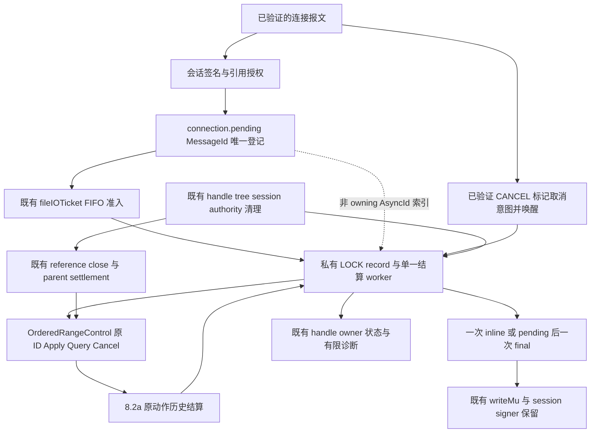

# Agent Note: 8.2b SMB LOCK/CANCEL 生命周期

Status: proposed

## 问题

一个等待中的 Windows 范围锁请求有两个独立结果：authority 是否取得或解除锁，以及客户端是否收到响应。CANCEL、授予、UNLOCK、关闭引用、会话过期和断线可能同时发生。把网络 context 的取消解释为“未取得锁”，会留下已经生效却无人清理的保护；把迟到的授予回执解释为当前持锁，又可能复活已经解除或随引用退休的状态。异步响应还必须在原 compound 缓冲区和会话响应生命周期结束后保留正确的请求身份、签名能力和 credit 记账。

当前 SMB endpoint 在 `commands_session.go` 的派发默认分支对 LOCK 返回 `STATUS_NOT_SUPPORTED`；`connection.go` 在正常 credit 准入前把 CANCEL 判为畸形连接。`pendingRequest.async`、`statusPending` 和最终 async header 分支已有形状，但没有 LOCK 将请求切入这条路径。CREATE 的原生待决 owner 用于恢复打开结果，不等于 SMB wire 已发送异步 pending。本提案针对尚未交付的 LOCK/CANCEL 生命周期。 这些边界见当前源码的[LOCK 派发](https://github.com/codetreker/remote-fs/blob/0d49a6a833bcb01f90d8ee5c56c2c93431ddb771/packages/smb/commands_session.go#L97-L131)、[唯一 pending 与 CANCEL 准入](https://github.com/codetreker/remote-fs/blob/0d49a6a833bcb01f90d8ee5c56c2c93431ddb771/packages/smb/connection.go#L41-L74)和[CANCEL 拒绝](https://github.com/codetreker/remote-fs/blob/0d49a6a833bcb01f90d8ee5c56c2c93431ddb771/packages/smb/connection.go#L212-L245)。

需求来源为 [requirements.md](../../../../docs/spec/requirements.md) 的 `R-FS-8`、`R-CC-14`、`R-WIN-6`、`R-WIN-9`、`R-WIN-10` 和 `R-ERR-1/2`。本提案依赖 [8.2a 有序范围动作](2026-09-28-ordered-range-actions.md) 的原生逐项结算、精确解除、跨入口排序和 reference owner 退休保证；沿用 [CREATE/CLOSE](../../implemented/feature/2026-09-28-smb-bounded-create-close.md)、[范围 I/O](../../implemented/feature/2026-09-28-smb-file-data-io.md) 的引用身份、准入和清理机制。它替代 [合并的范围锁与取消提案](../../rejected/feature/2026-09-28-smb-range-lock-cancel.md) 中 SMB wire 与生命周期部分；中立动作语义由 8.2a 拥有。

## 提案

SMB 层将 LOCK elements 映射为一个原生有序动作，复用已有 `RangeControl.Query/Cancel/Drop` 和同一 `LockRequestID` ledger。新增能力为可选的 `OrderedRangeControl`，提供能力检查和 `ApplyOrdered(ctx, UseOwner, OrderedRangeIntent{Rule: OrderedExactRanges, Commands: ...}, LockRequestID)`。接口的检查入口为 `CheckOrderedRangeControl`；receipt 的 rule discriminator 由 8.2a 定义，SMB 核对它与冻结的意图一致。协议身份、AsyncId、NTSTATUS 和 wire flags 只存在于 SMB 私有 record。

启用 LOCK 能力的 export 在发布新的普通文件 FileId 前，先在该已验证引用的 `UseScope` 上登记一个 `OwnerReference` 的 `UseOwner`。CREATE 沿现有 `authorizeOpen` 保留本次实际打开操作及其效果授权；对将调用的 `Scope` 和 `NewUseOwner`，在 CREATE 效果准入及实际调用前，分别以当前已认证 principal、可信 volume 经已有 `Config.Authorize` 检查 `OpFileScope` 和 `OpFileNewUseOwner`。取得 scope 后核对实际保留的 File/NodeReference、node ID、引用与 session/authority 身份，再登记 owner；发布 FileId 前仍通过现有 reserved reference 的身份与退休门禁。Scope 只标识已验证引用，不替代这些操作授权。登记失败使用现有 reserved handle 的 reference cleanup 收尾，不报告 CREATE 成功；登记回复未知也由这个原引用负责退休可能存在的 owner。同对象的不同 FileId 使用不同 owner，引用结束后不得复用。

既有 `ScopedReference.Scope`、`UseOwners.NewUseOwner` 和 `RangeControl` 已经分别表达引用作用域、持有者和动作身份；无需再建立 OwnerKey、对象全局锁列表、第二个 coordinator 或独立取消 journal。发布 LOCK 能力时必须沿 adapter 链验证 8.2a 的有序动作和引用退休能力，缺少能力则拒绝启用该能力，不能在 endpoint 用锁表替代跨入口保护。tree capability 检查沿原链补齐 UseOwners/RangeControl/OrderedRangeControl，普通文件使用实际持有的 File 或 NodeReference 核对 ScopedReference 并登记 owner；目录或非普通文件不登记范围 owner。

### 责任与数据流



`connection.pending[MessageId]` 是唯一 transport 登记。现有 `pendingRequest` 增加可选的 LOCK record；AsyncId map 只索引这个 record，不拥有 context、worker、额度或清理责任。会话和句柄可保存已登记 record 的引用以便退休遍历，不能另建相互独立的 pending owner。transport 登记移除后仍有未判定动作时，责任转交同一个 `fileHandle` 已预留且计费的 cleanup 记录，保留原 ID 和冻结意图。

一个 record 的私有字段分为以下几组。字段名表达实施责任，非新增公共 API：

| 字段组 | 类型与不可变内容 |
|---|---|
| 请求身份 | connection incarnation、原 `MessageId`、原 command、session/tree/FileId 及各自引用身份、compound index/最后位置、原 credit charge 与 credit request。 |
| 原生身份 | `FileSessionIdentityResult`、node ID、已验证 `UseScope`、该 FileId 的 `UseOwner`、当前 action epoch 生成的一次 `LockRequestID`。 |
| 冻结意图 | 拷贝的 `[]wire.LockElement`（包括原 offset/length/flags）、typed `OrderedRangeIntent`、首项类型、每项派生 ClaimID、请求时已验证的额度与 deadline。不能借用 signed packet backing array。 |
| authority 状态 | typed phase、最近一份校验通过且已复制的 `RangeAttempt`、取消/退休意图、绝对结算 deadline、下一次 Query 时间与分类原因。 |
| 响应状态 | typed phase、一次生成的 AsyncId、credit grant 是否已消费、interim/final 写 disposition、唯一 final claim、独立 response lease。 |
| 额度与唤醒 | pending slot、retained intent bytes、潜在 claim slot、cleanup/diagnostic reservation、合并唤醒通道、worker done。 |

扩展诊断时同步按字段和有限 record 数核算 `MaxDiagnosticBytes`，不能继续用现有每 handle 256-byte reservation 假定可保存任意个 range records。复制完成、所有额度已预留、record 已登记，并且会话响应 lease 已取得后，才允许调用 authority。结构畸形、签名失败、身份失效或额度不足在这个边界前拒绝。进入该边界后，失败必须保留已接纳动作的结算责任。

### LOCK 解码、授权与结果映射

wire decoder 按 [MS-SMB2 §2.2.26](https://learn.microsoft.com/en-us/openspecs/windows_protocols/ms-smb2/6178b960-48b6-4999-b589-669f88e9017d) 验证 StructureSize=48、LockCount≥1、完整 element 边界、frame 和 `storage.MaxRangeCommands` 上界；按 [element 规则](https://learn.microsoft.com/en-us/openspecs/windows_protocols/ms-smb2/73e941c7-9b07-42f6-8b0f-31c1a2cbf0b2) 忽略 Reserved。LockSequence 原字段复制并有界解析；本 endpoint 不提供 resilient/durable/persistent/multichannel sequence tracking，按 [§3.3.5.14](https://learn.microsoft.com/en-us/openspecs/windows_protocols/ms-smb2/a2f8b1cc-ebe0-4378-9da9-4e25de5c628f) 继续正常锁处理，不能因非零 sequence 预先拒绝。它保持原签名字节不变；整个 frame 的不可表示结构错误在效果前失败。

本 endpoint 选择严格 flags 校验：获取 flags 只能是 SHARED 或 EXCLUSIVE 二选一，再可带 FAIL_IMMEDIATELY；解除 flags 只能是 UNLOCK。其它位或组合不转换成一个合法动作：按原 element index 冻结可保存的明确非法 typed command，保留 `DomainEnforced`、范围与可确定的 edit class，固定 `Mode=255` 作为非法语义；class 本身不明确时 edit 也保持非法。raw flags 仍完整保留，重投不重新规范化。尤其 `UNLOCK|FAIL_IMMEDIATELY` 不得丢掉多余位后变成有效 RemoveMatching。各项 flags、范围、获取/解除类型和前缀停止语义交由冻结意图与 8.2a 的逐项执行承担，不能先用整批 `RangeCommand.Check` 抹掉原生应当保留的成功前缀。

非零长度映射为已有 `storage.Range{Kind: storage.Bytes, Start: offset, Length: length}`；长度为零映射为已有 `storage.Range{Kind: storage.Boundary, CutAt: offset}`。两者保持 `uint64`，不用 signed offset 截断。终点是否可表示按 8.2a 的逐项检查结算。

LOCK/UNLOCK 完成签名、身份和授权检查后，用原 handle 的 nodeKind 拒绝目录或非普通文件，返回 `STATUS_INVALID_PARAMETER`；不调用 ApplyOrdered 或登记范围 owner。普通文件即使只打开 DELETE/metadata 权限、h.file 为 nil，也用其实际持有的 scoped NodeReference 执行范围控制；LOCK/UNLOCK 不要求 READ_DATA/WRITE_DATA granted access，缺少实际 capability 仍按 capability 错误失败。LOCK 不增加数据读写权限。缺失或不匹配的 FileId 按 LOCK 专用规则返回 `STATUS_FILE_CLOSED`；未知 authority 结果仍返回 I/O 错误。获取命令的 `Claim` 保持空，由 authority 用原 request ID/index 派生；私有 record 可以保存同样派生的 ID 供记账校验。共享获取是 `AddExact/RangeShared/DomainEnforced`，策略为 `DenySelf=WriteData, DenyOthers=WriteData`；排他获取是 `AddExact/RangeExclusive/DomainEnforced`，策略为 `DenyOthers=ReadData|WriteData`。新 shared 可以与自身 exclusive 重叠；新 exclusive 与任何 owner 的 shared/exclusive 重叠都冲突，包括自己的已有 claim 与同批 draft 前缀。I/O 对自身 exclusive 的允许不等于另一次 exclusive LOCK 可以越过它。

UNLOCK 通过相同 owner 的 `RemoveMatching` 交给 8.2a：同坐标先选第一个自身 exclusive，否则选最后一个自身 shared，并在原动作 ledger 中冻结所选 `RemoveExact`。SMB 不预先在本地选 ClaimID。响应丢失后只能 Query 或安全重投同一个原动作，不能再次按坐标选择。

按 MS-SMB2 server 的范围处理政策及[客户端多范围要求](https://learn.microsoft.com/en-us/openspecs/windows_protocols/ms-smb2/06d42500-2ead-4659-8af2-86dcaec5286e)，首项为获取且 LockCount 大于一时，本 endpoint 采用服务器的严格 precheck：原始全部 LOCK elements 都必须带 `FAIL_IMMEDIATELY`，其中相反类型或其它语义非法的 element 也参与这个位检查。缺少该位在 submission 前以 `STATUS_INVALID_PARAMETER` 无效果失败。除了这个整数组位检查，不能提前拒绝语义后缀。8.2a 另在原生 element loop 前检查多项获取命令的 Wait，违规结算 `Rejected/RangeInvalid`、`FailedAt=nil`，没有 Effects/Claims/EverGranted；两层检查各自不产生获取前缀。可等待的获取只有单项 `AddExact`，因此 pending 没有未结算的获取前缀。首项选择获取或解除类；相反类型后项以该 index 的确定参数错误停止，按 8.2a 保留先前应当存活的效果。只有立即冲突获取按原生 rule 回滚本动作新取得的前缀，不能回滚其它动作或已成功的 UNLOCK。

| 已确认事实 | 原 LOCK 的 wire 结果 |
|---|---|
| `Granted`、取得后因后续解除成为 `Released`，或无失败且解除批次已确认 | `STATUS_SUCCESS`，LOCK response body。 |
| `Rejected/RangeBlocked`，立即失败获取 | `STATUS_LOCK_NOT_GRANTED`。 |
| `Rejected/RangeNotHeld` | `STATUS_RANGE_NOT_LOCKED`。 |
| 已验证 `RangeInvalid` 在有效 flags/edit 的失败项由正长度范围溢出造成 | `STATUS_INVALID_LOCK_RANGE`，保留结算前缀。 |
| 其它 `Rejected/RangeInvalid`、违反 element 类型或 flags 规则 | `STATUS_INVALID_PARAMETER`，保留原生允许的前缀。 |
| 确定的容量或批次上界拒绝 | `STATUS_INSUFFICIENT_RESOURCES`，仅明确无效果时回收 reservation。 |
| 确定能力缺失 | `STATUS_NOT_SUPPORTED`。 |
| `Cancelled` 且该单项未取得任何锁 | `STATUS_CANCELLED`。 |
| 无法确认动作结果、receipt 校验失败、查询窗口过期 | `STATUS_IO_DEVICE_ERROR`，引用隔离并保留原 owner。 |

等待冲突本身保持 pending；确认 `Rejected/RangeDeadlock` 返回 `STATUS_LOCK_NOT_GRANTED`；原动作 epoch 或历史过期仍按 I/O 错误处理并隔离引用。底层 transport error、`context.Canceled` 或通用 I/O errno 不得推断为 `RangeBlocked`、未执行或取消成功。所有响应发布前，先验明 rule、原 owner/request/intent、`FailedAt`、claim/effect 上限和结算形状。

[MS-FSA LOCK §2.1.5.8](https://learn.microsoft.com/en-us/openspecs/windows_protocols/ms-fsa/369103ec-a8af-452b-8006-aff07b925b61) 和 [UNLOCK §2.1.5.9](https://learn.microsoft.com/en-us/openspecs/windows_protocols/ms-fsa/84e68de6-31a6-4cba-afd4-00b1bac6d1a2) 要求正长度 end 溢出返回 `STATUS_INVALID_LOCK_RANGE`。SMB 在验证回执身份、意图、FailedAt 和前缀后，核对冻结的失败 raw element：只有 flags 与首项 edit class 均合法，且 `length != 0 && length-1 > MaxUint64-offset` 正是该项失败原因时，才覆盖中立 `RangeInvalid` 的 wire 状态。非法 flags、相反 edit class 的错误优先为 INVALID_PARAMETER；没有 FailedAt 或未触及后缀不得触发此覆盖。`offset=MaxUint64,length=1` 合法，length=2 才溢出。目录的无效果错误也来自这两节。

### authority 与响应的两个状态机

以下为拟采用的 SMB 私有类型；authority `Pending/Granted/...` 保持中立回执词汇，不与 wire 的 `STATUS_PENDING` 共用 enum：

```go
type lockAuthorityPhase uint8
const (
    lockRegistered lockAuthorityPhase = iota
    lockApplying
    lockReconciling
    lockKnown
    lockUnknown
)

type lockResponsePhase uint8
const (
    lockInlineCandidate lockResponsePhase = iota
    lockInlineChosen
    lockAsyncChosen
    lockInterimWriting
    lockInterimSent
    lockFinalWriting
    lockResponseDone
    lockTransportDead
)
```

`Registered` 表示身份、意图与 reservation 已冻结；`Applying` 表示唯一 worker 正在提交原动作；`Reconciling` 表示原生 pending、回复丢失或取消/退休意图需要同 ID 核对；`Known` 表示原动作的终态及历史 effects 已验证；`Unknown` 表示在规定期限内无法确认原动作，保留原 owner 和记录，并通过现有 handle fence/cleanup-only 状态拒绝该引用后续文件工作；CLOSE 和父级清理继续可达。一次 API 调用失败不会跳过 Reconciling 直接声称无效果。

单一有界 worker 独占 `ApplyOrdered/Query/Cancel` 调用与 authority 终态决策。CANCEL、timer、请求 context、close 和 session retirement 只设置意图并合并唤醒，不再各自启动取消 goroutine。worker 提交一次原动作，取得 Pending 或未知调用结果后按原 ID Query；所有 false-wait 获取都禁止原生 Pending；需要取消时用同 owner 和 ID Cancel，继续核对原结算。收到 `Granted` 后取消已经失败，live 引用保留锁并返回成功；后续解除使它成为 `Released` 时仍依据原成功结算响应，不恢复已解除的保护；收到 `Rejected` 后返回原拒绝，即使它记录了先前生效的 prefix；只有已确认的未授予 Cancelled 才映射取消。原生 `EverGranted` 只证明历史授予，不能选择 CANCEL 的 wire 结果。

Query 使用 min/max 之间递增的退避，取消/退休唤醒可以提前一次查询，不为重复 wake 延长绝对 deadline。单次 backend 调用取剩余 deadline 与现有 RequestTimeout/CleanupTimeout 的较小值。worker 的工作 context 与原网络 request context 分离，受当前授权、记录结算 deadline 和 cleanup 生命周期约束。请求 context 取消只使记录要求结算；它既不能杀死唯一结算者，也不能证明原动作取消。LOCK/UNLOCK 的初次 `ApplyOrdered` 和每次安全重投都须以当前 principal、可信 volume 检查 `OpFileRangeApply`；Query 与 Cancel 分别检查已有 `OpFileRangeQuery/OpFileRangeCancel`。每次调用还须核对原 owner 绑定的精确引用、session 和 authority 身份，Scope 或原动作 ID 均不能替代当前操作授权。权限撤销可以使这些新调用失败，却不消除既有动作与清理责任；引用/父级退休继续沿现有 cleanup 授权规则执行。重投只能是 8.2a 允许的同一 ID、同一 owner、同一逐字意图；它不生成新请求或新 claim。

record mutex 仅保护状态转移、意图和一次响应 claim。worker 在 mutex 外执行 backend 调用；writer 在 mutex 外等待 `writeMu`、签名和网络 I/O。关闭路径取快照后先释放连接、会话、tree、handle 和 record 的 admission/state mutex 再执行或等待清理，不因持锁等待长调用阻止 CANCEL 或关闭信号。

### inline、interim 与 final 的选择

Standalone LOCK 或 compound 最后一个 LOCK 可以转 async。短同步窗口截止点由 validated limits 提供，并受 `RequestTimeout` 限制；它只决定响应形式，不能充当 authority 动作 deadline。结果与 timer 在 record 中争取一次选择权：终态先获胜，`InlineCandidate → InlineChosen`，原 compound writer 编码一次同步结果；timer 先获胜，`InlineCandidate → AsyncChosen`，从此只能发送 interim 和相同 AsyncId 的 final。

选择 async 时一次分配连接内不复用的 AsyncId，并登记非 owning 索引。它是非零的 64-bit 值，不是 `MessageId+1` 的推算结果。record 在发送任何 interim 前持有 AsyncId、original MessageId、session 和独立 final response lease；compound 退休仅移除已完成同步 siblings，保留该 LOCK 的唯一 pending 登记和 final lease。以 AsyncChosen 为线性化点，授予即使在 interim 写之前或期间获胜，也只能排在 pending 后发送真实 final，不能改回 inline 或抑制已承诺的 pending。

writer 在短 state transition 后释放 record mutex，使用现有 `writeMu` 串行发送 frame。`AsyncChosen → InterimWriting → InterimSent → FinalWriting → Done` 只前进一次；final 必须等 interim 成功提交到 transport，保持同连接的发送顺序。interim 或 final 的任何写失败使该记录进入 `TransportDead`，封住后续网络写；authority 的已确认效果仍由原 handle 负责。部分写不能重发整个 pending/final 或重复 credit grant，连接随后关闭并进入清理。

按 [MS-SMB2 §3.3.4.2](https://learn.microsoft.com/en-us/openspecs/windows_protocols/ms-smb2/c1692ece-7c6d-45c8-a0e3-6b53c0483030)，interim 使用 async header、`STATUS_PENDING`、固定 AsyncId 和 SMB error body；按协议的 pending signing 建议发送未签名 interim，并清除 signed flag/signature。final 单独编码，使用同一 AsyncId、原 command/MessageId/session、真实 NTSTATUS 和正确 LOCK/error body；在 live transport 上按原已验证 session 的 signer 签名。final 的 lease 复用现有 [`session.retiringFrames` 的响应保留](https://github.com/codetreker/remote-fs/blob/0d49a6a833bcb01f90d8ee5c56c2c93431ddb771/packages/smb/connection.go#L629-L661)原则，增加区别于 compound frame 的私有 LOCK response 身份；原 compound frame 退休不能提前销毁 signer。只有 final 写 disposition 已确定，或 transport 已死亡无需再响应，才能释放这个 lease；不得为此保存裸 session key 或在另一处复制 signer。

普通 inline 的 credit grant 仍走 `grantCredits`。按 [MS-SMB2 §3.3.4.1.2](https://learn.microsoft.com/en-us/openspecs/windows_protocols/ms-smb2/46256e72-b361-4d73-ac7d-d47c04b32e4b)，async 请求的 charge 在原准入只消费一次；interim 从同一 credit window 申请并记录一次 grant，final 的 `CreditResponse` 固定为零。record 的 grant-consumed 位阻止 callback 重复记账；分配 grant 后写失败也不再次授予，连接被关闭。不能在普通 `process` 入口提前授予一次，再在 async interim 授予第二次。无论原调用返回多份 Query/Cancel 回执，record 都只有一个 final claim。

### CANCEL 准入

按 [MS-SMB2 §3.3.5.16](https://learn.microsoft.com/en-us/openspecs/windows_protocols/ms-smb2/57bae3d3-5dd7-4a5f-92cb-fc52e2087dad) 的目标定位与无响应规则，以及 [§3.3.5.2.4](https://learn.microsoft.com/en-us/openspecs/windows_protocols/ms-smb2/85df1680-2ee7-4d25-a916-a982371ddc75) 的 required signing 验证，本 endpoint 的 CANCEL 是已签名连接内的控制报文，不进入普通 `MaxRequests` 容量判定、credit 消费、response grant 或 handle FIFO。连接在有界 frame decode 后先识别 CANCEL，再走专用控制报文检查，避免现有普通 async-request flag 检查提前拒绝合法 AsyncId CANCEL。parser 按 [MS-SMB2 §2.2.30](https://learn.microsoft.com/en-us/openspecs/windows_protocols/ms-smb2/91913fc6-4ec9-4a83-961b-370070067e63) 验证 4-byte 固定结构、合法 compound padding 和 StructureSize=4，忽略 Reserved；不要求 CreditCharge/CreditRequest 为零、不进入 sequence window 检查。compound 的 CANCEL 沿现有 related 身份解析取得 effective authenticated session，再用该 signer 验证保留的原签名字节。CANCEL 从 ordinary pending/credit/FIFO 准入、response budget、credit grant 和 response frame 构造中排除，既不占 slot，也不生成占位响应；non-CANCEL siblings 沿现有 compound 顺序和正常计费执行。不存在目标时照常忽略，不能为了稍后登记的请求建立新取消 owner。同步 CANCEL 用 MessageId，异步 CANCEL 用 AsyncId；目标必须属于同一连接和相同 session generation。tree/FileId 身份从目标已冻结记录取得，不能相信 CANCEL 提供一个新的作用域。

合法且认证通过的 CANCEL 没有 wire 响应，目标缺失、已完成或 generation 不匹配也不会触碰其它记录；认证失败遵循已有连接完整性失败处理。只有匹配 LOCK record 的命中才设置一次 cancel intent 并唤醒其唯一 worker；非 LOCK 目标继续现有处理，不扩展取消 owner 或 mutation recovery。因此满请求队列和正在运行的 handle FIFO 不会阻止取消。worker 只有在确认尚未提交原动作时才能把本地未提交取消作为无效果事实；一旦 Applying，必须核对原动作回执。普通 I/O 的 transport context cancellation 与 LOCK 的原生 Cancel 是两个不同动作。

### handle FIFO 与等待

LOCK/UNLOCK 的初次准入使用已有 `tree.admitFileIO`、`fileIOTicket.wait` 和 live reference identity 检查；准入时及取得 FIFO turn 后、实际提交前，都经现有 operation authorizer 重新检查 `OpFileRangeApply`。检查使用当前 session principal 和可信 volume，并保留精确引用身份门禁，不新增数据访问 grant 前置条件。取得 turn 后把完整 authority submission ownership 交给已登记 record：worker 是唯一提交者，原动作和可能效果已计费，并且退休器能够找到它。完成这个交接后调用 ticket.finish，再等待原生结果或异步响应。authority 的最终对象顺序决定范围授予与受保护 I/O 的顺序；endpoint FIFO 不承担锁等待队列的所有权。

这使后来同 FileId 的 UNLOCK、CLOSE 及需要重新授权的请求能前进。若等待 LOCK 一直占着 `ioRunning`，另一条解除旧锁的请求就无法到达 authority，等待形成死锁。初次 submission 交接前失败可释放无效果 reservation；交接后即使 FIFO turn 已完成，record 的 worker/cleanup reservation 仍独立存在。父级 drain 必须同时等待有界已接纳 record 的退出或向同 handle 转交，不能只观察 `fileActive == 0`。

### compound 中非最后位置的等待 LOCK

[MS-SMB2 §3.3.5.2.7](https://learn.microsoft.com/en-us/openspecs/windows_protocols/ms-smb2/cb250ec7-d2d7-4a9a-9635-3e7770bfdae9) 允许服务器对 compound 中需要异步处理的请求立即失败。本 endpoint 选择只让最后一个命令产生异步响应；非最后位置本会等待的命令给出立即错误。[Windows 的实现说明 267](https://learn.microsoft.com/en-us/openspecs/windows_protocols/ms-smb2/a64e55aa-1152-48e4-8206-edd96444e7f7#Appendix_A_267) 记录此情况使用 `STATUS_INTERNAL_ERROR`。LOCK 若立即取得锁则正常 inline 成功；不能因 wire 未带 `FAIL_IMMEDIATELY` 就预先拒绝一切非最后位置的请求。

对这个位置的单项等待获取，record 保留原始 flags 与原 `Wait=true` 请求含义，但冻结的 typed native intent 使用 `Wait=false`。8.2a 保证 false-wait 的单项获取只能立即授予或明确拒绝，不能成为 Pending。确认 Granted 时返回 inline `STATUS_SUCCESS`；确认 `Rejected/RangeBlocked` 且没有 acquisition effects 时返回 `STATUS_INTERNAL_ERROR`；其它确认拒绝按真实分类映射。wire 实际带 `FAIL_IMMEDIATELY` 的 LOCK 保持普通的立即冲突错误，不套用此位置投影。

原生提交回复丢失时，用已经冻结的 `Wait=false` 意图 Query 或同 ID 安全重投；绝不能按保留的 raw flags 重建成 `Wait=true`。无法确认时以 I/O 错误结束该位置，隔离原引用并计费保留记录。这个位置不进入 wire async，也不提交一次等待获取后再猜测 Cancel 或用一个新动作补偿解除。收到不应出现的 Pending 视为能力契约失败和未知结果，封住引用并保留清理责任。

compound writer 只有在该位置的真实 inline 结果或确定错误已形成后才能继续。related suffix 沿已有 previous-failed 规则失败，不可越过 unresolved LOCK 使用一个猜测中的已锁状态；无关 suffix 可按既有 compound 顺序和各自授权执行。最后位置的 LOCK 可以转 async，先前同步命令的 response ownership 按原 compound 退休，LOCK 的 final ownership 独立保留。

### 历史结算与当前范围责任

`RangeAttempt.Rule` 必须等于 `OrderedExactRanges`，`Commands` 包括失败项及未触及后缀，逐字对应冻结意图。`RangeAttempt.Claims/Effects` 描述原逻辑动作结算时的历史效果；后来的 UNLOCK、Drop、reference close 或 parent retirement 可以已经移除这些 claim。SMB 使用历史结算回答原请求及检验 replay，不能用一次 Query 把它当作“此刻仍在锁列表里”的快照。`EverGranted=true` 也不证明当前持锁，更不能证明 CANCEL 应当成功或失败。

每项潜在获取在提交前预留 claim slot。handle 下的有限 record 保留该 slot 的单调记账状态：Reserved、已确认取得、已确认解除/退休。已知且 response disposition 已终结的记录可以释放完整 raw intent/receipt，仅保留尚未退休的 ClaimID/slot 元数据；Unknown 必须保留完整可核对意图。后续 UNLOCK 的 `RemoveExact` effect 可以按其选中 ClaimID 退休原 slot，即使原获取的响应仍未知；之后晚到的 Query 只补齐原动作历史，不能逆转已经确认的解除位或再次占用 claim slot。未知获取保留 reservation，直到原动作确认无取得、后续精确解除证据或绑定 owner 的退休证书成立。这个账只管理 endpoint 资源，不用于准入冲突、选择 UNLOCK 或宣称当前权威锁列表。

同一 action 的 terminal receipt 只消费一次，回执重复不会新增 slot、claim 或 response。receipt shape 不一致、rule 不一致、owner/request 不匹配或已超过历史窗口都进入 Unknown。原窗口截止由 action epoch、`HistoryRemaining` 和 8.2a 的保留保证共同限制；不能按每次 Pending Query 返回的 duration 无限续期。Query/replay 的 endpoint deadline 要覆盖在原生历史保留内，窗口已失效则保留 owner 隔离，等待 reference/parent 退休证据。

### 关闭、断线与停止

所有退休入口沿已有 cleanup owner 执行：单 FileId CLOSE、TREE_DISCONNECT、LOGOFF、认证/authority 过期、TCP 断开、Unpublish 和 Server.Shutdown。先封住相应新准入并向它的所有 LOCK record 发退休意图，再开始 tree/handle/connection drain。断线路径必须在 `c.wg.Wait()` 之前通知 worker；tree 关闭必须在 `waitFileWork` 之前通知；单引用关闭必须在等 FIFO/I/O 排空之前通知。不能先等待可能仍需 Cancel 的 worker，再发出它需要的退出信号。

worker 在 `CleanupTimeout` 约束的清理阶段核对原 ID 或提交原生 Cancel。引用或会话已失去查询/取消授权时，记录授权失败并继续走现有原引用/parent 清理；不能声称 Cancel 已成功。backend 调用必须履行已有 context 返回保证；调用结束、deadline 到达后 worker 明确退出。Known 结果转交同 handle 的范围记账；无法确认则转为 Unknown，把原 ID、owner、冻结意图、历史回执和 reservation 交给同 handle 的 cleanup 记录后退出。停止不留下无限运行的 goroutine，也不因 worker 退出删除责任。请求时限、动作结算时限与清理时限分别记载，重试不得重置原动作的绝对 deadline。

随后引用关闭复用 `ReferenceCloseActions` 的原 `CloseAttempt`、Query 和 `ReferenceCloseResult`。8.2a 的 `OwnerReference` 退休将待决获取封住，并在已接纳范围 I/O 排空后退休该引用所有范围 claim。精确 reference 的 `Released` 是原范围 owner 已终止的正面证据；若还存在 barrier/semantic settlement，handle 按现有 `barrier-only` 保留其它责任。不能以一个旧 LOCK 的历史 Granted 回执恢复 Released 引用，也不能把 Released 当成该旧动作从未授予的证明。

局部 reference close 无法判定时，沿既有 `authority_recovery.go` 的 parent retirement gate 核对完整成员集合和 session 结算；只有覆盖该引用的完整正面 certificate 才退休剩余范围责任。原 scope、session generation 或 authority incarnation 失效持续拒绝新文件工作；重开路径会产生新 FileId/owner，不能恢复旧锁。旧 `FileAction` 的明确未执行回执和 `CloseActionNotExecutedError` 仅证明它们各自的动作，不证明这个 `LockRequestID` 没有授予或已取消。

`Drop(owner, DomainEnforced)` 保持已有原生清理能力，供既有引用/authority 退休机制在其作用域内使用；SMB 不在不知道 owner 是否退休时另起 Drop，或先清本地账再寄望远端释放。取消错误不跳过合法的 reference close；reference close/parent cleanup 错误也不抹去原 LOCK 的可查询结果。精确引用或完整 parent 的正面退休/settlement 证书若证明没有剩余保护和未来 publication，原动作即使历史结果仍 Unknown，也可以释放范围记录和 intent 额度；不改写原 I/O 错误为取消或成功，不新增 terminal-failure ACK。只有 range responsibility、reference/barrier 及其它 handle 责任均已结算，原 cleanup owner 才能从诊断和容量账中消失。重复 CLOSE/stop 使用原清理 owner 继续，不重复取得或释放未知 claim。

### 资源上限与拒绝边界

现有 `Limits.MaxRequests` 限制连接 transport 登记和 credit window；`MaxHandleIORequests` 限制取得初次 submission turn 的 FIFO；`MaxFrameBytes/MaxCompound` 限制 wire 输入；`MaxHandles/MaxUnresolvedOwners/MaxDiagnosticBytes` 限制保留引用和诊断；`RequestTimeout/CleanupTimeout` 继续约束请求响应和清理。复用这些账户，不为 LOCK 增加第二套连接或 session 请求上限。

新增经 `Limits.check` 显式验证的范围资源为：`MaxPendingLocks`（server 总量，其连接份额还受 MaxRequests 限制）、`MaxRetainedLockBytes`（server 总量，包含原 elements、typed intent、receipt 和索引）、`MaxRangeClaimsPerHandle`（已取得与可能取得的 slot）、`MaxRangeReconciliationRecords`（live 与 Unknown 的 server 总量）、`RangeAsyncDelay/RangeSettlementTimeout`（响应切换与动作结算期限）、`RangeQueryMinDelay/RangeQueryMaxDelay`（有限查询退避）。时限都必须为正，min-delay 不大于 max-delay，async delay 小于 RequestTimeout 和 settlement timeout；settlement timeout 不越过已协商 FileSession 的历史窗口。每 handle 的 record 数还受 claim/record 总量和原生 `MaxRangeCommands/Claims/Effects` 限制；receipt 字节上界和 retention guarantee 沿 8.2a 的原生/HTTP 规则核算。实施时依据规定 workload、完整 receipt 大小和 backend latency 选定默认值，并同代码记录；本提案不以未测数字宣称容量合规。

submission 前一次预留 pending、全 intent/最大 receipt 字节、潜在获取 slots、reconciliation 和诊断容量。纯 UNLOCK 不预留新 claim slot，但必须预留有界 intent/receipt 和清理责任。预留失败的动作确定无效果，返回资源错误。成功 inline 后无 pending 责任的 transport slot 可以释放；仍持有 claim 或 Unknown 的 handle 记录和 reservation 继续计费。已 confirmed 精确解除或 lifetime retirement 只释放对应 slots；原动作历史保留需要的 receipt/intent 容量按其自己的 deadline 回收，不能把二者混为同一账户。

每个已接纳 pending/Unknown 记录在接纳时就预留一个 backend/record 清理执行资格；adapter 的 HTTP control 路由与有限清理容量由 [8.2a 的 HTTP 与包装链](2026-09-28-ordered-range-actions.md#http-与包装链)保证，SMB worker 消费这个准入保证。普通 LOCK 占满容量后，已有记录的 Query/Cancel、已触发的 reference close、parent cleanup 和 stop 仍能利用这个资格推进；这个资格不绕过新 wire 请求的 admission。未接纳 CANCEL 仅设置现有记录的一个位和一个合并 wake。清理 API calls 由已登记 worker 或现有串行 cleanup gate 执行，不对每个 retry 新建 goroutine。新的获取 reservation 与请求 turn 不得吃掉关闭的清理资格；server Shutdown 若仍有未获退休证据的 charged Unknown，返回错误并保持 stopping。新 wire CLOSE/TREE_DISCONNECT/LOGOFF 仍受现有 MaxRequests 与 credit 规则约束，满表时可以返回资源错误。CANCEL 绕过该准入，bounded worker 随后发出真实终态或 I/O final，并在 response disposition/Unknown 转交后释放 transport slot；之后新 close 才可正常准入。断线与 Shutdown 无需新 wire slot，直接触发已有 parent cleanup。

### 诊断与处置

扩展现有 `HandleOwnerStatus` 的有限快照和 `Server.Status()` 的范围计数，沿 `Server.HandleOwners()` 导出。record 诊断只包含 opaque request ID、MessageId/AsyncId、FileId/session/tree、authority identity、authority/response phase、pending/Unknown 数、已预留 claim/intent 字节、最后 NTSTATUS 和分类原因。分类区分 transport、receipt-invalid、history-expired、authorization、authority-retired、capacity、cleanup；不输出 raw error、路径、文件内容、SID、凭据、session key 或 signer 材料。分类可改变诊断，不能代替 `RangeAttempt.Rejection` 选择成功或冲突响应。

这些状态通过嵌入的现有 [Status](https://github.com/codetreker/remote-fs/blob/0d49a6a833bcb01f90d8ee5c56c2c93431ddb771/packages/smb/server.go#L435-L467)、[HandleOwners](https://github.com/codetreker/remote-fs/blob/0d49a6a833bcb01f90d8ee5c56c2c93431ddb771/packages/smb/handle_diagnostics.go#L48-L82) 和 [Shutdown](https://github.com/codetreker/remote-fs/blob/0d49a6a833bcb01f90d8ee5c56c2c93431ddb771/packages/smb/server.go#L313-L338) API 查询或推进，不增加仅为 LOCK 建立的管理 RPC。集成方先调用 `server.Status()` 查看 `PendingRequests`、范围 Pending/Unknown 计数、`CleanupOnlyHandles/BarrierOnlyHandles`、`RetainedConnections` 和 `Stopping`；再用 `server.HandleOwners()` 按 opaque FileId/session/tree 定位同 handle 的原 request、phase、最后状态和 close attempt。健康 pending 由现有 worker 查询，操作者不能为它另发一个新 LOCK。Unknown 记录通过同连接的合法 CLOSE 或父级退出触发原清理；断线后的同一个 server 对象由重复 `server.Shutdown(ctx)` 推进 retained cleanup。`Export.Unpublish(ctx)` 仍遵守 live export 的 busy 判断，不以 Unpublish 冒充强制关闭。

若清理重试仍失败，原 server/handle 保持 charged cleanup-only 或 barrier-only，并记录最近分类；调用方继续保存该 stopping server 对象。authority 换代的处置是退休旧引用并由应用新开，不按旧路径 remint owner。诊断中的原 request ID 用于嵌入方核对有限记录，普通 Windows 应用仍只收到文件操作的 NTSTATUS，不接收内部动作标识。

### 计划的目录结构

下列新增/修改是实施本提案时的布局。本文件只提出设计，目录表不声称 LOCK 已可运行。

```text
packages/smb/
├── internal/wire/lock.go       新增：LOCK/CANCEL decoder、LOCK response
├── range_locks.go             新增：引用 owner、映射、历史结算、范围额度
├── pending_requests.go        新增：私有 LOCK record、唯一 worker、响应仲裁
├── connection.go              修改：原 pending 登记、async 索引、credit/write 生命周期
├── commands_session.go        修改：LOCK 派发、已认证 CANCEL 控制准入
├── status.go                  修改：已确认范围拒绝的 NTSTATUS 映射
├── file_handles.go            修改：range record、同引用 close/settlement 转交
├── tree_capabilities.go       修改：原 owners/range/ordered capability 链检查
├── file_io_gate.go            修改：submission turn 交接与 drain 协作
├── commands_close.go          修改：先退休 LOCK，再等待引用 I/O 与 close
├── session_cleanup.go         修改：断线/tree/session drain 前通知、final lease
├── authority_recovery.go      修改：覆盖原 scope 的 parent certificate 退休范围账
├── config.go                  修改：范围资源和时限验证、状态计数
├── handle_diagnostics.go      修改：原 handle 诊断中的有限范围信息
├── server.go                  修改：范围容量、Shutdown/Status 清理门禁
└── *_test.go                  新增/修改：相应 wire、状态机与真实 adapter 用例
```

8.2a 负责 `packages/storage`、原生 advisory/objectstore、wrapper 与 HTTP 的接口和 ledger；8.2b 只消费它们，不重新定义 `RangeCommand` 或添加 SMB 专用远端接口。实现时同步 [SMB endpoint design](../../../../docs/design/client/smb-endpoint.md) 的响应、owner、准入和退休小节、[testing.md](../../../../docs/testing.md) 的相应协议/生命周期策略，并将本 note 按 Agent Note 生命周期转为 implemented，描述实际交付行为。

### 范围与延期成本

| 需求/候选 | 归类与本提案交付 | 延期成本与形态约束 |
|---|---|---|
| `R-FS-8/R-ERR-1/2` 原动作身份、未知结果与责任保留 | 保证；此次完整覆盖。 | 缺少这些会迫使响应、清理和 replay 重写，不能延期。 |
| `R-CC-14/R-WIN-6` LOCK、UNLOCK、等待、CANCEL 与关闭 | 功能和保证；8.2a 原生排序，8.2b wire 与生命周期。 | 先交付 8.2a 才能实施 8.2b；禁止 endpoint 本地保护替代原生保护。 |
| `R-WIN-9/10` 签名、认证、bounded stop | 保证；复用并扩展现有 session/handle cleanup。 | 异步 final 的 session lease 与 cleanup 容量必须在接纳时成立。 |
| 通知与 Windows 文件/目录缓存一致性 | 独立功能，继续由其 owning proposal 承担。 | 后续可增加通知路径；范围记录必须继续绑定对象身份，不能用锁成功伪造缓存失效。 |
| WNet 映射与 Windows 11 redirector qualification | 独立交付/环境验收。 | 源码、signed peer 和 Windows Server 2025 tests 只能证明其实际覆盖项，不能代替 Windows 11 原生验收。 |
| native EOF/Boundary 保护与既有零长度 READ 行为 | 相关 qualification 问题。 | 要核对现有 I/O 的实际范围与 Boundary 排序；确认问题后由范围 I/O owning 工作处置，不能把 LOCK proposal 扩成 READ 重构或宣称资格已通过。 |

## 备选方案

**仅实现同步立即失败 LOCK。** 能减少 async response 状态，但缺少 R-WIN-6 要求的等待和取消，且后补会重写 signer、credit 和 cleanup ownership。保留完整等待生命周期，交付其所需的有限状态和清理额度。

**endpoint 锁表和独立 cancel coordinator。** 容易从 wire 状态推导当前锁，但其它入口可以绕过 endpoint，原生和 endpoint 会形成两份可分歧的 owner/claim 真相；已有原生 ledger 与 connection pending 已各自拥有动作和 transport 身份。

**在非最后 compound 位置先提交 waiting action，再 Cancel 或另发精确解除。** 能保留提交时的 wire Wait，但需要解决未完成、grant 已胜出、补偿解除未知和新动作授权，同时复用范围必须被冻结。单项 false-wait 投影已有确定原生结果和同 ID replay，不产生待决获取，满足立即成功/不能等待时立即错误的协议要求。

**所有非最后位置 waiting LOCK 预先失败。** 消除了 async 问题，却错误拒绝可以立即成功的无冲突获取；false-wait 投影保留这种成功，只有确认冲突才返回该 compound 位置的错误。

**等待期间一直持有 handle FIFO turn。** 保持 endpoint 表面顺序，但同 FileId 后来的 UNLOCK 被锁在等待请求之后，无法释放使等待完成的旧锁。采用 submission ownership 交接后释放 turn，并由 authority 最终排序承担效果顺序。

**为每次 Cancel/Query 创建 worker，或 context 取消即清空 record。** 前者使容量上限和终态 writer 数不再受 request 数约束；后者遗忘竞争授予。一个 record 一个 worker，把退休与取消作为有限意图，保留未知责任。

**把范围锁、缓存/通知和驱动器 qualification 合并。** 可以在一个变更中扩大 Windows 可观察覆盖，但增加与 LOCK 结算无关的机制和验收环境，不能帮助证明本次 pending/credit/retirement 正确性。后两项保持独立，范围 owner 和诊断绑定稳定对象身份，以免后续接入需要重写。

## 验收标准

本提案的完成判据属于实施 PR；这里没有运行 LOCK tests 或声称原生 qualification 已通过。实现必须用可控 barrier 固定竞态顺序，观察 wire、原生剩余保护和 endpoint owner/容量三个结果。

1. **wire 与授权。** LOCK/CANCEL 有界 parser 覆盖 truncation、count/frame 上界、flags、零长度 Boundary、`uint64` 极值和 signed packet 不变；全部拒绝检查副作用，目录 LOCK/UNLOCK 在 ApplyOrdered 前无效果拒绝，普通文件 metadata/DELETE-only NodeReference 取得/解除范围锁不依赖数据访问 grant；有效末字节 MaxUint64/length1，以及获取或解除前缀后 length2 溢出的准确状态和前缀均覆盖；相反 edit class 或非法 flags 的溢出项仍优先返回 INVALID_PARAMETER。Reserved 忽略、无 sequence 能力时非零 LockSequence 正常处理也覆盖。live/retired FileId、related placeholder、tree/session generation、当前授权拒绝与排队后重新授权均覆盖。direct 与 HTTP 对相同策略执行同一矩阵：允许实际打开操作、分别拒绝 OpFileScope 或 OpFileNewUseOwner 时，两条链都不能登记新 owner/claim 或发布成功 FileId；拒绝初次 OpFileRangeApply 时无范围效果，FIFO 排队后撤销该操作也不提交。回复丢失后撤销重投、Query 或 Cancel 的相应操作许可时，拒绝该新调用且保留原 Unknown owner，不能因已有 scope/动作 ID 绕过策略或猜测无效果；后续原引用/父级退休仍使用已有 cleanup 授权规则。多项获取必须立即失败，single wait 才能 Pending。
2. **精确效果。** 使用 8.2a 已通过的 direct 和 HTTP adapter 验证 shared/exclusive、自身排他冲突、相同 shared 精确解除、批次失败前缀和冲突回滚。UNLOCK 回复丢失后原 ID 查询/重投只解除已冻结那一项；每次解除后从另一 FileId、SDK/Linux 入口观察剩余保护。失败后有历史获取的 Rejected 返回原错误并保留责任。
3. **响应仲裁。** 固定结果先于 timer、timer 先于结果，以及授予发生在 interim 写之前、期间和之后三种次序；分别观察一次 inline 或一次 pending 后一次真实 final。重复完成、重复 Query/Cancel 不产生第二个 final。AsyncId 非零、连接内唯一、不从 MessageId 推算，final 与 interim 完全一致。
4. **签名与 credit。** signed peer 校验未签名 interim、已签名 final、最终 NTSTATUS/body、final credits 为零和一次 interim grant；请求 charge 与 response grant 分别核对。原 compound 同步 siblings 退休、LOGOFF、session replacement/过期时 signer 在 final disposition 前仍有效，之后可销毁。interim/final prefix 或 body 部分写失败、signer/编码失败都检查无重复 grant/response、无遗忘 claim。
5. **CANCEL。** MessageId 与 AsyncId 两种目标、错误 session/generation、不存在和已结算目标、重复 CANCEL、签名缺失/错误、满 MaxRequests/credit window 和满 handle FIFO 均覆盖。compound 中 related CANCEL 的 effective session 签名、非 CANCEL siblings 的 response/credit 正常、无 CANCEL 占位 response/budget 也覆盖。CANCEL 自身无响应、无 charge/grant；Cancel 先于授予得到原 LOCK 的取消，授予先于 Cancel 得到原 LOCK 的真实成功。Rejected 含历史 claim 和 Granted 后 Released 不被 Cancel 改成取消。
6. **compound。** 非最后位置的原 waiting LOCK 无冲突立即成功；确认冲突 inline `STATUS_INTERNAL_ERROR`，实际 FAIL_IMMEDIATELY 保持普通冲突结果；其它语义错误保留真实状态。回复丢失时原 ID 重投保持冻结 Wait=false，不生 Pending、不额外 Cancel/补偿，不让 related suffix 越过 unresolved 状态。最后位置 async 的 siblings/final lease 与 credit 生命周期独立。
7. **等待与 FIFO。** 等待获取交接 submission 后同 FileId 的后续 UNLOCK 能到达 authority 并使等待完成；CLOSE/Cancel 可以退出等待。Query/backoff 不长期占 ioRunning。retirement 在 handle/tree/file-work/wg drain 前通知 worker，禁止关闭等 worker、worker 等关闭的环。
8. **未知与历史。** Apply/Query/Cancel 回复丢失、错误 envelope、Rule/identity/intent/Claims/Effects 不一致、HistoryRemaining 截止、action epoch 过期和 authority 换代均返回错误并保留 charged owner。确认 UNLOCK/reference Released/parent certificate 后晚到的原 Granted 回执只补历史，不恢复 claim、容量或 live 引用；部分 Rejected 在后续解除后仍报告原失败。
9. **退休与额度。** 对 CLOSE、TREE_DISCONNECT、LOGOFF、认证过期、TCP 断开、Unpublish busy 和重复 Shutdown 交错 pending、在途 I/O、失败 reference close 与 parent settlement。worker 在有界调用/清理期限后 Known 或转交 Unknown 并退出；只在正面释放事实后回收对应额度。满 pending、intent、claim、reconciliation、diagnostic 与原生 receipt 容量时新工作无效果失败，现有 backend Query/Cancel/已触发 close/stop 仍可前进；新 wire close 在满表仍按原规则被拒绝，CANCEL 和 bounded settlement 释放 slot 后重试 close 可准入。断线/Shutdown 可直接清理；退休证书可以清除历史 Unknown 的 active charge，原错误保持未知，停止失败保留可查询 stopping 对象。
10. **诊断与环境。** `Status()` 与 `HandleOwners()` 能定位同原 request 的 pending、Unknown、cleanup-only/barrier-only；输出和日志不含秘密、SID、路径、内容或 raw errors。signed peer 与 Windows Server 2025 的 wire/native SSPI 测试写明各自覆盖；Windows 11 redirector/WNet 及 native EOF/allocation、零长度 READ 的资格结果独立记录，未取得实际验收不得报告平台完成。

race tests 检查一个 record 一个 worker、一份 terminal decision、一份 final writer 和单调 slot 退休；integration tests 对真实 objectstore/SQLite 与 HTTP 全链观察范围保护和 reference close 效果。验收通过意味着每个已报告 LOCK 结果可追溯原动作或明确未提交边界，所有待决/未知动作持续有 owner，引用退休后没有可重新生效的旧请求，且满额度和错误路径仍能完成或明确保留清理责任。

## 风险

async response lease、compound frame 退休和 session signer 销毁必须共用现有会话退休门禁；只在 record 保存一个 signer 指针，不能保证原 signer 尚未被 Destroy。credit 提前分配与部分写同样可能留下双重 grant，需要把 grant 的一次消费和连接写 disposition 与 record 状态一起验证。

原生历史回执可以晚于精确解除或引用关闭到达。endpoint 若根据历史 Claims 重建当前锁账，会把有限资源和保护责任重新取得；采用预留 slot 的单调退休，只以原生 owner 维护实时保护。Unknown 会持续占用有限资源并使受影响引用失败，这降低不可达期间的可用性，但避免假设未取得或已释放。

非最后 compound 的 Wait=false 投影是一项明确的 endpoint 政策：它保留立即成功和确定冲突失败，承担与具体 Windows 客户端异步 compound 行为的 qualification 成本。不能把本政策、signed peer 或现有 Windows Server 2025 CI 当成 Windows 11 redirector 验收证据。

关闭证书的范围必须覆盖精确引用和绑定的 owner。`Released` 与 barrier settlement、parent session closure、旧动作 NotExecuted 各自证明不同事实；证书混用会提前回收资源或改变原请求结果。实施验证必须沿既有 close/authority recovery 机制核对实际释放，不只检查本地表为空。
