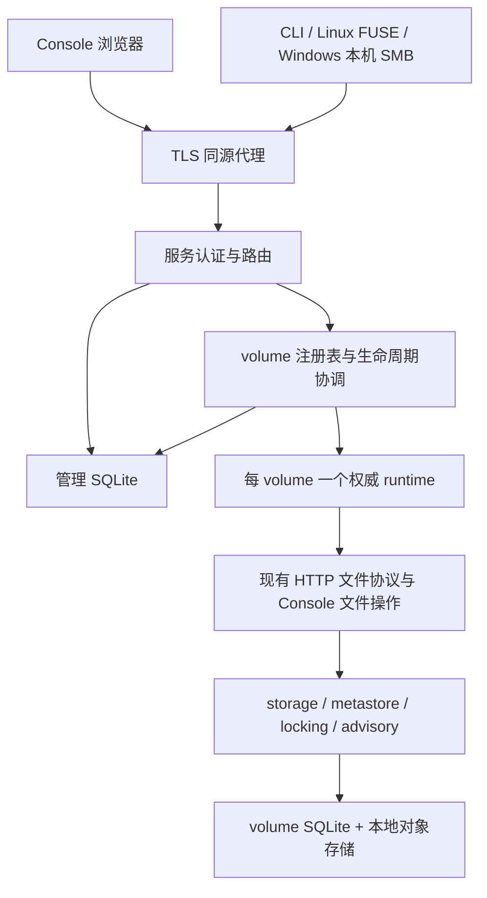

# Agent Note: 独立多用户 volume 服务

Status: proposed

## 问题

现有文件系统核心可以发布一个持久 volume，也可以被业务程序嵌入，但独立部署缺少用户、volume 归属、管理状态和统一入口。运维无法从一个 Console 查看服务中的 volumes，使用者也无法通过 CLI 创建和管理自己的 volumes。把多个已有单 volume 服务并排启动，仍无法落实跨入口的身份隔离、管理员摘要权限和管理动作的重启恢复。

本提案实现 [R-SVC-1 至 R-SVC-8](../../../../docs/spec/requirements.md#九独立多用户服务)，保留 R-INT-6、R-INT-7 的嵌入能力、R-INT-13 的单机持久目录，以及已有文件、锁、配额和可见性保证。服务提供账号密码管理员登录；普通用户登录在外部身份系统完成后接入。多用户的数据归属和服务端授权同时建立，不能等到外部登录接入后再补。

## 提案

交付一个 Linux 服务二进制、随附的同源 Web Console，以及连接服务的 CLI。服务使用一份管理 SQLite 和每个 volume 已有的 SQLite 与本地对象存储。所有入口访问同一份 volume 权威实例；单机私有持久目录保存全部持久状态。TLS 由前置代理终结，服务不依赖外部数据库或对象存储。

管理层属于独立服务。`packages/` 继续表达平台中立的单 volume 文件能力，不引入内置账号、管理员角色或 volume 注册表。已有的[volume 进入契约](../architecture/2026-08-19-volume-in-the-contract.md)保留一个 storage 实例就是一个 volume 的归属；本提案拥有独立服务的注册、管理和跨 volume 总预算。

### 范围与延期约束

| 事项 | 分类与处置 | 延期成本或实现约束 |
|---|---|---|
| 多 volume、所有权、管理员摘要隔离 | 保证，纳入 | 所有入口和已有引用都必须校验，后补会重做访问路径 |
| Console 文件管理、CLI 管理与挂载 | 功能，纳入 | Console 不提供在线编辑；文件操作仍满足原有并发语义 |
| 管理动作持久责任与重启恢复 | 保证，纳入 | SQLite 提交和存储根操作不能合成跨库原子事务 |
| 管理员账号密码 | 功能，纳入 | 初始化和恢复只通过离线管理命令，不开放注册入口 |
| 普通用户外部登录 | 功能，延期且约束身份结构 | 保留稳定内部用户 ID 与发行者/subject 绑定；禁止以登录名、邮箱或 token claim 作为 volume owner |
| PostgreSQL、多节点接管 | 功能，延期 | 当前一个服务进程独占数据根和各 volume authority；没有分布式调度或 leader 选举 |
| 第三方管理 SDK、MCP | 功能，延期 | 服务 API 客户端为内部包；文件 packages 的既有编程访问继续适用 |
| 后台 daemon 多挂载控制 | 功能，延期 | 需要明确本机控制通道和挂载 ownership；当前继续使用 foreground mount 与信号卸载，R-INT-4 的独立 daemon 行为不由服务 API 实现 |
| 回收站、文件历史、批量递归删除、断点续传 | 功能，延期 | 删除立即改变当前名字树；非空目录删除明确失败；传输取消和未知结果可观察，不伪装可续传 |
| 分享 volume、管理员代登录、跨 owner 迁移 | 功能，延期 | 当前 owner 不可变，角色不绕过所有权；未来新增权限必须独立定义 |
| 在线编辑、离线写入 | 不提供 | Console 不显示编辑器；断线遵守原有错误语义 |

### 部署与依赖



Console、CLI、文件协议和摘要查询都从 `internal/service` 的认证入口进入。一个请求先得到服务自己确认的 Principal，再选择 volume。Principal 至少含 `UserID`、`AuthenticationID`（browser session ID 或 CLI credential ID）、`AuthEpoch`；角色从管理库读取，客户端提交的 owner、role 或身份头没有授权意义。

一个 volume runtime 同时持有 `localstore.Store`、匹配的锁 authority、同一个 HTTP handler、Console 文件会话与共同的变更发布通知。runtime 负责最终 close settlement 后释放独占权。管理库不可被文件 handler 用来解析节点，Console 不直接读写 volume SQLite。

### 代码目录与依赖方向

单 Go module 保留现有 `packages/`。服务专用代码放在 `internal/`，不建立第二个 Go module，也不为一种 SQLite 实现创建通用 repository 接口。Console 的 TypeScript 源码和 Go 嵌入包装放在同一目录，使用 pnpm、React 和 Vite。

```text
cmd/
  remote-fs-server/
    main.go                 # 解析启动/离线管理员命令，调用 service
  remote-fs/
    main.go                 # CLI 与 daemon 的既有入口
    service_commands.go     # login、volume、operation 等命令
internal/
  service/
    service.go              # 组合管理库、runtime、HTTP 与停止流程
    config.go
    auth.go / auth_sessions.go / auth_credentials.go
                            # Principal、本地登录、会话与 CLI 凭据
    volumes.go / runtime.go / lifecycle.go
                            # 一个 manager 持有注册、gate、恢复和清理责任
    http_routes.go / http_auth.go / http_volumes.go / http_files.go
                            # 管理、摘要及文件协议的认证路由
    files.go / transfer.go  # 身份与 DTO 编排，不持有独立文件事实
  management/
    store.go                # 一种具体 SQLite store
    users.go
    sessions.go
    volumes.go
    operations.go
    migrations/             # 使用 packages/sqliteschema 的有序迁移
  serviceapi/
    types.go                # 服务 JSON 类型、错误与版本
    client.go               # CLI 使用的 HTTP client
  console/
    embed.go                # 发布产物的 Go embed
    package.json
    pnpm-lock.yaml
    vite.config.ts
    src/
      api/                  # 管理 string DTO 与 v5 lossless numeric codec 分开
      pages/                # 登录、我的 volumes、文件、用户概览
      components/           # 表格、表单、操作进度、文件选择
    patches/
      lossless-json.patch   # 固定 release 的严格 duplicate/own-key 修补
    dist/                   # UI 构建产物，供 go:embed 使用
packages/
  authz/                    # 继续使用宿主提供的 Authorizer
  storage/
    summary.go / quota.go / transfers.go
                            # 新增单 volume 可选中立 capability
  metastore/sqlite/
    summary.go / quota.go / transfers.go
                            # authority 事务、计数、策略、精确回执与迁移
  storage/objectstore/      # 未发布流式 import、固定 immutable export
  storage/objectstore/localdisk/
    physical_budget.go      # 中立共享 backing-filesystem reservation owner
  storage/localstore/       # 持久根、native capability delegation 与配置
  transport/httprest/        # 单 volume 文件协议与共同发布通知
  ...                       # 既有客户端、锁与存储包
deployments/
  service/
    Dockerfile              # UI build、Go build、单服务发布镜像
    compose.yml             # 私有持久 bind mount 和同源代理配置
    remote-fs-server.service
    config.example.yml      # Compose/systemd 使用相同字段
Makefile                    # UI build 先于 Go embed/build
.github/workflows/ci.yml     # UI lock/type/build 与受影响服务验证
```

依赖方向为 `cmd → service/serviceapi`，`service → management + console + packages`，`management → sqliteschema`。`packages` 不依赖 `internal`；Console 浏览器仅依赖 HTTP API。`serviceapi` 不包含服务 store、role policy 或 runtime。`internal/service` 保持一个包，auth、runtime 与 lifecycle 共享 manager 和 gate，不为文件分组增加相互依赖的子包。现有 `cmd/remote-fs-server/lifecycle.go` 的运行生命周期逻辑迁入 service，cmd 只保留参数、标准输入与退出码；移动时保留其 handler/backend settlement 契约。

构建先执行 `pnpm --dir internal/console install --frozen-lockfile` 与 UI build，再执行 `make build`；Makefile、Dockerfile 和 CI 使用同一个顺序。Go/toolchain 沿用项目固定版本，前端依赖与补丁固定在 pnpm lock，发布镜像基底按项目可验证的构建策略选定，不另造未经验证的版本号。发布二进制必须嵌入真实 `dist`；缺失产物导致构建失败。开发可使用 Vite proxy 访问本地 API；产品页面不展示开发代理、文件存储路径或内部故障栈。生成资源及其版本、锁文件的发布规则与 CI 一起确定，不能以占位页面补足 Go embed。

### 状态目录与管理 SQLite

```text
state-root/                 # 私有、固定 canonical path，目录自身不可替换
  service.lock              # 稳定 lifetime anchor，永不备份/还原/删除/改名
  data/                     # 可恢复的数据子树，固定为 state_root/data
    management.sqlite
    management.sqlite-wal / management.sqlite-shm
    volumes/
      <volume-id>/          # ID 不复用；显示名称不进入路径
        metastore.sqlite
        ...                 # localstore 自己管理对象、绑定、Witness 与锁证据
    quarantine/
      <volume-id>-<operation-id>/
                            # 同一文件系统，验证证明绑定到唯一删除操作
    transfers/
      <transfer-id>/        # 私有未发布 spool；责任随 transfer 记录恢复
```

state root、data root 及祖先必须由服务信任的部署方控制，目录 `0700`、数据库、anchor 和临时对象 `0600`。`state_root` 是唯一配置路径，data root 固定派生为 `state_root/data`；两者的 canonical path 不在运行时切换。server、离线 admin/bootstrap、backup、restore 和 upgrade 都先打开同一个 `state_root/service.lock` 并持有 exclusive flock，再触碰 data。state root 目录和该 anchor 的 inode 在数据还原期间保持不变，禁止 unlink/rename/recreate；第二个进程永远竞争同一稳定 anchor。恢复只替换 data 子树，不能把包含 anchor 的 state root 换掉。存储目录操作基于已打开的可信目录，拒绝符号链接和未知绑定，禁止从显示名称拼接路径。管理库和各 volume 都使用 WAL 与 FULL durability；SQLite 文件不放在网络共享文件系统。

管理库使用 `STRICT` 表、显式事务和有序 schema migration。一个 writer 连接、有限 reader 连接和有界 busy 等待；数据库占用超时返回真实错误。表间完整性在同一 writer 事务中校验，不引入 foreign key。quarantine 与 volumes 必须位于同一文件系统；启动校验失败明确拒绝。ID 使用不可复用的随机标识；时间存 UTC 整数，字节和计数使用非负 64 位整数，quota 最小值遵守 localstore 的原生 minimum；超出 int64、负数或不支持的输入明确拒绝。下面是最低字段集合，迁移须把检查约束写入数据库。

| 表 | 字段与检查 |
|---|---|
| `users` | `id PRIMARY KEY`、`role CHECK IN ('admin','user')`、`display_name`、`auth_epoch >= 1`、`next_action_namespace >= 1`、`retired_before_namespace >= 0`、`logical_time_high_water >= 0`、`created_at`；ID 和 role 不由登录请求决定 |
| `local_admin_credentials` | `user_id UNIQUE`、`login_name UNIQUE`、`password_hash`、`password_version >= 1`、`changed_at`；只允许 role 为 admin 的 user，密码不落明文 |
| `identity_bindings` | `issuer`、`subject`、`user_id`、`UNIQUE(issuer,subject)`；当前没有普通用户登录入口，外部接入只增加绑定 |
| `sessions` | `id PRIMARY KEY`、`user_id`、`kind CHECK IN ('browser')`、`secret_digest UNIQUE`、`csrf_token`、`auth_epoch`、`created_at`、`last_used_at`、`idle_expires_at`、`absolute_expires_at`、`revoked_at NULLABLE`；会话总量和每 user 数量有硬上限 |
| `cli_credentials` | `id PRIMARY KEY`、`user_id`、`label`、`current_digest UNIQUE`、`generation >= 1`、`pending_digest NULLABLE`、`pending_action_id NULLABLE`、`pending_fingerprint NULLABLE`、`previous_digest NULLABLE`、`previous_valid_until NULLABLE`、`auth_epoch`、`created_at`、`expires_at`、`revoked_at NULLABLE`；secret 只由客户端保存，服务仅保存 verifier |
| `action_namespaces` | `actor_user_id`、`sequence >= 1`、`accept_until`、`retired_at NULLABLE`，唯一 actor/sequence；user 持久保存 retired-before sequence 与逻辑时间高水位 |
| `volumes` | `id PRIMARY KEY`、`owner_user_id`、`display_name`、`storage_name UNIQUE`、`state CHECK IN ('creating','active','deleting','deleted','failed')`、`management_revision >= 1`、`last_operation_id`、`created_at`、`updated_at`；owner、storage_name 不可变；同 owner 的未删除名称唯一 |
| `operations` | `id PRIMARY KEY`、`actor_user_id`、`volume_id`、`kind CHECK IN ('create','rename','quota','delete')`、`action_namespace >= 1`、`action_nonce`、`fingerprint`、`expected_revision`、`payload`、`state CHECK IN ('pending','running','succeeded','failed')`、`phase`、`verified_root_proof NULLABLE`、`planned_reclaim_proof NULLABLE`、`quarantine_leaf NULLABLE`、`reclaiming_proof NULLABLE`、`result`、`error_code`、`created_at`、`updated_at`、`UNIQUE(actor_user_id,action_namespace,action_nonce)` |
| `physical_reservations` | `id PRIMARY KEY`、`filesystem_id`、`responsibility_kind`、`responsibility_id`、`reserved_unmaterialized_bytes >= 0`、`materialized_bytes >= 0`、`cleanup_reserved_bytes >= 0`、`phase`、`updated_at`；同一 owner 的转换和释放必须有已确认的原生/物理证明 |
| `transfers` | `id PRIMARY KEY`、`actor_user_id`、`access_id NULLABLE`、`volume_id`、`kind CHECK IN ('upload','download')`、`action_namespace >= 1`、`action_nonce`、`action_id`、`fingerprint`、`declared_bytes >= 0`、`retained_bytes >= 0`、`state`、`expires_at`、`result`、`error_code`；spool/pin 的责任先记账再分配，状态转换限定于下面的传输协议 |

`volumes` 不保存另一份文件统计或另一个生效配额。创建和 quota operation 的 payload 保存期望值；每 volume 的原生 authority 保存已生效 quota、quota revision 与原生动作回执。API 返回 authority 确认的数值。管理库可以保留已观察回执供 operation 查询，但不能把它当作当前容量。

`management_revision` 用于 volume 改名和删除等管理 CAS。名称要求有效 UTF-8、1–128 个 Unicode scalar，拒绝控制字符，按确切字符串唯一，不大小写折叠；名称可以改，ID、根和 localstore 内部 Volume 名不能改。内部 storage_name 固定为 ID 的规范编码，保持 localstore 的永久根绑定。

### 登录、会话与授权

离线命令在服务停止且取得稳定 state-root anchor 独占锁后初始化管理员。server 与所有离线命令使用同一配置的 `state_root` 或显式 `--state-root` 参数，不能从待还原 data 子树另找 lock。不存在管理员时服务拒绝进入 ready，不提供网络 bootstrap。`admin create` 从 TTY 或明确指定的受保护 password file 读取密码；拒绝命令行 password 参数。密码使用带随机 salt 的 Argon2id 编码，参数由密码学库验证并固定在策略中；密码恢复增加 `auth_epoch` 并撤销该用户全部会话。允许维护多个管理员，每个管理员仍只有自己的文件权限。

Console 通过 `POST /api/service/v1/auth/login` 提交管理员账号密码。成功签发高熵 opaque 会话 cookie，使用 `__Host-rfs_session`、`Secure`、`HttpOnly`、`SameSite=Strict`、`Path=/`，管理库仅保存 secret digest。所有带 cookie 的 mutation 检查确切 `Origin` 与会话绑定的 CSRF token；不接受 CORS wildcard，不从 query 接受认证信息。login 本身校验 Origin 并限流，错误不区分账号不存在和密码不对。

浏览器 session idle 30 分钟、absolute 12 小时到期，失效后重新登录；CLI 使用独立、最长 90 天的可轮换 opaque credential。`remote-fs login --server ... --credential-file <path>` 通过 TTY 读取管理员密码，向 `/auth/cli-credentials` 取得服务确认的 credential ID 和 secret，并保存到显式指定的私有文件。文件权限为 `0600`，父目录不得公开，命令拒绝符号链接和不安全替换；没有默认写入隐藏 home 目录的行为。密码不保存，secret 不打印、不进入 shell 参数、浏览器存储或日志；认证 HTTP client 拒绝重定向。credential ID 是稳定身份关联，secret 轮换不建立另一个挂载身份。

CLI 轮换先本地产生新 secret，并把旧 secret、pending secret 与 action ID 原子持久保存到 credential file，然后通过已认证 TLS 向 `POST /auth/cli-credentials/{id}/rotation/prepare` 提交 pending secret。服务仅持久保存其 verifier 与 action fingerprint；相同 prepare 返回相同状态，fingerprint 不同拒绝。客户端随后用 pending secret 调用 `POST .../rotation/activate`，服务原子设 current verifier、generation 与 exact receipt；activate 丢响应仍可用 pending secret查询/重试同 action。旧 verifier 在 60 秒 grace 内仍有效，之后明确失效；已建立 session 与 streams 绑定稳定 credential ID，轮换本身不断开它们。服务不保存可供重放的 raw secret，也不在 prepare 响应里重新签发 secret。客户端确认激活后再原子清除旧 secret 与 pending 状态。

credential revoke、password reset 和到期撤销该 Principal 的后续访问与持续输出。credential 管理只允许当前 user 自己的 credentials，没有管理员代他人签发或轮换。离线 password reset 增加 auth_epoch，使该 user 的 browser sessions 与 CLI credentials 同时失效。密码校验 Argon2id 建议参数为 64 MiB、3 iterations、parallelism 1；并发校验最多 2 个、等待最多 8 个且有 deadline，避免登录耗尽服务内存。profile 明确保存服务 origin 和 credential file 引用，foreground mount 与 CLI 使用同一份可原子更新的凭据。

每个请求都核对当前 browser session 或 CLI credential、过期、revocation 和 `users.auth_epoch`，再把 Principal 放入业务 context。文件、挂载、transfer 和已有引用的每个服务路由在激活 registry、调用 store.Open 或分配 volume 资源前，必须从管理库取得权威的 immutable owner 和当前作用域并确认访问；不能靠打开后的 Authorizer 才拒绝。admin 摘要路由在激活目标 volume 前确认当前 admin role 和目标 user 的 ordinary role。服务端 Authorizer 对每个文件语义操作核对目标 volume 的不可变 owner，角色不参与 owner 判断。挂载 URL 先确认 owner；临时 session/reference/grant/snapshot/transfer context 还须按下文绑定同一 SubjectID 和 AccessID。durable 管理/quota/import receipt 归属于稳定 SubjectID 和 actor namespace，不能因凭据轮换或 password reset 丢失已接受责任。摘要 ID、别人的 reference 或管理员 role 不能换取访问。

持续 SSE、下载和快照输出由服务拥有的 session cancellation scope 管理，注销、到期和密码恢复会取消它们。输出在每个有界单元前重检授权，设置 socket 写期限；对端停止读取不能延迟撤权或无限持有 pin。授权确认与 core transaction 不跨管理库原子提交。已经 final admission 的固定动作允许完成，后续动作和持续输出按当前身份拒绝；core 不读取账号和角色。请求取消不得撤销已经接受的持久 mutation；它只结束当前等待，调用方用 operation/action ID 核对结果。

browser session 持久保存独立高熵随机 `csrf_token`，它不是认证凭据，必须与该 HttpOnly cookie session 匹配。login 返回该 token；页面刷新后通过仅支持已认证 browser cookie 的 `GET /auth/session` 取得当前 user、到期时间和 token，响应 no-store、JSON content type 且无跨源读取许可。token 在同一 session 的 reload、第二个 tab 和服务重启后保持，不按读取或 tab 轮换；只存前端内存，不写 localStorage。该 token 不改变 HttpOnly 认证 cookie。mutation 在确切 Origin 校验后再比对该 session 的 token；CLI bearer routes 不复用 browser CSRF token。

### 临时 capability 与持久责任的身份绑定

为现有 `httprest.HandlerOptions` 增加可选、宿主中立的 access-binding hook，按已验证业务 context 返回有界 opaque `{SubjectID, AccessID}`，每项最多 128 字节。服务供应稳定 UserID 和 browser session ID/CLI credential ID，不向 core 引入 role、账号、密码或用户库。未配置 binding 的 embedded handler 保留原有模式；独立服务启动要求 handler 的全部 backing chain 支持绑定，缺少时明确失败。

绑定附着到已有 file registry、FileSession、retained reference、强锁 enrollment/session/owner/grant、volatile terminal action/close history 的记录，不创建第二套 session registry。creation、lookup、使用、续期、query、recovery 和 terminal receipt 返回之前都先比较两项 binding；同 owner 的另一 credential 知道 bearer 标识也必须失败。客户端提交的内部 owner、scope 或 enrollment metadata 不能决定 binding；native scope 和 stateful capability 恢复 metadata 只能从可信 hook 和匹配的现有记录派生。binding 参与现有 capability 的归属/fingerprint 检查，不能只在新建时检查后让恢复旁路。

opaque bearer 本身不足以授权。CLI secret 轮换保持 credential ID，故 AccessID 不变；注销、revoke、到期或 password reset 取消该 access context，后续 capability 使用和 query 均拒绝。服务自己已经持有的 cleanup responsibility 继续结算，不要求无效 credential 再调用 close。临时 file-close 的终态历史仍按原 AccessID 查询；新 credential 必须建立新 session，不能恢复旧文件引用或强 grant。

replication 的 `(incarnation, position)` cursor 是不可信的 stateless history selector，不是按 credential 登记的 bearer capability。每次 subscribe、resubscribe 和 snapshot 在 owner 检查后，以当前已认证 SubjectID/AccessID 建立输出 context，每个有界 frame/page 再授权；same owner 的另一有效 credential 可以合法提交同一个 cursor，other owner 仍在访问目标 volume 前拒绝。不新增 wire token 或 cursor registry。access-binding hook 只约束真实 stateful file/locking/enrollment/volatile terminal records；快照 producer 的生命周期与输出 context 受认证取消和预算管理，不把原始 cursor 当成业务身份。

durable 已接受 management、quota 与 sealed import action/receipt 绑定稳定 SubjectID、volume ID 和 actor namespace，effect fingerprint 不使用易失 AccessID/password epoch 来永久封锁责任。当前有效的新 credential 只要属于同一 SubjectID，可查询原回执并继续同一已接受 sealed action；新的 final admission 仍重新核对当前 owner/访问与原生 guard，不改变效果输入，不重新执行已完成动作。其它 SubjectID 永远不能继承。正在接收/输出的未完成流仍绑定原 AccessID；它的撤销会 fence receive/send，而持久 sealed/native receipt 的查询采用稳定 actor 规则。

普通用户接入时只增加外部认证适配器和 `identity_bindings` 的受控建立。`issuer + subject` 必须由服务验证的发行者提供；同 subject 的邮箱变化不创建新 owner，外部 claim 不能把 role 改成 admin。当前不提供普通用户自注册、本地密码、管理者代登录或修改他人用户的 API。

### API 与 CLI

服务管理 API 使用 `/api/service/v1`；文件协议挂在 `/api/volumes/{id}/v5/`，strip 固定前缀后交给该 runtime 的现有 `httprest.Handler`。同源服务只信任配置的外部 origin 和显式受信代理，不接受任意 forwarded headers。服务管理 API 认证失败是 `401`，确认的越权是 `403`，revision 冲突是 `409`，未知 volume 是 `404`，存储不可用是 `503`。文件 v5 路由保持带协议 marker 的既有 `ErrorResponse`：身份拒绝映射 `422/EACCES`，认证系统或 authority 故障映射 `422/EIO`，不能以代理裸 `401/403/503` 破坏文件 client 的错误分类，也不能把存储故障翻译成不存在。

| 方法与路径 | 结果与权限 |
|---|---|
| `POST /auth/login`、`POST /auth/logout` | 浏览器管理员登录与当前会话注销 |
| `POST /auth/cli-credentials`、rotation prepare/activate、revoke | 当前 user 自己的 CLI credential 签发、持久轮换与撤销 |
| `POST /action-namespaces` | 为当前 actor 签发有界、可退休的 action namespace |
| `GET /auth/session` | 已认证 browser cookie 的当前 session 与可恢复 CSRF token，不返回认证 secret |
| `GET /me` | 当前内部用户与服务确认的角色，不含 credential |
| `GET /volumes` | 当前 owner 的 volume 列表、生命周期状态和真实摘要；带有界 cursor |
| `POST /volumes` | 自己创建 volume，输入 name、quotaBytes、idempotency key，返回 operation |
| `GET /volumes/{id}` | 自己的 volume 配置、状态、摘要或具体统计错误 |
| `PATCH /volumes/{id}` | 自己改名，携带 management revision 与 idempotency key |
| `POST /volumes/{id}/quota` | 自己更改 quota，携带原生 quota revision、目标字节和 idempotency key |
| `DELETE /volumes/{id}` | 自己删除，携带 management revision；忙时明确失败，不能强制断开挂载 |
| `GET /operations/{id}` | 仅原 actor 查询自己的操作、阶段、结果与剩余责任 |
| `GET /admin/users` | admin 只读普通用户列表，包含稳定用户 ID 与显示名称，不包含认证绑定或凭据 |
| `GET /admin/users/{id}/volumes` | admin 只读普通用户的五项摘要：名称、文件数、目录数、已用空间、配额；不返回 file API URL、文件路径、属性或订阅 |
| `/api/volumes/{id}/v5/*` | 仅 owner 的原有文件、复制、会话与锁协议；admin role 不授予他人的访问 |
| `POST .../v5/file-transfer` | 仅 owner；新增中立 import/export/query/cancel 操作，由同一个 handler 执行 |

摘要中的未知字段使用结构化 error 分支，不能以 null、零值或旧缓存表示已成功取得统计。例如 `{"name":"build","summaryError":{"code":"metadata_unavailable"}}`。管理 API 的计数、字节和 numeric revision 使用十进制字符串；现有 v5 的 uint64 NodeID、int64 字节及计数仍是 JSON number，不能把它改成 string wire 以适配页面。Console 在隔离的 v5 client codec 中固定使用 `lossless-json 4.3.1`，通过 pnpm `patchedDependencies` 应用仓库内 patch：无条件拒绝所有 duplicate keys（包括相同值），并用安全 own-property assignment 构造对象，避免 `__proto__` 改变原型；不以未修补 release 承诺 v5 strict decoder。该 lossless JSON parser，保存数字的原始十进制 lexical value，按各字段的 int64/uint64 范围校验并转为 `BigInt`；只有枚举等已证明小范围值才可转 Number。v5 response 禁止调用普通 `response.json()` 或 `JSON.parse()`；request serializer 使用 `new LosslessNumber(decimalString)` 与库的 `stringify` 将经验证的整数生成不带引号的精确数字 token，禁止先转 JS Number 或用默认 JSON.stringify 处理 BigInt。管理 string DTO 和 v5 numeric DTO 是两个明确类型，不能共享会隐式转换的 parser。显示 human-readable 容量时同时保留确切字节。所有身份相关响应设置 `Cache-Control: no-store`；Console 注销或切换身份清空全部内存列表、目录和缓存状态。

管理 mutation 必须带服务已签发的 actor namespace 与 client nonce，二者组成 idempotency key。服务在单个事务中验证 Principal、owner、namespace、revision、输入并写 operation；同 actor/key 且 fingerprint 相同返回原 operation，不同输入返回 `409`。已受理返回 `202` 和 operation URL，只有 `succeeded` 才算完成。已在管理库单事务完成的改名可以直接返回 `200` 和已完成回执。客户端超时后查询原 key；不得换新 key 自动重试具有未知效果的动作。终态明细保留 7 天后按下文 namespace retirement 原子清理；已退休 key 返回明确的 history-expired，永不作为新动作执行。非终态责任不丢弃；namespace 或 receipt 容量耗尽时拒绝新动作。

```sh
remote-fs login --server https://files.example.com --credential-file ./private/credential.json
remote-fs volume list --json
remote-fs volume create workspace --quota 20GiB
remote-fs volume rename <volume-id> workspace-next
remote-fs volume quota <volume-id> 40GiB
remote-fs volume inspect <volume-id>
remote-fs operation inspect <operation-id>
remote-fs mount <volume-id> ./workspace --credential-file ./private/credential.json
# Ctrl-C 或终止信号按现有 foreground mount 生命周期卸载
remote-fs volume delete <volume-id>
remote-fs user list --json
remote-fs user volumes <user-id> --json
```

CLI 的 volume 命令和挂载按 ID 定位。名称仅辅助展示和按自己列表进行显式选择，多个可能匹配时不猜测。长动作默认等待终态并报告 operation ID；`--no-wait` 输出已受理，不能输出创建成功或删除成功。`--json` 返回稳定的结构化字段和精确数字，错误退出码非零；Ctrl-C 结束等待后保留用于核对的 ID。foreground mount 使用同一 credential file 取得稳定身份，服务地址按 volume ID 解析；现有 `-server`/`-mountpoint` 直接使用形态继续可用，并可显式配置 credential transport。当前挂载由信号结束，没有新增后台多挂载控制或独立 unmount 命令；R-INT-4 的 daemon 本机控制通道另行设计，不能把服务管理 API 当作本机卸载协议。

### Console 与原始文件名

Console 包含登录页、“我的 Volumes”、volume 文件浏览器和 admin “用户概览”。我的 volume 页面提供创建、改名、配额与删除；文件浏览器提供目录导航、上传、下载、新建目录、改名、移动和删除。用户概览仅包含普通用户列表和五项 volume 摘要，不能打开对方的文件浏览器。删除、替换文件及降低 quota 提供目标与影响的确认，后台仍独立验证。

浏览器文件 client 使用 `v5/file` 的身份目录和 namespace 操作，包括 `file.session-open`、`file.observe-directory-metadata`、`file.open-at`、`file.mutate-name` 等，保留同一文件 session。新增 transfer 也挂在同一个 handler；不通过服务 API 直写 store，再自行触发另一套通知。`internal/service` 的 files 文件仅编排身份检查和 DTO，不产生独立存储 mutation 路径。文件 mutation 的原生 commit、日志 barrier 与 publisher wake 由 handler 的共同完成路径执行，完成结果必须包含已确认 barrier。

文件名是原始字节。wire 中叶名使用 standard padded base64 的 `rawLeaf`，解码再编码必须确切等于输入；身份对象按既有 wire 的确切字段名（包括默认 Go `NodeID`/`Scope`）处理，不擅自改成管理 DTO 名称。目录和对象使用身份标识；UI 单独生成显示字符串。显示编码必须可逆且一对一：literal backslash 编码为 `\\`，不可解码字节编码为 `\xNN`，控制字符、所有 Unicode Cf（包括 bidi）和行/段落分隔符编码为 `\u{HEX}`，其余有效 UTF-8 的可打印文字原样显示，不做 Unicode normalization。这样原始 `FF` 显示为 `\xFF`，原始 ASCII `\xFF` 显示为 `\\xFF`，两者不能碰撞；保留原始值用于选择、下载和 mutation。两个不同 rawLeaf 不能因 replacement character 或规范化显示成同一可选择名字。所有用户输入按明确 UTF-8 编码转换成新 rawLeaf；服务遵守中立 storage 叶名规则，拒绝 NUL、分隔符和非法叶名，不把原始名字塞进 URL path。

目录列举使用一次完整、有界权威观察；超过 entry/byte 上限时整个列举失败，页面报告限制。选择对象后以 captured parent ID、rawLeaf、expected child ID 和必要 revision 做条件动作，最终原生事务再次检查。并发改名、替换或删除返回冲突并要求刷新；不以旧路径重开后继续操作。符号链接作为文件显示，删除和改名作用于链接自身；不在浏览器中自动展开或下载目标。下载名使用安全的 `Content-Disposition` 编码，禁止 CR/LF 和 header 注入。

页面加载、空结果、失败、冲突、恢复、删除中和 operation 结果未知都是独立状态。只有确认的空列表显示空状态；离线和统计失败显示具体错误。文件上传显示字节传输和等待原生提交的阶段，100% 字节已发送不代表文件已发布。Console 不提供预览执行、富文本渲染或在线编辑入口。

### 文件传输的原生能力

现有全文件 `Read`/`Write` 和重复 `ReadAt` 不足以同时保证任意大小内容的有界内存、单一下载版本和原子上传。增加可选、平台中立的原生 `FileTransfer` 能力；没有完整 backing chain 的 backend 明确拒绝，不通过反复范围请求模拟。该能力复用 objectstore 的 `Reserve → Put → Commit`、不可变对象与最终 publication coordinator，并由 HTTP handler 暴露，不直接操纵 SQLite。

上传采用明确的 `create` 或 `replace-name` 模式。后者是把一个新对象绑定到被选名字，Console 显示“替换文件”；替换前打开的旧句柄继续访问旧对象。它不是对既有句柄做内容编辑。请求包含 parent identity、canonical raw leaf、expected absent/child identity、声明长度、action ID 与 fingerprint；fingerprint 覆盖所有影响效果的输入。

服务先持久登记 transfer 与资源 reservation，再接收固定声明长度到未发布的私有 spool/object。过短、过长、超限、取消或认证失效都不能发布。接收阶段只消耗有界 chunk memory 和显式 staging byte/count 预算，不创建目录树临时节点，也不增加文件数。完整接收并验证后，service 在 final admission 核对当前 Principal 与不可变 owner；原生 final transaction 原子检查 scope、parent/child 条件、访问保护、删除共享、强锁、配额和节点种类，并提交新名字绑定、旧对象脱名、计数、用量、日志与 durable action receipt。符号链接不被隐式跟随。

替换旧文件时，仍有引用的旧对象继续计入 allocation；新对象需要满足这一真实用量下的配额，不用“新文件减去旧文件”估计余量。final transaction 条件失败返回冲突，spool 由持久责任清理。操作取消发生在最终提交之后时返回结果未知并给出 action ID，query receipt 确认真正结果；同 action 不重复发布或覆盖后来修改。

下载使用原生 `ExportFile`，在 publication coordinator 的同一次有序操作中原子取得 retained-node reference，并捕获 ordinary node 的确切 immutable object key/revision 和独立 object-key pin。node reference 防止节点脱名后被回收；object-key pin 防止并发内容提交把旧 key 列入 GC 后删除。GC 必须排除所有被 pin 的旧 key，不能把 node reference 或 metadata/WAL snapshot 当作 object pin。detached 当前节点的 allocation 按原生规则继续计入 Used；被后续内容覆盖的历史版本仅计入物理存储和 pinned-export budget，不凭导出 pin 虚增 quota Used。

先把 captured key 的完整内容验证到有界私有 spool，再发送成功 headers；校验失败时不发成功和错误字节。verified spool 建立后，原生 node reference 与 exact-key pin 仅在 close settlement 已确认时释放；spool 和传输责任继续持有到发送或清理完成。close 未结算保留 native pin 与预算，不能仅凭 spool 已写好释放。发送时从已验证 spool 读取，不重新按路径或范围选择对象；并发改写、改名、删除不改变该次下载。设置确切 `Content-Length`，途中断线或撤权显式中断，不能称整个下载成功。客户端只在完整字节和长度验证后保存最终目标。

transfer 生命周期是 `prepared → receiving/verifying → ready → committing/sending → completed`，取消与确定失败进入 `canceled/failed`。native commit receipt 与 transport completion 分开；上传发布成功但响应丢失仍可 query，下载捕获成功不代表客户端已收完。spool、原生 reservation、export pin 和运行 goroutine 各有唯一 owner，结束时逐一释放；清理错误保留记录与责任。未 sealed 的上传重启后被 fence 并清理；已 sealed 的对象和 native reservation 保留，owner 查询后以仍获当前授权的相同 exact action 继续最终提交。重启取消未发送完的下载并清理；已提交上传先查原生回执再完成记录，不能重传替换。transfer reservation、action receipt 和 spool GC 由有界维护 worker 执行，未确认清理不归还预算。

### 权威统计与配额

增加可选的中立 `VolumeSummary` 能力。每 volume SQLite 保持 named-file 与 named-directory counter，文件种类 regular/symlink 各增加 1，目录增加 1，root 不增加；脱名节点不计数。create、remove、rename-replace、跨目录移动及 transfer publication 都在已有最终事务中更新 counter；纯改名和同 volume 移动不改变总数，replacement 按旧名字退出和新名字进入计算。现存库由 migration 从权威节点初始化并验证，正常运行不扫描文件树或使用估算 fallback。

一次 authority read snapshot 同时返回 fileCount、directoryCount、allocation used、effective quota 与 quota revision。已用是配额虚拟分配量，不是 payload 长度或宿主磁盘用量；detached 打开对象计入用量，目录和符号链接按已有 allocation 规则计费。管理界面不把各 volume quota 加总解释为底层盘的实际容量承诺。

单个 volume 的健康读取不可用、snapshot 失败或计数不一致时，该行显示明确的 unavailable/error，其余行可以独立成功；管理员错误 DTO 使用固定安全 code，不返回底层文件路径、SQL、node ID 或原始错误链。strong-lock recovering 只限制会冲突的授予和 mutation；健康的 VolumeSummary、Space、普通读取和原生恢复查询继续通过 healthy-read 路径提供，不能仅凭 recovering 状态把统计报错或拒绝普通读取。一次 summary 成功不是多个 volume 之间的全局快照，API 不声称同一时刻观察整个服务。

配额增加可选 `QuotaControl` 原生 capability。独立服务显式选择 durable policy mode；已有嵌入方 fixed allowance mode 的生命周期语义保持成立，不能运行时把缺失旧字段解释为新策略。迁移负责 schema 转换。effective quota 和 revision 持久保存在 volume authority；最终 publication、Space.Total 与容量 admission 使用同一策略。

quota operation 的原生 action receipt 与策略变更同一事务提交，输入含 expected quota revision、目标值和 action fingerprint。降低到 used 以下允许完成，此后剩余 quota 余量为零，新增长明确失败，既有文件仍可读取和释放。并发发布与 quota 变更按同一 publication coordinator 排序。管理 worker 写入意图后调用原生 action，丢失响应只查询原回执；相同 action 不重放覆盖更晚的 quota。收到已确认原生结果后再完成管理 operation；不通过关闭重开 volume 应用 quota。

### 共享物理盘与 SQLite WAL

多个 volume 根、management SQLite 与 transfer spool 位于同一 backing filesystem，不能各自把同一份 statfs 余量预留一遍。服务按核对的 backing-filesystem 身份构造唯一共享 physical-budget owner，并显式注入所有 localdisk/object publication、native pending、export key pin、spool 和 management/volume SQLite transaction。embedded 单根默认形态不被迫链接服务管理库；独立服务必须选择 shared budget 形态，不能混用一部分 per-root 独立 manager。

physical-budget owner 在受理 materialization 前保守预留确切有界最大空间，保存责任关联和跨库未知状态；管理库的 `physical_reservations` 持有服务级责任记录，原生 pending/receipt 提供完成证据。新 immutable object 要预留完整结果大小，不能仅按本次 patch 长度预留。spool 与对象副本同时存在就分别收费；old-key pins、garbage、unresolved objects、SQLite 主文件增长和 WAL 各自占用物理字节，不能因为 quota Used 不增加就忽略它们。reservation 从尚未物化字节转换为已物化责任时保持唯一计账，测得 free bytes 只再扣尚未物化的承诺，避免已落盘字节被双重扣减。quota allocation 和 shared physical budget 是不同的限制。

manager 保留专用于管理 WAL、回执、关闭、恢复、删除和 checkpoint 的物理 headroom，普通 publication/spool admission 不能消耗。已接受操作的 cleanup reserve 保持到确认 reclaim/sync，控制面 SQLite mutation 也先取得相应 reservation。重启在责任与 native pending reconciliation 完成前保守保留不确定承诺，不能因当前 free 看似较多就放开。`Space.Avail` 由原生 quota 与共同 filesystem pool 的当前可用事实共同约束；无法确认 global 状态明确失败，禁止把每根看到的 statfs 或配置配额当作可兑现的独占容量。

所有 SQLite writer 在 transaction admission 前预留该操作的最大有界 DB/WAL 增长；native mutation 的 limit 同 metadata/name/delete-intent 上限一起定义，超出预测边界必须事务失败而不是绕过预算。每库有 WAL retained-byte 上限、最长 snapshot age 和并发 snapshot 上限。checkpoint pressure 时停止会增加 WAL 的 data admission，维护 worker 仍使用预留容量；snapshot 达到生命周期上限明确结束并释放，不能无限阻止 checkpoint。`journal_size_limit` 只辅助 checkpoint 后的回收，不能宣称它限制仍被 snapshot 持有的活跃 WAL。checkpoint/close unknown 保持 reservation 和不健康状态，不能假定空间已归还。

共享预算控制通过本服务的承诺，不能保证宿主盘永不 ENOSPC：文件系统自身元数据、部署方操作和实际 I/O 仍可能失败。ENOSPC、fsync 或 SQLite I/O 错误必须保留链和剩余责任，原生 Space 不报告无法兑现的估算余量。发布前需要用多 volume 同盘、WAL pin 和 spool 组合压力确认 headroom 参数及最坏 transaction growth，不用单 volume 测试代替。

### runtime、资源预算与管理动作

volume 注册表从管理库加载轻量记录，按需打开 runtime；volume 数量不能等于永久打开的 SQLite 与 goroutine 数量。registry 对同一 ID 只允许一个并发 open，打开中的调用者等待同一结果或明确取消，不能另起实例。open 严格验证已有 localstore 绑定和证据；冷打开的历史 lease 屏障未完成时显示 `recovering`，由原生 authority 拒绝冲突的 grant/mutation；健康统计、Space、普通读取和恢复查询仍可用，服务不施加 blanket unavailable。

runtime admission 与 pin counter 由同一 gate 保护。正在执行的 HTTP 请求、文件/锁 session、live grant、需要在原 handler/authority 内存中查询的 volatile action history、SSE、snapshot、transfer 和未结算的原生 cleanup 都具有明确 pin 责任。volatile history 只按已声明的有界原生生命周期 pin；durable terminal quota/transfer receipt 可在重开后查询，不在 7 天明细保留期间 pin runtime。持久化且能按原生恢复规则重新取得的状态不因为“有历史记录”就持有内存实例。idle eviction 和删除先在 gate 内原子确认零 live pin、停止新 admission，再进行不可逆 `Handler.Stop`。`Busy` 必须发生在 Stop 前，已有挂载仍可使用；不能 Stop 后发现繁忙，再试图恢复已经退役的 handler。停止和底层 close 必须核对完整 settlement，不能用 `Released=true` 代替完成。

服务全局总预算覆盖所有 runtime，不能把“每 volume 有上限”当作服务总量有界。配置包含 registered volumes、active runtimes、正在 open 的数量、请求、session、SSE、snapshot、transfer、staged bytes、pinned bytes、job、等待队列与 response bytes 的硬上限。先取得全局 reservation 再取得每 volume reservation，遵守固定顺序；失败归还已取部分。超限立即返回可识别 busy/quota/limit，不建立无界 waiter、无界 goroutine 或无界 map。

status/summary 使用有限预留 admission，文件流量不能占满它。建议 16 个 runtime 总槽位中预留 2 个 cold-summary 槽位，256 个 request 槽位中预留 16 个管理/摘要槽位，并预留 1 个 summary open 槽位；这些 reservation 全部计入各自硬总上限，data admission 最多使用剩余部分。已打开的 volume 统计借用同一 runtime 的短期观察 pin；冷 volume 经同一个 registry/gate 取得预留槽、正常 `localstore.Open` 和 `VolumeSummary`，只能执行统计，不发布文件 handler 或创建文件 session，完成后按正常 settlement 关闭。它不是第二份 live volume，也不绕过 store API 直接打开 SQLite；如果同 ID 已由数据流量打开或正在打开，统计复用那个实例/结果。summary-only runtime 不能转为 data runtime 来消耗保留槽。删除中拒绝打开；strong recovering 显示状态但仍尝试正常 healthy-read 统计，不能凭该状态返回空值或 unavailable；open、观察或 close 失败保留责任和 reservation，不能释放未结算槽。冷 summary 页一次最多 50 行，统计 worker 最多 4 个、cold opens 至多预留槽数；请求 deadline 到期显示 unavailable，不持有无界等待。

管理/status/operation query、file-close、已受理动作的 cleanup 和 recovery 使用预留容量贯穿全路径：HTTP/control request、response bytes、worker/queue、metadata writer 的有界优先 admission、store close 和物理盘维护空间均有各自计入总上限的 control reservation。data 请求不能耗尽这些预留。新 file session、transfer 和 operation 在受理时取得其最坏有界 cleanup 容量，并把 reservation 交给其唯一 responsibility owner；这部分容量保持到 native/spool/runtime settlement 确认，不在 close 时重新争抢饱和的 data 槽。已接受的 cleanup 不需从 data queue 再取得准入；control admission 本身也有硬上限和 deadline，正在提交的短 data transaction 不被强行取消，由有限 writer 顺序和优先队列排空。拒绝新 admission 不能停止既有 responsibility worker 或使其失去已预留空间。

管理 worker 属于服务 lifetime，不属于某个请求。接受动作时先保存责任，执行阶段可重复查询；API 请求断开后 worker 继续。重启先扫描非终态 operation 和 transfer，再提供对该 volume 的正常 admission。每 volume 管理动作按状态与 revision 串行；native quota 与文件 publication 的实际顺序仍由 authority 决定。`failed` 只表示确认动作未完成且没有未结算的剩余责任；不确定状态保持 `running` 与 last error/phase，不猜测失败。

| 动作 | 持久与生效顺序 | 重启或丢响应后的处理 |
|---|---|---|
| 创建 | 一个管理事务分配不复用 ID、immutable storage_name、owner、creating 行与 operation；在可信 `volumes` 目录 fd 下 exclusive `mkdirat` 创建根，执行已有显式初始化，核对根/数据库/锁绑定，并 `fsync` 持有新根名字的 `volumes` 父目录，最后事务置 active+succeeded | 匹配本操作创建意图的未完成初始化可续作；已完成绑定验证后重新 fsync `volumes` 父目录再补 management commit；父目录同步未知或失败保持 running 与剩余责任，不能确认创建；未知根、错绑定、缺失证据明确失败并保留清理责任，不能重建成空 volume |
| 改名 | 在一个管理事务核对 owner、management revision 和名称唯一性，更新显示名、revision 和成功 receipt | lookup 原 key 返回原结果；内部 storage_name 与物理根保持不变 |
| 配额 | 管理库写意图，native QuotaControl 以 revision+action 原子提交策略与回执，管理库记录确认结果 | 查询原 native receipt，已完成则补管理回执；unknown 保持待核对，不换 action 重做 |
| 删除 | 零-pin gate 通过后冻结 admission、持久记 deleting；完成 Stop/close settlement 并保存 verified-root proof，将根无覆盖地移入 ID+operation 绑定 quarantine，同步两个父目录，安装和同步 copy-preserved quarantine proof xattr 后持久确认 reclaiming proof，再做有界 reclaim 和父目录同步，最后置 deleted+succeeded | reclaiming 前核对完整根绑定、close 与 rename 责任；reclaiming 后仅按持久 verified-quarantine proof 继续清理，不重新 Open 或要求已删标记；未知 close/同步/局部删除保持 running |

删除以 `frozen → verified-close → quarantined → reclaiming → completed` 为唯一清理顺序。`verified-close` 证明记录 volume/operation ID、immutable storage_name、已核对的持久 store/database binding 和完整 close settlement；同时在管理库持久计划一个随机 opaque proof ID，绑定同一 volume、operation 与固定 quarantine leaf。state/data root 私有权限与稳定 state-root lifetime anchor 在整个过程保持。源 `volumes` 和目标 `quarantine` 位于同一文件系统，目标叶名固定为 volume ID + operation ID，使用 no-replace rename，禁止删除或覆盖未知目标。device/inode 只用作当前进程已打开 descriptor 的 path fence，每次启动重新建立，不充当可复制恢复的持久身份。

rename 后同步源和 quarantine 两个父目录，在核对过的 quarantine 根目录使用 XATTR_CREATE 安装 `user.remote-fs.reclaim-proof`，其规范记录包含 planned opaque proof ID、volume ID 与 operation ID；已有 marker 只有确切匹配才可续作，不能覆盖。同步该目录及父目录后，管理库才能把固定 canonical quarantine path、已核对的 native binding、marker 记录与已确认 close/rename/sync 结果提交为 `reclaiming_proof`。只有该事务确认后才能删除任何 LOCALSTORE、Witness 或数据子项；reclaim marker 保留在根目录上直到最后 rmdir。

reclaiming 前崩溃时核对源或匹配 quarantine 中仍完整的 native binding，按持久 planned proof 完成 rename、marker 与目录同步；完整绑定或已存在 marker 不匹配时明确失败并保持冻结。reclaiming 后允许 native marker 已消失或局部数据已清理；每次恢复 reclaim 必须同时匹配固定 canonical quarantine path、管理库 proof 与根目录 reclaim xattr，并以当前 descriptor 重建 live path fence，再继续 bounded reclaim。绝不 `localstore.Open`、重新初始化或要求已删除的 native binding 再出现。同路径的文件复制恢复即使 inode 改变，只要 copy-preserved reclaim xattr 和 DB proof 完全一致就可继续；缺失或错 marker、未知或不匹配路径绝不删除。quarantine 已消失时重新同步父目录再确认完成；管理库回执只能在剩余 quarantine/root/spool 责任都结算后成功。

删除的 volume tombstone 保留 ID 与 owner，ID 不复用；用有界归档或 retired namespace 规则管理历史，不能以清掉记录允许旧 ID 指向新 volume。文件树非空不阻止整个 volume 删除，但活跃 pin 阻止受理生效；Console 明确提示先卸载并关闭传输。创建失败的根不能被目录扫描自动导入；扫描发现 registry 外的数据只报告 orphan，不发布。

动作回执采用服务签发、绑定 actor 的 namespace 和 client nonce。`POST /action-namespaces` 签发有限有效期的递增 namespace，client 保存后用于 management/transfer action；namespace 默认仅允许接受新动作 24 小时，响应给出确切 expiry；未知 namespace、过期 namespace 中的未知 key 和 fingerprint 不同的 key 均明确拒绝。同一个已知 key 只返回原回执，history expired 不等于 NotExecuted。管理库和 native authority 各保存持久 retired-before namespace watermark；清理只有在该 namespace 没有非终态责任且其终态回执达到保留期后才能推进，推进与 GC 原子提交。已退休的 namespace 永久拒绝。持久非递减逻辑时间高水位和 retired-before namespace watermark 必须同时存在：每次签发、接受窗口校验和 GC 都使用 `max(persisted_high_water, wall_time)`，将更新高水位与相关状态同事务提交；时钟回退不能重新打开已经到期的接受窗口。retirement 只能推进连续、已满足清理条件的 namespace floor，不能越过仍有 pending 责任的 namespace；本机时间或 storage 故障不能回退任一 watermark。

终态 operation/transfer 详细回执默认保留 7 天；活跃 namespace、终态回执和未结算责任分别设 count/byte 上限。非终态责任不按时间丢弃，达到上限时拒绝新动作。GC 先确认 native receipt、spool 和 pin 的结算，再删除 transport 明细；本机或传输错误不能把 watermark 退回。native quota/transfer 重试使用相同 action namespace，authority 拒绝已退休动作，避免清理后旧上传或旧 quota 再次执行。

### 停止、健康、备份与升级

服务收到终止信号时先撤销 readiness、停止新的 login/management/runtime admission，再通知各 handler Stop，取消 SSE、HTTP waits 与传输输出，排空已进入原生提交的动作，结算各 file/lock session 和 runtime。等待有配置上限；超时以失败退出并保留持久责任。管理库、底层 store 和 state-root anchor 按依赖顺序最后关闭，未结算时不提前释放稳定 anchor 给第二个服务。重启按已有恢复屏障和本提案的 responsibility records 继续，恢复不能解释为成功。

`/health/live` 仅表示进程与协调 loop 存活；`/health/ready` 要求稳定 state-root anchor 独占、管理迁移完成、管理库可访问和 worker 可接收请求。独立 volume 的 failed 状态按请求报告；strong recovering 不阻断 healthy reads，也不阻断其它可用 volume。readiness 不冒充每个 grant/mutation 都能通过恢复屏障；文件请求和 summary 由各原生操作返回真实结果。公开 health 不返回用户、volume 名称或文件信息。管理进程发生不可恢复错误时退出或进入不 ready，不能留下可继续接收 mutation 的半失效服务。

备份流程为 STOP → 确认进程停止并取得稳定 state-root lifetime anchor → 锁持有期间只备份 `state_root/data` 子树的一致副本或 exact snapshot；state root 目录和 `service.lock` 不进入备份、不会被还原替换。备份必须保留全部 hidden evidence、SQLite 主文件/WAL、objects、quarantine/spool/责任记录、xattrs（尤其 `user.remote-fs.lease-state` 和 `user.remote-fs.reclaim-proof`）、mode、ownership 和 link 关系；仅复制文件内容的 archive 不合格。不能在线复制一个 `.sqlite` 主文件，也不能只备份当前具名文件。备份介质和宿主 root 运维者属于信任边界，管理员 UI 限制不约束其文件系统权限。

恢复必须在服务停止且稳定 state-root anchor 由恢复者持续持有时，只还原 data 子树到原来的相同 canonical `state_root/data` path，并逐一核对 localstore/native lease 的绝对目录绑定、持久 ID、xattrs、ownership/modes 与 responsibility proof。复制副本或 snapshot 只有通过这些验证才可启动；缺失 xattr、错 owner、错误绑定或变化的 canonical path 明确拒绝，不能 Initialize 或提供旧数据 fallback。迁移到另一个路径需要单独的 offline binding migration，超出本提案；不把改 YAML 当成受支持的恢复。

升级流程同样是 STOP → 稳定 state-root anchor → data 子树完整备份 → 有序管理库和 volume schema migration → 新版本启动。迁移失败不运行正常文件入口；版本不兼容明确拒绝。应用降级只能在停止并持锁时还原对应完整备份到同一 canonical path，再运行旧二进制，不能把新数据交给旧程序并启用默认值兼容。schema、嵌入 UI 与 API 版本随同一个发布制品交付。

### 配置与可观测性

```yaml
listen: 127.0.0.1:8080
external_origin: https://files.example.com
state_root: /var/lib/remote-fs
trusted_proxy_cidrs: [127.0.0.1/32, '::1/128']
limits:
  registered_volumes: 10000
  active_runtimes: 16
  reserved_summary_runtimes: 2
  concurrent_opens: 3
  reserved_summary_opens: 1
  requests: 256
  reserved_management_requests: 16
  authenticated_sessions: 1024
  file_sessions: 512
  streams: 128
  snapshots: 16
  transfers: 8
  single_transfer_bytes: 1073741824
  staged_bytes: 8589934592
  pinned_export_bytes: 8589934592
  physical_control_headroom_bytes: 1073741824
  sqlite_retained_wal_bytes_per_database: 268435456
  pending_operations: 1024
  terminal_receipts: 100000
  lifecycle_workers: 4
  waiters: 64
runtime_idle_timeout: 10m
shutdown_timeout: 30s
transfer_idle_timeout: 2m
transfer_absolute_timeout: 30m
snapshot_absolute_timeout: 30s
terminal_receipt_retention: 168h
```

这些是建议的有界默认值，实际发布前用验收负载确认，尤其是 physical headroom 必须覆盖由原生限制导出的最大 metadata/WAL transaction 与已接受 cleanup reservation，配置不够时拒绝受理或启动；部署方可调整但不能设置无上限。per volume 原生资源限制和 localdisk maintenance reserve 继续配置并校验。单 transfer 超出上限明确失败；staged、pinned、对象原生 pending bytes 与物理空间上限分别计算，不能把其中一个 reservation 当作满足其它预算。所有等待和重试都有 deadline、最大队列与退避上限；持久责任不因一个 retry deadline 丢弃，维护故障可使 admission 关闭并要求运维处理。

主要部署入口是 Compose：一个应用容器同时提供 embedded Console 和 API，把私有持久 host state root bind mount 到固定 canonical container path `/var/lib/remote-fs`，实际数据固定在 `/var/lib/remote-fs/data`；同源 TLS proxy 可由同 compose 的配置或既有受信代理提供。备用入口是 systemd，使用相同配置字段、固定低权限用户和对应私有盘路径。服务不挂载文件系统，不需要 FUSE、`/dev/fuse` 或 privileged container；客户端继续在自己的机器挂载。服务只监听受控内网/loopback，生产 external_origin 必须是 HTTPS；代理保留所需 streaming 行为并设置有界上限。容器重建、备份恢复和版本升级保持相同 canonical state root、data path 与正确 UID/ownership，整个 state root（anchor + data）由同一个持久 bind mount 保存，anchor 不在容器 overlay；维护操作只恢复 data 子树并保持 `service.lock` 原 inode，路径变更不绕过 native binding。配置错误、缺少 embed 资源、数据根无权限、管理 schema 不兼容、独占锁失败都使启动失败。fresh deployment 中普通用户列表为空；接入外部身份之前，Console 没有建立普通用户的隐藏入口。

日志采用 JSON，核心字段为 `time`、`level`、`event`、`request_id`、`operation_id`、`transfer_id`、`user_id`、`credential_id`、`volume_id`、`runtime_incarnation`、`phase`、`outcome`、`error_code` 和 `duration_ms`。跨 HTTP、worker、native receipt 和 cleanup 使用同一个 action/operation 关联 ID。日志不包含密码、token、cookie、raw filename、内容和下载 URL；原始错误链只进受保护的运维日志，返回管理员摘要的 error code 是固定映射。

```sh
jq 'select(.volume_id == "<volume-id>" and .operation_id == "<operation-id>") | {time,event,phase,outcome,error_code,duration_ms}' service.jsonl
```

metrics 记录当前/上限的 runtime、requests、sessions、pins、staged bytes、pending jobs，及统计失败、认证拒绝、过载、native commit、cleanup failure 和 recovery latency。指标 label 不含 user/volume/file 身份，避免泄漏和无界 cardinality。operation 查询说明当前责任与可确认结果，内部 goroutine panic 或维护错误必须传播到统一 supervisor，不允许悄悄停止 worker 后服务仍报告健康。

### 实施依赖顺序

以下是有依赖关系的交付切片，各自以单一行为和验收为范围；分支依赖尚未合并的前项时采用 stack。完整服务交付包含全部纳入事项，不用这些切片削减最终保证。

1. **原生统计和 durable quota policy**：schema migration、allocation 同 snapshot 统计、quota action/revision、既有 fixed mode 的独立契约与测试。
2. **原生文件传输**：未发布 import、不可变 export、reservation/receipt/GC 与共同 publication barrier，先证明对象与锁语义。
3. **服务管理状态与 runtime 生命周期**：管理 SQLite、immutable IDs/owner、root 独占、创建删除恢复、全局 admission 和零 pin gate。
4. **身份与管理 API**：离线管理员、cookie/CLI credential、owner Authorizer、只读摘要和持久 operation 查询，证明全部入口的隔离。
5. **CLI 与挂载服务接入**：显式 credential file、稳定 volume ID URL、凭据轮换、不确定结果查询以及现有 foreground mount 与 Linux/Windows 入口。
6. **Console 与发布运行**：同源 UI、原始名字操作、所有页面失败状态、生产 embed 构建、停止/备份说明和端到端验收。

各切片同时更新相关 `docs/design/`、测试及 implemented note；本提案在完整实现时移动并重写，不把 proposal 当作已落地架构。已有文件协议的新增可选能力必须进行独立 adversarial design review，再进入实现。

## 备选方案

**在当前单 volume server 上增加静态 Console 和配置列表。** 可以快速浏览一组配置好的 volume；缺少持久 owner、管理责任和动态 lifecycle，无法满足用户创建和删除，也容易让管理权限直接继承文件服务权限。适用于运维只管理预先配置单 volume 的场景，不满足本提案的服务目标。

**独立管理应用通过 HTTP 控制多个现有单 volume server。** 管理库和 UI 可单独部署，文件服务进程隔离更强；每次 volume 创建需要进程管理、端口和存储调度，并形成跨进程 create/delete 责任。无法用一个二进制和目录提供完整部署，还必须给管理应用额外的文件授权凭据。当前选择同进程 composition 和每 volume 原生隔离；若以后需要独立故障域，可保留 management/runtime 边界重新评估。

**完全由外部控制面承担账号、归属和 volume 生命周期。** 保持库的嵌入能力，对已有身份、计费和编排系统的集成方仍合适；独立部署使用者必须自行建 Console、CLI 管理和恢复协议，无法交付已经要求的产品形态。该选项继续作为 embedded packages 的使用方式，不成为独立服务的部署前置条件。

**管理库使用 PostgreSQL，支持多个管理实例。** 适合多节点共享管理状态；当前 per volume 单 authority、localstore 私有根和进程内 publisher 仍需要额外调度、租约与接管协议，单独换数据库不能带来文件 HA。SQLite 对一个服务进程经 API 多用户访问是合适的部署形态；它的单 writer 限制由有界 writer 和事务长度控制。多节点成为明确需求时再评估 PostgreSQL 与整套 authority 接管。

## 验收标准

- 单个发布二进制在私有持久目录启动并提供真实 Console；CLI 可登录、创建、改名、配额、删除、查询操作和挂载，不需要外部数据库或对象存储。缺失 UI 产物或配置无效必须失败；v5 round-trip 覆盖大于 2^53 的 NodeID/int64，原始数字 token、BigInt 与 exact request serialization 不丢位，管理 API string DTO 独立验证；v5 identical duplicate key 和 `__proto__` 字段回归验证 patch，字段大小写与 padded base64 完整回环。
- 两个普通用户和两个管理员的可信测试 Principal 覆盖目标权限矩阵：own 管理成功；admin 对普通用户只有五项摘要；所有他人列表、节点属性、read、SSE、snapshot、mount、transfer、receipt 与 mutation 都失败。测试直接调用 API，不能以按钮隐藏为证据；被拒绝的匿名/跨 owner/非 ordinary 摘要请求不得触发目标 open、创建 handler 或消耗 volume 槽。当前不新增普通用户测试登录入口。
- auth 验收覆盖密码初始化/恢复、reload/second-tab/server-restart 的既有 session CSRF provisioning、login 限流、cookie flags、Origin/CSRF、token 轮换丢响应、旧 verifier grace、revocation、expiration、重启；已建立挂载保持身份，失效输出在有界时间内终止，slow reader 不阻塞清理。同 owner 不同 AccessID 不能盗用 file/grant/enrollment/volatile terminal receipt；轮换保持 AccessID；same-owner 新 credential 的 stateless cursor resubscribe 合法、other-owner cursor 请求拒绝，每个输出单元继续授权；password reset 后新 credential 可按稳定 SubjectID 查询/完成原 durable action，不能恢复旧临时 capability。
- 原始 byte 名字包含无效 UTF-8、literal backslash、ASCII 转义文本、控制字符、bidi、Unicode 相似字符和规范化不同字节；列举保持可区分 identity，选择后并发改名/替换返回真实冲突，不能误操作另一个对象；Console 不引入 Windows-only 名字限制。
- 文件统计覆盖 root 排除、空文件、符号链接、rename replace、跨目录移动、detached 打开对象与 quota 下调；authority snapshot 与实际节点/用量一致。损坏、断开和超预算返回错误；strong recovering 时健康统计/Space/普通读取仍成功而冲突 grant/mutation 拒绝，UI 不显示虚假零值。
- 上传/下载覆盖大于内存预算的内容、exact declared length、staging 满、disk reserve 满、取消、锁/share 冲突、并发写与替换、symlink、bad object 校验、丢 commit 响应、seal 后崩溃和 slow receiver。上传原子 publication、旧句柄身份和实时通知必须在真实挂载端观察；下载是一个完整捕获版本；在 old-key 进入 GC 后继续并发改写，仍能读出 captured key，WAL snapshot 和 node reference 不能替代 object pin，quota Used 不重复计入历史版本。
- 在 exclusive mkdirat、root 初始化、volumes 父目录 fsync、原生 quota commit、管理 receipt commit、close settlement、verified-close、quarantine rename、两个父目录同步、planned proof commit、reclaim xattr install/fsync、reclaiming proof commit、binding marker 删除和其余 reclaim 各阶段注入进程崩溃；重启能查询相同 operation 且继续唯一责任。丢响应重试和 namespace GC 后旧 key 不重执行、不覆盖后来的 quota 或文件；时钟回退不重开 expired accept window，pending namespace 阻止 retirement floor 越过它。
- runtime 零 pin gate 与新 mount 并发：只有 gate 获胜才停止 runtime；Busy 不使既有 mount 失效。冷 reopen 显示恢复状态，并保持健康统计/Space/普通读取与恢复查询可用。durable terminal receipts 保留期间不 pin runtime，超过 data 槽数量的冷 volumes 仍可通过预留统计槽观察；大量注册且少量活跃的 volumes 不超过配置的 goroutine、FD、connection、内存、spool、pin 与 queue 上限。
- 服务停止超时、authority cleanup 失败、管理库 busy、磁盘满和 backup/restore 都有明确验收；data 槽、response、worker 和 physical budget 饱和时 control query/file-close/accepted cleanup 仍有已预留容量。多个 volume、管理 WAL、长 snapshot、对象旧版本与 spool 同盘并发时不重复承诺 free bytes，WAL pressure/capped snapshot/checkpoint errors 不泄漏 headroom。恢复者持有稳定 anchor 时只替换 data 子树，旧 anchor inode 与 flock 保持，第二进程在替换前后都被拒绝；备份不含 service.lock。使用实际停止+持锁 data snapshot 恢复后，IDs、owner、quota、内容、xattrs 和未完成责任不丢失；missing lease/reclaim xattr、错 ownership 和改变 canonical path 均拒绝启动或 reclaim；实际文件复制恢复改变 quarantine inode但保持同 canonical path、DB proof 和 xattr 时仍可完成，未知路径绝不清理。没有残留挂载、服务或测试 spool。
- 构建、受影响包 race、服务端到端、UI type/build、链接检查及现有严格 no-skip/coverage 门禁按实际 diff 运行；错误路径、crash 和 concurrency 验收不能用 green build 替代。

## 风险

**单进程故障域与 SQLite writer。** 一个进程故障影响全部活跃 volume；管理库只支持一个写者。短事务、有界 admission 和惰性 runtime 能控制资源，不能提供高可用。运维必须保留完整备份与恢复流程。

**跨库与物理根之间没有原子提交。** management、volume authority 和文件系统有独立失败点；持久 intent、exact receipt 与 cleanup ownership 是必要机制。删库行或 catch 错误返回 success 会破坏 R-SVC-8。

**原生 transfer 和 quota 是共享契约变更。** 用 wrapper 假装能力会绕开 allocation、locks、retained object 和通知。需要先实现最终原生 transaction 与 backing chain 校验；此处付出的实现成本换取 Console 与挂载相同的文件保证。

**逻辑管理员隔离不等于宿主数据加密。** admin session 没有他人的文件权限，但部署方能读取私有盘、备份和运维日志。若将来要求连宿主运维者也不能读取，需要单独的密钥和端到端加密需求，不能由隐藏 UI 获得。

**普通用户登录尚未可用。** 当前只能登录管理员，其各自拥有的 volume 功能完整；普通用户摘要列表为空。外部身份接入仍需验证发行者、绑定策略和 token 生命周期，稳定 owner 结构只保证无需迁移归属，并不等于身份集成已完成。

**大文件与大目录具有明确上限。** 原生流式 transfer 降低 RAM 需求，却增加 private spool I/O 与物理空间需求；超过单文件、目录捕获或服务总预算时明确失败。扩大限制要有实测资源证据，不改为估算或部分成功。

### 源码依据与外部约束

下列源码固定到提案读取的 commit `c08f521097dc3d4a0e5732937537f5253eb094c9`；它们说明复用点和需要补的能力，不代表本提案已经实现。

| 依据 | 引用内容与设计含义 |
|---|---|
| [`localstore.go:44–49`](https://github.com/codetreker/remote-fs/blob/c08f521097dc3d4a0e5732937537f5253eb094c9/packages/storage/localstore/localstore.go#L44-L49) | “Completion binds Root to Volume permanently”——管理显示名与持久内部名必须分开，改名不能改根绑定 |
| [`completion.go:18,33–37`](https://github.com/codetreker/remote-fs/blob/c08f521097dc3d4a0e5732937537f5253eb094c9/packages/storage/localstore/completion.go#L18-L37) | `completionFilename = "LOCALSTORE"` 与 `ENOENT → false`——绑定是可被 reclaim 删除的普通标记；进入 reclaiming 前必须持久记录 verified quarantine proof，不能重启后要求标记仍在 |
| [`authorization.go:80–81`](https://github.com/codetreker/remote-fs/blob/c08f521097dc3d4a0e5732937537f5253eb094c9/packages/transport/httprest/authorization.go#L80-L81) | `request.Volume = h.volume` 和 `h.authorizer.Authorize(ctx, request)`——为同一 handler 注入服务 Principal 和 owner policy，复用语义授权 |
| [`server.go:71–74`](https://github.com/codetreker/remote-fs/blob/c08f521097dc3d4a0e5732937537f5253eb094c9/packages/transport/httprest/server.go#L71-L74) | “record its change atomically before the storage method returns”——transfer 必须进入原生 commit/log 路径，成功 barrier 不能补造 |
| [`publish.go:35–38`](https://github.com/codetreker/remote-fs/blob/c08f521097dc3d4a0e5732937537f5253eb094c9/packages/transport/httprest/publish.go#L35-L38) | “this process is the only one writing the volume”——单 volume 独占 authority，Console 与挂载共享同一 publisher |
| [`sqlite.go:743–761`](https://github.com/codetreker/remote-fs/blob/c08f521097dc3d4a0e5732937537f5253eb094c9/packages/metastore/sqlite/sqlite.go#L743-L761) | `SELECT allocated_used FROM volumes WHERE id = ?` 与 `Total: s.allowance`——已有精确 allocation counter，并经 `beginHealthyRead` 读取；strong recovering 不应阻止健康容量统计；文件/目录 counter 与 durable quota policy 需要新增原生实现 |
| [`storage.go:501–514`](https://github.com/codetreker/remote-fs/blob/c08f521097dc3d4a0e5732937537f5253eb094c9/packages/storage/objectstore/storage.go#L501-L514) | `Reserve`、`Put`、`Commit`——复用对象 publication，现有 whole-content `[]byte` 需要补流式 sealed import 和 pinned export |
| [`message.go:128–131`](https://github.com/codetreker/remote-fs/blob/c08f521097dc3d4a0e5732937537f5253eb094c9/packages/transport/httprest/message.go#L128-L131) | `ID uint64`、`Size int64`——v5 原有 JSON 数字不能经过 browser Number；管理 string DTO 与 lossless v5 codec 分离 |
| [`localdisk.go:346`](https://github.com/codetreker/remote-fs/blob/c08f521097dc3d4a0e5732937537f5253eb094c9/packages/storage/objectstore/localdisk/localdisk.go#L346) 与 [`capacity_linux.go:16–37`](https://github.com/codetreker/remote-fs/blob/c08f521097dc3d4a0e5732937537f5253eb094c9/packages/storage/objectstore/localdisk/capacity_linux.go#L16-L37) | `capacity: &physicalCapacity{}` 与 `available-c.reserved`——当前每根独立 reservation 看不到同盘其它根、管理 WAL 和 spool；服务必须注入共同 pool |
| [`nativelease/records.go:17–25`](https://github.com/codetreker/remote-fs/blob/c08f521097dc3d4a0e5732937537f5253eb094c9/packages/metastore/sqlite/internal/nativelease/records.go#L17-L25) 与 [`anchor.go:149–169`](https://github.com/codetreker/remote-fs/blob/c08f521097dc3d4a0e5732937537f5253eb094c9/packages/metastore/sqlite/internal/nativelease/anchor.go#L149-L169) | `user.remote-fs.lease-state` 和确切 Directory binding——备份必须保留 xattr，恢复不能任意改 canonical path 或重新初始化缺失证据 |
| [`operations.go:33–37`](https://github.com/codetreker/remote-fs/blob/c08f521097dc3d4a0e5732937537f5253eb094c9/packages/storage/operations.go#L33-L37) | `file.open-at`、`file.read-dir-node`、`file.mutate-name`——Console 用身份和条件动作复用当前原生路径 |
| [`authorization.md:141`](https://github.com/codetreker/remote-fs/blob/c08f521097dc3d4a0e5732937537f5253eb094c9/docs/design/server/authorization.md#L141) | “游标只选择历史；快照授权覆盖整份捕获视图”——cursor 不登记 credential ownership；持续输出使用当前身份 context 并逐单元再授权 |
| [`sqliteschema.go:3–7`](https://github.com/codetreker/remote-fs/blob/c08f521097dc3d4a0e5732937537f5253eb094c9/packages/sqliteschema/sqliteschema.go#L3-L7) | “Migrations go forward only”——管理库复用有序 migration；降级恢复完整备份 |

[SQLite 部署选型](https://www.sqlite.org/whentouse.html)支持由应用服务器通过 API 承担多用户访问，但一个数据库只有一个并发写者；[WAL 限制](https://www.sqlite.org/wal.html)要求参与者位于同一主机，不能把服务根放在网络共享。 [SQLite transaction durability](https://www.sqlite.org/pragma.html#pragma_synchronous)说明 WAL + FULL 的 commit 同步语义；这些设置仍要求底层盘正确执行 flush。

[OWASP 密码存储](https://cheatsheetseries.owasp.org/cheatsheets/Password_Storage_Cheat_Sheet.html)建议使用 Argon2id；[session 管理](https://cheatsheetseries.owasp.org/cheatsheets/Session_Management_Cheat_Sheet.html)和 [CSRF 防护](https://cheatsheetseries.owasp.org/cheatsheets/Cross-Site_Request_Forgery_Prevention_Cheat_Sheet.html)支撑 opaque secret、cookie flags、固定生命周期、Origin 与 token 检查。外部身份将来接入时遵循 [OIDC subject identifier](https://openid.net/specs/openid-connect-core-1_0.html#SubjectIDTypes) 的发行者作用域，不能使用可变邮箱替代内部 owner。

固定 codec release 的 [数字解析](https://github.com/josdejong/lossless-json/blob/a19ae09763876582d120d2f3de4cbd7741faa427/src/parse.ts#L238-L239)保留 raw token，[序列化](https://github.com/josdejong/lossless-json/blob/a19ae09763876582d120d2f3de4cbd7741faa427/src/stringify.ts#L82-L90)生成 numeric literal；[duplicate 处理](https://github.com/josdejong/lossless-json/blob/a19ae09763876582d120d2f3de4cbd7741faa427/src/parse.ts#L77)只在值不同的时候调用 hook。选择固定依赖并提交严格 patch，同时回归 duplicate、prototype key 与大整数，避免源码主线已修补但发布包仍不满足 decoder 约束。
