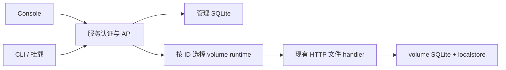

# Agent Note: 独立多用户 volume 服务

Status: proposed

## 问题

现有文件核心可以发布一个持久 volume，但独立部署缺少统一的用户登录、volume 归属和管理入口。使用者需要通过 Console 和 CLI 管理自己的多个 volumes，在 Console 中浏览和管理文件；管理员需要查看普通用户及容量使用摘要，又不能取得他们的文件访问权。

本提案对应 [R-SVC-1 至 R-SVC-8](../../../../docs/spec/requirements.md#九独立多用户服务)。管理员使用账号密码登录。普通用户登录等外部身份系统完成后接入；稳定 owner 和服务端隔离在此处定义，外部登录接入不改变既有 volume 的归属。Console 不提供在线编辑。

## 提案

### 范围与权限

交付一个独立 Linux 服务、同源 Web Console 和连接服务的 CLI。管理数据使用 SQLite，每个 volume 沿用自己的 SQLite metadata 与本地不可变对象。Console、CLI 和挂载入口访问同一份原生 volume，不另建文件存储路径。

| 入口或身份 | 可以做什么 |
|---|---|
| 当前用户 | 查看、创建、改名、调整配额和删除自己的 volumes |
| 当前用户的 Console 文件页 | 浏览目录、上传、下载、新建目录、改名、移动和删除 |
| 管理员 | 管理自己的 volumes/文件，额外只读查看普通用户及其 volume 摘要 |
| 普通用户登录 | 外部身份接入后启用；当前没有普通用户注册或临时登录入口 |

管理员摘要严格限制为 `name`、`fileCount`、`directoryCount`、`usedBytes`、`quotaBytes`。不能由摘要取得文件 API、文件名、路径、逐文件属性、内容、变更输出或挂载权；管理员也不能修改普通用户或他们的 volumes。目标 ID、隐藏按钮和已有对象引用都不能代替服务端权限检查。

### 组件与代码目录

[volume 进入契约](../architecture/2026-08-19-volume-in-the-contract.md)保持一个 storage 实例就是一个 volume。服务负责可信 ID 到实例的映射、owner 和生命周期；`packages/` 不理解服务用户或管理员角色。



单 Go module，应用层使用四个 package。`service` 内 auth/runtime/lifecycle/routes 使用文件分组，共享同一个 manager，不拆成互相依赖的子包。`management` 是一种具体 SQLite store，不为单一实现增加 repository 接口。

```text
cmd/
  remote-fs-server/            # serve、离线 init/admin 与既有 reference 入口
  remote-fs/                   # login、volume/user/operation、文件和 foreground mount
  internal/password/          # 命令共用的终端/私有文件密码输入
internal/
  service/
    service.go / config*.go
    auth*.go / principal.go
    root.go / runtime*.go / lifecycle*.go
    http_routes.go / http_volumes.go / http_users.go / http_files.go
  management/
    store.go / auth.go / volumes.go / actions*.go
    migrations/
  serviceapi/
    types.go / client.go / lists.go / capabilities.go
  console/
    embed.go
    src/{api,components,pages}/
    package.json / pnpm-lock.yaml / patches/
    dist/
packages/
  storage/                    # 单 volume 统计、配额和传输能力
  metastore/sqlite/            # 原生计数、配额与文件 publication
  storage/{objectstore,localstore}/
  transport/httprest/          # 复用原文件协议和变更通知
deployments/service/          # 服务镜像、Compose、systemd 与配置示例
Makefile
.github/workflows/ci.yml
```

依赖方向为 `cmd → service/serviceapi`、`service → management + console + packages`。`management` 复用已有 SQLite migration 工具；`serviceapi` 只保存 wire 类型和 HTTP client。`packages` 不导入 `internal`。Console 使用 pnpm、TypeScript、React 和 Vite，UI build 先于 Go embed/build；发布二进制嵌入真实静态资源。

### SQLite 与 volume 事实

管理库只保存账号、登录凭据、owner、volume 配置及管理操作，不复制文件树。主要数据如下；实际迁移为字段建立类型、唯一性和非负值约束，完整性在管理事务中校验，不新增 foreign key。

| 表 | 主要字段 |
|---|---|
| `users` | 稳定 ID、显示名、服务确认的 role |
| `local_admin_credentials` | user ID、唯一 login name、password hash |
| `sessions` / `cli_credentials` | user ID、secret verifier、到期和撤销状态；browser session 另存 CSRF token |
| `volumes` | 不复用 ID、immutable owner/storage name、可改 display name、revision、state |
| `operations` | actor、固定 action key/input、目标 volume、state、结果或尚未完成责任 |

服务在私有持久目录中保存 `management.sqlite` 与 `volumes/<volume-id>/`。显示名不进入存储路径；启动取得目录独占锁，并按已有 localstore 规则验证持久绑定。管理 SQLite 使用本机 WAL 和显式事务，不部署到网络共享。

每个 volume 的原生 Summary 在同一读取中返回计数、有效配额和 Used。regular file 与 symlink 各计一个文件，不跟随链接；目录单独计数且不含 root。计数覆盖仍有名字的节点，脱名但仍被引用的 allocation 继续进入 Used。统计失败返回明确错误，不扫描目录补出估值、不返回零或旧缓存。

配额在 volume authority 中持久执行；管理库保存修改意图，不能用另一个配置数字冒充有效 quota。quota 修改比较原生 quota revision，rename/delete 比较独立的 management revision。既有 embedded/reference fixed allowance 模式保持独立。

### 登录与授权

本地管理员通过离线 `init` 和 `admin create/reset` 建立或重设，密码只保存 Argon2id hash。browser 使用 Secure/HttpOnly/SameSite cookie；cookie mutation 同时校验配置的同源 Origin 和 CSRF token。login 返回 token，已认证 session 查询能在页面 reload 后重新取得它。

CLI 登录后将 opaque credential 保存在显式私有文件中，默认位于当前项目目录的 `.remote-fs/`；server 只保存 verifier。密码从 no-echo 终端或明确的私有文件/标准输入读取，不放入命令行参数。凭据到期、注销或撤销后，新请求和持续输出按当前认证状态拒绝；轮换不改变内部用户身份。

每个文件或 mount 请求先认证，再读取管理库中的实际 owner，最后选择 runtime；没有权限的请求不能打开他人的后端。已有文件/锁 capability 和持续输出仍执行原 Handler Authorizer 的检查，不因为曾成功登录就跳过。普通用户未来通过受验证的 issuer/subject 关联稳定 UserID；邮箱、登录名和外部 role claim 不决定 owner 或管理员角色。当前没有普通用户登录入口。

### 管理 API 与文件入口

管理 API prefix 为 `/api/service/v1`，身份相关响应 no-store。认证拒绝、越权、输入错误、条件冲突和存储故障分别返回明确错误。文件入口是 `/api/volumes/{id}/v5/`，授权后交给现有单 volume Handler；文件错误保留原 v5 marker/errno，不用管理响应替代。

| 方法与相对路径 | 作用 |
|---|---|
| `POST /auth/login`、`POST /auth/logout`、`GET /auth/session` | 管理员 browser 登录、注销、恢复当前 session |
| `/auth/cli-credentials` | 当前用户自己的 CLI credential 签发、查询和撤销 |
| `GET /me` | 当前用户 |
| `GET/POST /volumes` | 自己的 volume 列表/创建 |
| `GET/PATCH/DELETE /volumes/{id}` | 自己的详情、改名和删除 |
| `PUT /volumes/{id}/quota` | 修改自己的容量上限 |
| `POST /action-namespaces`、`GET /operations` 或 `/operations/{id}` | 取得管理 action key 并查询原动作 |
| `GET /admin/users` | 管理员只读普通用户列表 |
| `GET /admin/users/{id}/volumes` | 管理员只读五项 volume 摘要 |
| `GET /capabilities` | 当前文件会话和传输限制 |

own volume DTO 可包含 ID、state 和 revision。管理员的他人 volume DTO 只含五项摘要或固定安全 error，分页 cursor 为 opaque selector，不能充当文件入口。计数、字节和管理 revision 使用十进制 string，避免 JavaScript Number 丢位。现有 v5 numeric wire 由隔离的 lossless codec 精确解析和序列化，不能先转 Number。

Console 文件页保留 NodeID、目录 revision 和原始叶名字节，用现有 identity/conditional namespace 操作浏览、创建、改名、移动和删除。显示名仅供阅读，raw leaf 用 canonical standard base64 传输；literal backslash、无效 UTF-8、控制和 bidi 字符的显示转义保持不同原始名字可区分，不施加 Windows-only 命名规则。

上传使用原生未发布 import，确切长度/digest 验证后才通过原 publication 路径提交；创建或显式 replace-name 为新 regular file，旧引用仍指向旧节点，symlink 不被跟随。下载捕获一个 immutable version，完整验证后输出成功。两者与现有锁/share、quota、log barrier 和变更通知共同工作，Console 不直写 SQLite 或补造通知。没有文件预览或在线编辑器。

### 创建、删除与正常重启

management operation 保存固定输入和原 action key，区分 pending/running/succeeded/failed；请求接受不表示完成。响应丢失后查询同一 key，不为未知结果自动建立新动作。

创建记录 owner 和未完成意图，初始化唯一内部根后验证 native binding 和持久结果，再标记 active/succeeded。quota 结果由原生 authority 裁定。删除先停止该 volume 的新 admission并检查 live file/lock/stream/transfer；Busy 在不可逆 Stop 前返回，原 mount 继续可用。确认 close 后按绑定根回收，未完成清理仍由原 operation 持有，不能报告已删除或删除未知路径。

正常停止、异常退出和重启后继续核对原管理动作与 native receipt。缺失或不匹配的 SQLite/Witness/锁证据遵守现有拒绝规则，残存根不初始化为空 volume。idle runtime 可以关闭并按需重开；原生健康统计和正常文件读取与 strong-lock recovery 的冲突限制分别裁定。

复用已有 per-volume 资源上限，为 service runtime、请求、会话和 transfer 设置有限 concurrency/size/time limits，并保留状态查询和已接受清理所需路径。这不引入共享物理空间 journal、额外 WAL/RAM 预算模型或全进程内存证明。

### 部署与 CLI

一个 Linux 服务进程独占私有持久目录，Console/API 同源，由部署的 TLS proxy 提供 HTTPS。Compose 和 systemd 使用同一配置。server 不挂载文件系统，不需要 FUSE 权限；原 single-volume reference flags 和 embedding 方式保持可用。

```sh
remote-fs-server init --config ./service.yml
remote-fs-server admin create --config ./service.yml --login admin --display-name Administrator
remote-fs-server serve --config ./service.yml

remote-fs login -server https://files.example.com -login admin -credential-file .remote-fs/credentials.json
remote-fs volume list
remote-fs volume create -name workspace -quota 20GiB
remote-fs volume quota -volume <volume-id> -quota 40GiB
remote-fs user list
remote-fs user volumes <user-id>
remote-fs operation show <operation-id>
remote-fs mount -volume <volume-id> -mountpoint ./workspace
```

mount 继续前台运行，以 Ctrl-C/signal 卸载。Console 页面为 Login、自己的 Volumes/Files 和管理员 Users；空数据、Busy、统计不可用和未知操作结果分别显示。注销或切换身份清空私有页面缓存。

## 备选方案

**给单 volume reference server 加静态页面和配置列表。** 可以浏览预配置 volume，却没有动态 owner、create/delete 和管理员摘要隔离，不能满足当前管理需求。

**独立管理应用控制多个文件进程。** 文件服务的故障域分开，但每次 volume 创建还需要进程/端口/存储调度和额外文件凭据。当前选择同进程 composition，保留 management 与 native volume 的职责分界。

**全部交给外部控制面。** 适合 embedding host 已有用户与注册体系的场景，不能提供所要求的独立 Console/CLI；packages 继续支持此用法。

**PostgreSQL 管理库。** 多节点共享管理行并不能单独解决 localstore 与原生 authority 接管。当前是单机进程经 API 多用户访问，SQLite 不增加外部数据库部署；以后新增多节点目标再单独设计。

## 验收标准

- 独立服务提供真实 Console，CLI 能登录和管理自己的 volumes；create/rename/quota/delete 的结果可查询，正常重启保持 owner、配置与未完成责任。
- 用可信测试身份核对普通用户和管理员矩阵。直接调用他人 list/stat/read/stream/mount/transfer/mutation 均拒绝；管理员只能取得普通用户和五项摘要。当前不提供生产普通用户测试登录。
- regular/symlink/目录/root/脱名对象的计数和 Used 正确，失败不变成零；quota 修改与真实原生拒绝行为一致。
- Console 文件操作在另一文件入口可见，原始名字和大整数 identity 不失真，并发替换保持旧引用身份；上传/下载失败、取消和未知结果可观察。页面没有在线编辑。
- Busy deletion 保持已有 mount 可用；关闭或清理失败不误报删除完成。缺 native evidence 不发布为空 volume。
- browser session/CSRF、CLI credential、logout/revocation 和当前 owner 检查覆盖接口与持续输出；frontend assets 在 Go build 前真实生成。

## 风险

SQLite 管理事务和 native volume 事务不能合成一次跨库提交，operation 必须以原结果或剩余责任推进，不能仅凭请求返回判断完成。管理员摘要权限和文件访问必须在不同路径执行，任何复用都不能扩大字段或访问权。

普通用户登录延期，未来接入保留稳定 owner 和确切 issuer/subject 映射。该提案不交付备份/还原、反回滚体系、外部 NodeID 分配、共享 physical/WAL/RAM 预算、运维 metrics 或专门日志系统；停止后的运维不能被描述成已具备这些能力。

单机部署不提供 HA，在线编辑不提供。第三方管理 SDK、跨 owner sharing/migration、daemon 多挂载控制和文件历史等另有产品范围，不为它们增加预备机制。
